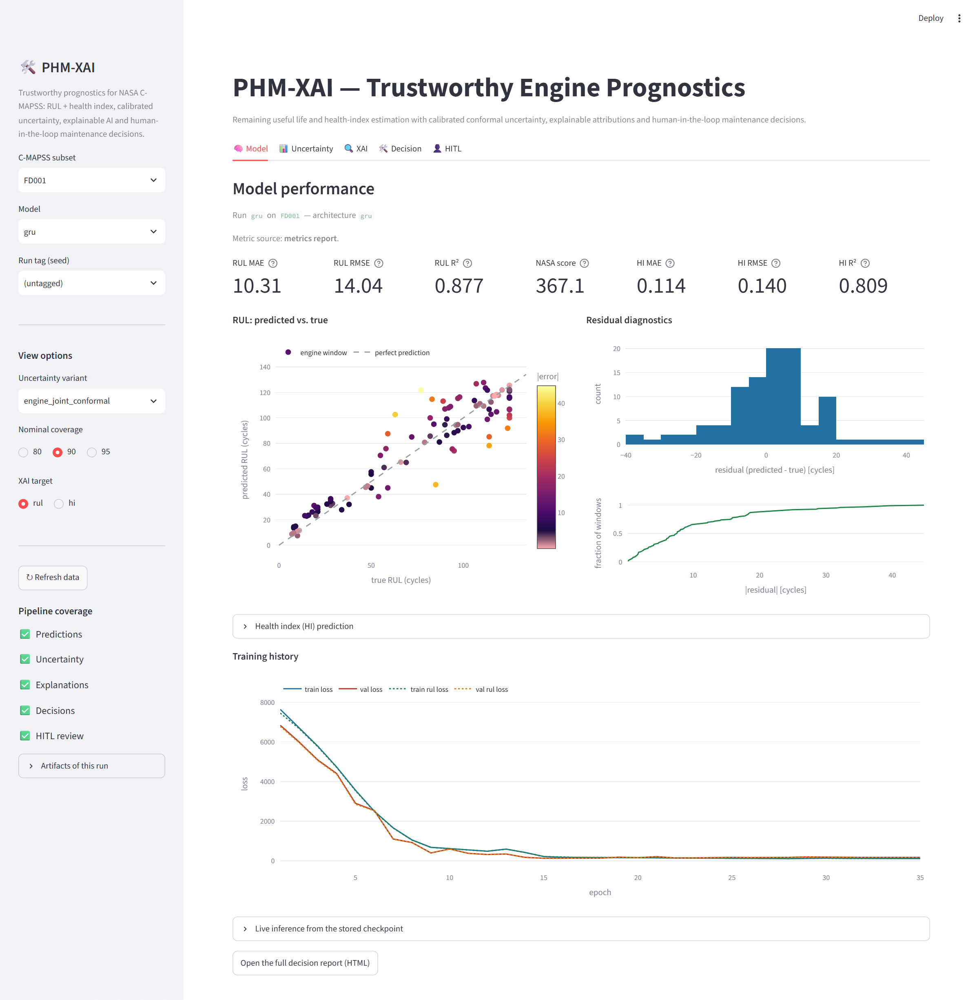
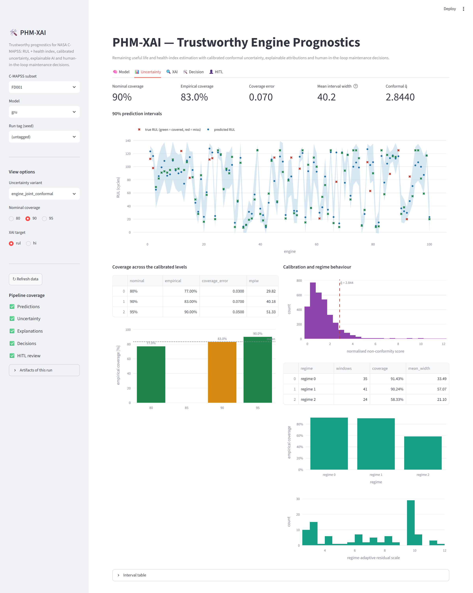
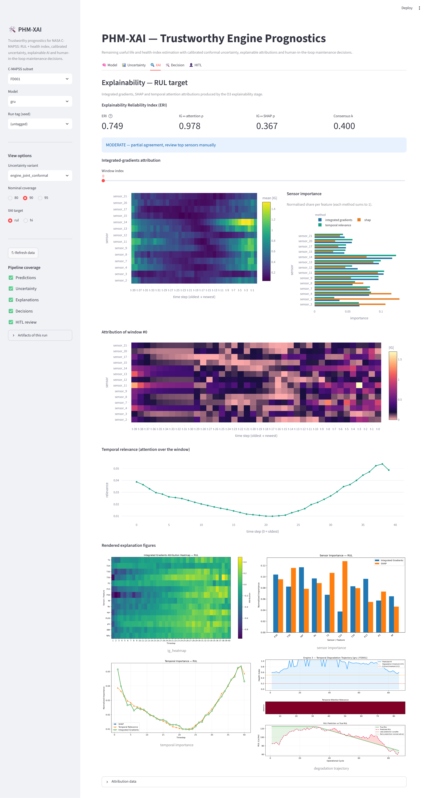
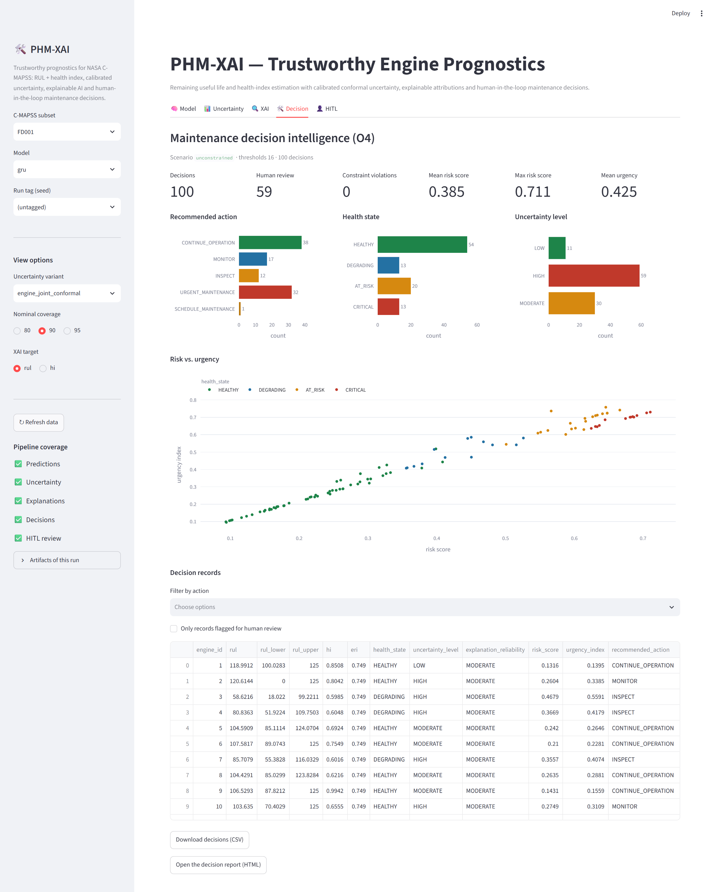
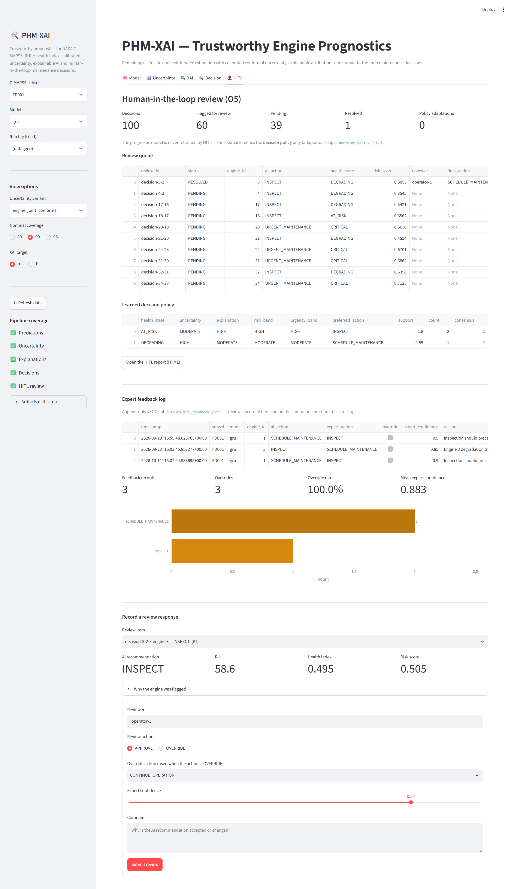
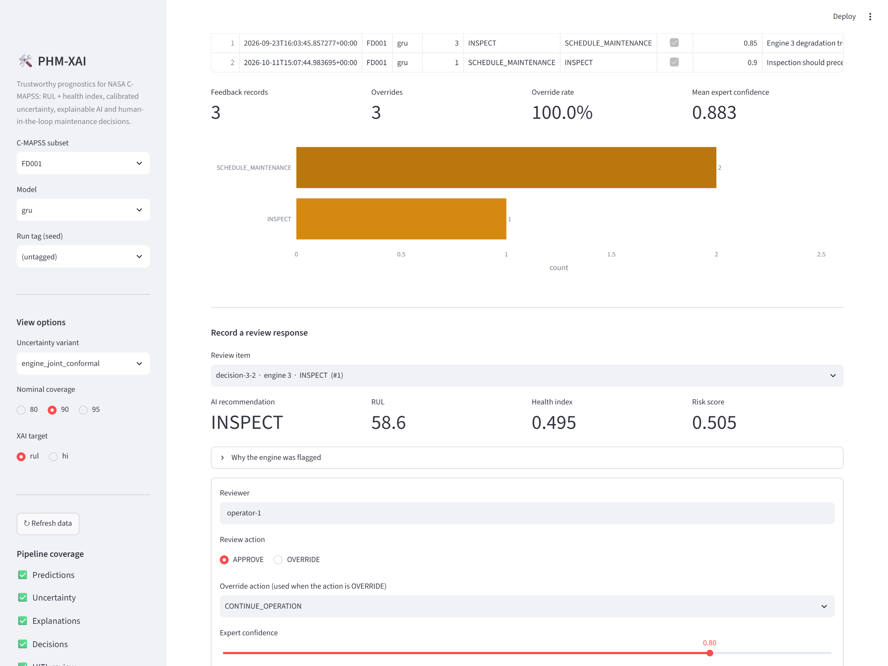

# PHM-XAI: Engine-Aware Trustworthy Prognostics

End-to-end prognostics pipeline for **remaining useful life (RUL)** and **health index (HI)** estimation on the NASA C-MAPSS turbofan dataset. Point predictions are extended with calibrated uncertainty intervals, post-hoc explanations, and constraint-aware maintenance recommendations.

> Results are from project runs on C-MAPSS. This is a research implementation, not a production system. See [Implementation Status](#implementation-status) for what is complete and what is not.

**New here?** [docs/ARCHITECTURE.md](docs/ARCHITECTURE.md) is the map of the codebase — pipeline stages, module boundaries, artifact contracts, the conformal calibration math, the full decision policy, an extension guide, and the known gaps.

### Documentation map

| Document | What it answers |
|---|---|
| [README.md](README.md) | How to install, run, and what the project claims |
| [docs/ARCHITECTURE.md](docs/ARCHITECTURE.md) | How the code is organised and how to extend it |
| [RESULTS.md](RESULTS.md) | The published numbers and the SOTA comparison |
| [docs/SOTA_BENCHMARK.md](docs/SOTA_BENCHMARK.md) | Authoritative RMSE benchmark, bootstrap CIs, significance tests |
| [docs/RMSE_TARGET_PLAN.md](docs/RMSE_TARGET_PLAN.md) | Why each hyper-parameter is what it is |
| [CONTRIBUTING.md](CONTRIBUTING.md) | Setup, coding standards, pull-request workflow |

---

## Contents

- [Overview](#overview)
- [Repository Layout](#repository-layout)
- [Setup](#setup)
- [Pipeline](#pipeline)
- [Uncertainty Methods](#uncertainty-methods)
- [Conformal Benchmark](#conformal-benchmark)
- [Decision Support](#decision-support)
- [Decision Sensitivity](#decision-sensitivity)
- [HITL Review](#hitl-review)
- [Dashboard](#dashboard)
- [Results Summary](#results-summary)
- [Evaluation Metrics](#evaluation-metrics)
- [Implementation Status](#implementation-status)
- [Tests](#tests)
- [Contributing](#contributing)
- [Citation](#citation)
- [License](#license)

---

## Overview

The pipeline treats prognostics as a decision-support chain. A recommendation is considered trustworthy only when four questions are answered together:

1. **What is the predicted degradation state?** Joint RUL and HI estimation provides the point forecast. The HI target is derived from the *sensor signal* — a condition-free, per-engine-normalised degradation index — so it is a genuine second learning problem rather than a re-scaled RUL.
2. **How uncertain is that forecast?** Engine-disjoint conformal calibration provides the uncertainty baseline; EARA-Conformal adds regime- and scale-aware interval sizing.
3. **Why did the model produce it?** Integrated Gradients, SHAP, temporal relevance, and ERI expose sensor-level evidence and flag explanation disagreement.
4. **What action is feasible?** A rule-based engine combines health state, uncertainty, ERI, and operational constraints into an auditable recommendation, and the sensitivity of that recommendation to its own weights is measured rather than assumed.

```text
NASA C-MAPSS → Preprocessing → Multi-task model → RUL / HI predictions
                                                         |
                                          ┌──────────────┴──────────────┐
                                   EARA-Conformal              IG, SHAP, ERI
                                   uncertainty                 explanations
                                          └──────────────┬──────────────┘
                                                  Decision engine
                                                  (severity ladder + constraints)
                                                         |
                                               Auditable recommendation
                                                         |
                                        HITL review → feedback
                                        → policy refinement
```

Three invariants hold at every stage:

- **Engine-disjoint splits.** Windows from one engine are correlated, so train/validation and calibration/test splits are grouped by engine ID, and every stage asserts zero engine overlap before continuing.
- **Calibration never sees test targets.** Conformal quantiles are estimated on a calibration split carved out of the training set; the test set is used only to measure coverage.
- **Monotone policy.** More uncertainty or a less reliable explanation can never produce a less severe maintenance action, and the operational constraints can only escalate.

---

## Repository Layout

```text
README.md        this file
RESULTS.md       published results + comparison to C-MAPSS SOTA baselines
CHANGELOG.md     notable changes per release
LICENSE          Apache-2.0
CITATION.cff     machine-readable citation metadata
CONTRIBUTING.md  setup, coding standards, pull-request workflow
main.py          exploratory data analysis entry point
app.py           Streamlit dashboard (model, uncertainty, XAI, decision, HITL)
pyproject.toml   package metadata + pytest/ruff config
requirements.txt runtime dependencies (PyTorch is installed separately)
.github/workflows/ci.yml  CI: pytest on Linux/Windows, Python 3.9/3.12
configs/         subset configuration files (fd001–fd004.yaml) — see note below
docs/
  ARCHITECTURE.md      internal design, data contracts, extension guide, known gaps
  RMSE_TARGET_PLAN.md  why each config value is what it is
  SOTA_BENCHMARK.md    authoritative RMSE benchmark, bootstrap CIs, significance tests
data/
  external/      example decision input JSON files
  raw/           NASA C-MAPSS text files — not committed, add manually
  processed/     NumPy windows and labels — generated by preprocess.py
scripts/         CLI entry points for each pipeline stage
  preprocess.py  train.py  evaluate.py  uncertainty.py  explain.py
  decision.py    hitl.py   demo.py
  ensemble.py    summarize.py  sota_benchmark.py
  multiseed_train.py  multiseed_pipeline.py
  multiseed_conformal_benchmark.py  multiseed_report.py
  multiseed_downstream.py  decision_sensitivity.py
  regime_sweep.py  verify_seed_alignment.py
src/
  preprocessing/  loading, validation, labelling, health index, selection,
                  scaling, windowing
  models/         LSTM, GRU, Transformer, Hybrid, GRU-Att-Deg (+ losses, trainer)
  uncertainty/    conformal prediction, calibration, coverage, adaptive intervals,
                  pipeline.py — the single interval engine shared by the CLI and
                  the multi-seed benchmark
  explainability/ IG, SHAP, temporal relevance, ERI
  decision_engine/ severity ladder, rules, constraints, scenarios, recommender
  hitl/           review workflow, feedback schema, policy refinement
  evaluation/     metrics, ablation, robustness, decision sensitivity
  utils/          config loading, logging, IO, seeding, tag-aware artifact paths
results/          published benchmark artifacts (tracked)
  conformal_benchmark/  multi-seed conformal comparison outputs
  multiseed/       training manifest, per-seed/mean±std tables, certification.json
  web-showcase/    screenshots of the Streamlit dashboard (README showcase)
tests/            pytest suite
outputs/          generated artifacts — not committed
  checkpoints/    trained model weights, per model/subset
  figures/        EDA and experiment plots
  hitl/           feedback.jsonl — append-only expert feedback log
  logs/           pipeline logs
  models/         scalers
  reports/        HTML reports and CSV summaries
  results/        metrics, predictions, intervals, decisions
                  results/uncertainty/<variant>/<subset>/<model>.npz
  xai/            attribution arrays, ERI JSON, HTML reports
```

> **Every artifact records its own origin.** The `.npz` files written by
> `scripts/evaluate.py` and `scripts/uncertainty.py` embed a provenance
> stamp (`meta_json`) holding the SHA-256 of the checkpoint they were
> produced from, plus the seed, epoch, git commit and a UTC timestamp.
> `src/evaluation/benchmark.py::comparative_benchmark` compares the stamps
> of the predictions and the intervals it pairs and reports `ok`,
> `mismatch` or `unknown`, so a comparison between two different models
> cannot pass silently. See
> [docs/ARCHITECTURE.md § 8.1a](docs/ARCHITECTURE.md#81a-artifact-provenance).

> **Configuration is wired up.** Every knob lives in `configs/fd001.yaml` …
> `configs/fd004.yaml`, merged over the defaults in `src/utils/config.py`.
> `scripts/train.py` and `scripts/preprocess.py` read the config directly
> (`--overrides key=value,...` patches individual keys). `scripts/evaluate.py`,
> `scripts/uncertainty.py` and `scripts/explain.py` rebuild the architecture
> from the `model_config` stored inside each checkpoint, so a model is always
> rebuilt with the configuration it was actually trained with — including the
> per-subset overrides such as `hidden_size: 160` on FD002/FD004.
> See [docs/ARCHITECTURE.md § Configuration](docs/ARCHITECTURE.md#3-configuration).

---

## Setup

Python 3.9+ required.

```powershell
python -m venv .venv
.venv\Scripts\Activate.ps1
pip install --upgrade pip

# 1. Install the PyTorch build that matches your hardware (required first —
#    it is intentionally not pinned in requirements.txt):
#      CPU-only:
pip install torch --index-url https://download.pytorch.org/whl/cpu
#      CUDA 12.4:
# pip install torch --index-url https://download.pytorch.org/whl/cu124
#    (Other CUDA/OS combinations: https://pytorch.org/get-started/locally/)

# 2. Then the rest of the dependencies:
pip install -r requirements.txt

# 3. Optional: the Streamlit dashboard (app.py) needs Streamlit and Plotly.
#    `requirements.txt` already lists them; with pip install -e use the extra:
pip install -e ".[dashboard]"
```

PyTorch is **not** pinned. The previous pin (`torch==2.11.0+cu128`) was a
CUDA-12.8-only build, which made the project unrunnable on CPU or any other GPU
— replace it with the wheel for your platform as shown above. `pyproject.toml`
carries the same guidance; `pip install -e .` installs everything except
PyTorch.

### Quick check

```powershell
python -c "import torch; print(torch.__version__, torch.cuda.is_available())"
python -m pytest -q
```

### Dataset

Place the raw C-MAPSS files in `data/raw/`:

```text
data/raw/
  train_FD001.txt   test_FD001.txt   RUL_FD001.txt
  train_FD002.txt   test_FD002.txt   RUL_FD002.txt
  train_FD003.txt   test_FD003.txt   RUL_FD003.txt
  train_FD004.txt   test_FD004.txt   RUL_FD004.txt
```

---

## Pipeline

Each stage depends on outputs from the previous one. `--subset all` and `--model all` iterate over every combination; a stage that fails for one combination is reported and skipped rather than aborting the run.

```powershell
# Exploratory data analysis (FD001 only, hard-coded)
python main.py

# Preprocess (one subset or all) — window_size and max_rul come from the config
python scripts/preprocess.py --subset FD001
python scripts/preprocess.py --subset all

# Train and evaluate — every hyper-parameter comes from the config
python scripts/train.py    --model gru_att_deg_v2 --subset FD001
python scripts/evaluate.py --model gru_att_deg_v2 --subset FD001

# Patch individual config keys without editing the YAML
python scripts/train.py --subset FD001 --overrides epochs=200,hidden_size=160

# Uncertainty intervals (one method at a time)
python scripts/uncertainty.py --model gru --subset FD001 --method engine_joint

# Explanations (one target or all)
python scripts/explain.py --model gru_att_deg --subset FD001 --target rul
python scripts/explain.py --model all --subset all --target all

# Maintenance decisions, then the human-in-the-loop review of those decisions
python scripts/decision.py --model gru --subset FD001
python scripts/hitl.py     --model gru --subset FD001
```

Valid model names: `lstm`, `gru`, `transformer`, `hybrid`, `gru_att_deg`, `gru_att_deg_v2`  
Valid subsets: `FD001`, `FD002`, `FD003`, `FD004`  
Valid explain targets: `rul`, `hi`, `all`

Every stage above accepts `--tag <tag>` to operate on one specific run of a
model — for example `--tag ms42` for the seed-42 member of the multi-seed
family. The tag selects the checkpoint *and* every artifact downstream of it,
so a decision is never made from a mixture of two different sets of weights.
`scripts/uncertainty.py` reads the training seed back out of the checkpoint and
reproduces that checkpoint's engine hold-out before it calibrates.

Default training hyperparameters (from `configs/*.yaml`, merged over
`src/utils/config.py::DEFAULT_CONFIG`):

| Parameter | FD001 | FD002 | FD003 | FD004 |
|---|---|---|---|---|
| Model (`--model`, default) | `gru_att_deg_v2` | `gru_att_deg_v2` | `gru_att_deg_v2` | `gru_att_deg_v2` |
| Window size | 40 | 40 | 40 | 40 |
| Max RUL | 125 | 125 | 125 | 125 |
| Hidden size | 128 | 160 | 128 | 160 |
| Layers | 2 | 2 | 2 | 2 |
| Attention heads | 4 | 4 | 4 | 4 |
| Dropout | 0.30 | 0.35 | 0.35 | 0.35 |
| Batch size | 256 | 256 | 256 | 256 |
| Epochs | 150 | 150 | 150 | 150 |
| Learning rate | 3e-4 | 3e-4 | 3e-4 | 3e-4 |
| Optimizer / scheduler | AdamW / cosine (5 warm-up) | ← | ← | ← |
| Gradient clip | 1.0 | 1.0 | 1.0 | 1.0 |
| EMA decay | 0.995 | 0.995 | 0.995 | 0.995 |
| RUL loss weight (α) | 1.0 | 1.0 | 1.0 | 1.0 |
| HI loss weight (β) | 0.4 | 0.4 | 0.4 | 0.4 |
| Scale loss weight | 0.1 | 0.1 | 0.1 | 0.1 |
| Window augmentation | off | off | off | on |
| Validation split | 20% (engine-wise) | ← | ← | ← |
| Early stopping patience | 30 | 30 | 30 | 30 |

The rationale for every value is in
[docs/RMSE_TARGET_PLAN.md](docs/RMSE_TARGET_PLAN.md).

> **Caveat on the loss weights.** The RUL term is an unscaled MSE on cycles
> and is three orders of magnitude larger than the bounded HI and scale terms,
> so the HI term is put on the RUL scale explicitly: `hi_loss_scale: rul_max`
> multiplies it by `max_rul²`, which expresses it in cycle-equivalent units.
> With that factor `hi_loss_weight` is a real dial instead of moving the
> total loss by ~1e-5 in relative terms.

> **Caveat on augmentation.** Augmentation is **off** in the FD001, FD002 and
> FD003 configs — a single-run ablation showed it *raised* RUL RMSE (FD001
> 11.96 → 12.56, FD002 13.61 → 14.72; single seed, not certified multi-seed) —
> and on only in FD004. The `augment` key in
> `src/utils/config.py::DEFAULT_CONFIG` is `true`, but the per-subset YAML
> wins, so a default run does not exercise the augmentation path on three of
> the four subsets. Enable it explicitly with `--overrides augment=true`.

### The health index

The health index is built from the **sensor signal**, not from the RUL label.
`scripts/preprocess.py` fits it on the training split only:

1. each sensor is regressed on the three operational settings and the
   residual is kept (without this step the dominant variance direction on
   FD002/FD004 is the *operating condition*, not the degradation);
2. each engine's first 30 cycles define its own healthy reference, which
   removes the engine-to-engine offset;
3. a one-component **PLS** direction is fitted against the training RUL
   label, giving the direction that tracks degradation;
4. the projection is mapped onto `[0, 1]` with reference quantiles taken
   from the training windows.

The index of a row is computed from the *same trailing window the model
sees*, so the label attached to a window is a function of exactly that
window's features. The three HI breakpoints of the decision policy are then
calibrated on the training split (each is the median index of the training
windows in the corresponding RUL band) and stored in the dataset metadata,
so the HI criterion fires at the same degradation levels as the RUL
criterion.

```powershell
# The default (sensor-derived) index
python scripts/preprocess.py --subset FD001

# Reproduce the legacy HI = RUL / max_rul label for comparison
python scripts/preprocess.py --subset FD001 --hi-mode rul
```

> **Caveat on the index.** The index is strongly — but not perfectly —
> related to the true degradation state: `corr(HI, RUL)` on the training
> split is 0.890 (FD001), 0.674 (FD002), 0.797 (FD003) and 0.705 (FD004).
> The spread between subsets is the point: the multi-condition subsets have a
> weaker sensor-to-health relation, exactly as one would expect. A value of
> 1.000000 would mean the index was a re-scaled RUL again.

### Reporting and benchmarking scripts

Three scripts sit beside the pipeline: they read the artifacts it produces and
never feed back into it.

```powershell
# Accuracy table over every predictions file in outputs/results
python scripts/summarize.py                # -> outputs/reports/accuracy_summary.csv

# RMSE benchmark, bootstrap CIs and significance tests
python scripts/sota_benchmark.py           # -> outputs/reports/sota_*.csv

# Uniform ensemble over several checkpoints (no weights fitted on test)
python scripts/ensemble.py --subset FD001 --models gru_att_deg_v2@noaug,gru_att_deg_v2@seed7
```

### Multi-seed certification

A single training run cannot certify a claim. `scripts/multiseed_train.py`
trains the **deliverable architecture** across a grid of seeds and subsets and
writes an auditable manifest — the seed, the resolved config, the git commit,
the SHA-256 of every checkpoint, and the determinism configuration that was
active. Every checkpoint it produces is a full model that the rest of the
pipeline can consume.

```powershell
python scripts/multiseed_train.py --model gru_att_deg_v2 --subsets all --seeds 42 43 44 45 46
```

Runs are tagged `ms<seed>` (e.g. `ms42`), so the multi-seed family stays
separate from the historical single-run tags (`seed7`, `noaug`, `mild`).
The manifest lands in `results/multiseed/training_manifest.json`.

The rest of the chain runs on those same checkpoints — there is no proxy
model anywhere in the certification path:

```powershell
# Intervals, SHAP/IG attributions, decisions and HITL for every seed
python scripts/multiseed_pipeline.py --subsets all --seeds 42 43 44 45 46 --stages all

# Five-method interval benchmark on the real checkpoints (24 min on the
# reference GPU; writes results/conformal_benchmark/)
python scripts/multiseed_conformal_benchmark.py --subsets all --seeds 42 43 44 45 46

# Aggregate into mean ± std, paired tests, literature comparison and a report
python scripts/multiseed_report.py
```

`scripts/multiseed_pipeline.py` finishes by verifying that the artifacts of
each run exist and that they describe the same weights: the point prediction
the uncertainty stage stores must match the one the evaluation stage stored to
within 0.1 RUL cycles (the two stages use different batch sizes, so the GPU
forward pass is not bit-identical) and correlate above 0.9999. It writes
`results/multiseed/pipeline_manifest.json`, which records the per-run stage
status, timings, artifact paths and the verification result for every
(subset, seed) pair.

`scripts/multiseed_report.py` writes:

| File | Contents |
|---|---|
| `results/multiseed/per_seed_metrics.csv` | every (subset, seed) point-prediction row |
| `results/multiseed/summary_mean_std.csv` | mean ± std across seeds, per subset |
| `results/multiseed/aggregate_by_seed.csv` | the four-subset aggregate per seed |
| `results/multiseed/literature_comparison.csv` | this repository vs. published four-subset means |
| `results/multiseed/certification.json` | machine-readable verdict and all inputs |
| `outputs/reports/multiseed_report.md` | the human-readable report |

`scripts/multiseed_downstream.py` summarises the *downstream* artifacts of the
same grid — the ERI of both explainability targets, the decision-engine action
mix, review rate, constraint violations and the width of the interval the
decision engine actually consumed, and the HITL review/feedback counts:

| File | Contents |
|---|---|
| `results/multiseed/downstream_per_run.csv` | one row per (subset, seed) |
| `results/multiseed/downstream_summary.csv` | mean ± std across seeds, per subset and for the four-subset aggregate |

The certified result of that grid is **13.361 ± 0.136** mean RUL RMSE on the
four-subset mean (per subset: 12.38 ± 0.28 / 13.92 ± 0.43 / 11.97 ± 0.26 /
15.17 ± 0.17). That is **behind** the repository's own `< 13` target and 0.53
behind the best published four-subset mean, so the certification report says so
rather than quoting the better single-run draw. See
[RESULTS.md § 2](RESULTS.md#2-point-prediction--this-repository) for the full
table and the literature verdict.


### Quick demo (one command)

`scripts/demo.py` runs every stage above in one shot — preprocess → train →
evaluate → EARA-Conformal uncertainty → explainability → decision → HITL —
by invoking the same CLI entry points, and finishes by verifying every key
artifact. Per-stage skip flags and operational-constraint passthroughs are
available (`python scripts/demo.py --help`).

```powershell
python scripts/demo.py                    # full pipeline, FD001 / gru
python scripts/demo.py --subset all       # all four subsets
python scripts/demo.py --eda              # also run the EDA entry point (FD001)
```

> `demo.py` accepts only the architectures wired through the full chain
> (`lstm`, `gru`, `transformer`, `hybrid`) — `gru_att_deg` and
> `gru_att_deg_v2` are not part of it, even though `gru_att_deg_v2` is the
> default architecture in `configs/*.yaml`. Only stages that were *not*
> skipped must be re-run — the demo aborts on the first stage that fails.

---

## Uncertainty Methods

`scripts/uncertainty.py` implements four conformal methods, selected with `--method`:

| Method | Interval | Character |
|---|---|---|
| `split` *(default)* | `ŷ ± q̂` | Global split conformal (baseline) |
| `cqr` | `[q_lo(x) − q̂, q_hi(x) + q̂]` | Conformalized quantile regression; the quantile head is anchored to the point prediction and `q̂` is the signed conformal correction |
| `adaptive` | `ŷ ± q̂ · s(x)` | Scale-adaptive, with `s(x)` fitted on training-engine residuals |
| `engine_joint` | `ŷ ± q̂ · s(x)` | Engine/regime-aware (EARA-Conformal): `s(x)` is retrieved from the `top_k = 5` nearest training-engine profiles, conditioned on one of three degradation regimes; `q̂` is global |

All four share the same engine-disjoint calibration split and the same `[0, max_rul]` clipping (`max_rul` comes from the subset config). The regime enters EARA through the retrieved *scale*, not through a per-regime quantile: per-regime quantiles with 20 calibration engines are too small for the finite-sample rank and are only used by the library helper `calibrate_eara_levels`.

Coverage is evaluated at nominal 80% / 90% / 95%, reporting empirical coverage, coverage error, MPIW, PINAW, and the stricter engine-level coverage. Intervals are written to `outputs/results/{subset}_{model}_{method}.npz`, where the file suffix is `conformal` (split), `cqr`, `adaptive_conformal`, and `engine_joint_conformal`.

The k-means regime count used by the offline sweep is validated with:

```powershell
python scripts/regime_sweep.py    # writes outputs/results/regime_sweep.json
```

> The methods differ only in how the interval radius is calibrated. Calibration scores and prediction radii share a common scale floor so the two paths cannot disagree on near-zero scales.

---

## Conformal Benchmark

`scripts/multiseed_conformal_benchmark.py` runs a repeatable, engine-disjoint comparison of five interval methods on FD001–FD004 across five fixed seeds (42–46). It loads the **real checkpoints** produced by `scripts/multiseed_train.py` — there is no proxy or surrogate model anywhere in the benchmark — and reproduces each checkpoint's own engine hold-out from the seed stored inside it, so calibration and training never share an engine.

| Method | Description |
|---|---|
| `split_conformal` | Global split conformal on absolute residuals |
| `cqr` | Conformalized quantile regression (signed score) |
| `adaptive` | Global scale-adaptive conformal |
| `nex_scp` | Prequential adaptive conformal inference (Gibbs & Candès) |
| `eara_conformal` | Engine/regime-aware scale-adaptive conformal |

All five methods are computed by one shared engine,
`src/uncertainty/pipeline.py::compute_all_intervals`, so the comparison between
them is paired by construction: the same weights, the same calibration engines
and the same test engines.

**Certified outcome (window unit, 90 % nominal, five seeds):** `nex_scp` is the
safest default — coverage 0.888–0.904 with the narrowest or second-narrowest
interval on every subset. `split_conformal` is almost equally well calibrated
but wider. `eara_conformal` and `adaptive` are narrower but under-cover by 3–5
points on FD003/FD004. With five seeds the paired exact test cannot separate the
methods statistically (smallest attainable p = 0.0625), so this is a
description of the measured means, not a ranking. Full tables:
[RESULTS.md § 3](RESULTS.md#3-conformal-interval-benchmark-multi-seed).

`nex_scp` is implemented as **prequential adaptive conformal inference** rather than an offline weighted quantile: the miscoverage level is updated from each test engine's realised outcome in stored order,

```text
alpha_{t+1} = clip(alpha_t + gamma * (alpha - err_t), 0.01, 0.99)
```

where `err_t` is 1 when the true label falls outside the interval produced for engine `t`. The adaptation rate is `--aci-gamma` (default `0.02`). The level is kept strictly inside `(0, 1)`: the unclipped update can reach exactly 0 after a run of misses, which is not a valid conformal level. The 0.01 floor means the adaptor never targets more than 99 % coverage.

**Two calibration units are reported for every method.**

| Unit | Score set | Behaviour |
|---|---|---|
| `window` (primary) | one score per calibration **window** (thousands) | matches the unit the test set is scored on and tracks the nominal level |
| `engine` (conservative) | one **maximum** score per calibration engine (20–52) | valid but over-covers badly at low nominal levels, because a max over a whole engine lifetime is much larger than any single test window |

The calibration engines are engine-disjoint from the test engines in both cases; only the reduction of the window scores differs. Both units are computed in one inference pass, so the second unit is nearly free. The finite-sample rank is `ceil((n + 1)(1 − α))` and is never clamped — when it exceeds `n` the quantile is `+inf`, which is the honest answer.

```powershell
python scripts/multiseed_conformal_benchmark.py --subsets all --seeds 42 43 44 45 46

# one unit only, if the conservative variant is not needed
python scripts/multiseed_conformal_benchmark.py --calibration-units window
```

Outputs are written to `results/conformal_benchmark/`: `per_engine_intervals.csv`, `per_seed_metrics.csv`, `summary_mean_std.csv` (one row per calibration unit), `paired_comparisons.csv`, `split_manifest.json`, `run_config.json`, and two coverage/width plots per subset (`{subset}_{unit}_coverage_width.png`). The protocol, the full coverage tables and the analysis are in [RESULTS.md § 3](RESULTS.md#3-conformal-interval-benchmark-multi-seed).

---

## Decision Support

The decision engine fuses RUL, HI, the conformal interval, and ERI into a risk score, classifies health and uncertainty, selects an action, then applies operational constraints. Constraints can only make an action more conservative, never less.

It normally consumes upstream artifacts directly — predictions, the 90% interval, and the ERI/top-sensor JSON from `scripts/explain.py` — and names every missing artifact if a stage has not been run.

```powershell
# Run against all subsets using default thresholds
python scripts/decision.py --subset all

# Pick a specific uncertainty variant and model
python scripts/decision.py --subset FD001 --model hybrid --uncertainty-variant engine_joint_conformal

# Decide from one specific multi-seed run (predictions + intervals + XAI of ms42)
python scripts/decision.py --subset FD001 --model gru_att_deg_v2 --tag ms42

# Run with a named operational scenario
python scripts/decision.py --subset FD001 --constraint-scenario degraded_operations

# Run with custom operational constraints
python scripts/decision.py `
  --subset FD001 `
  --minimum-safe-rul 10 `
  --maintenance-lead-time 10 `
  --no-maintenance-window
```

`--tag` makes the decision engine read the predictions, the calibrated
intervals and the ERI report of that one run, so a maintenance decision is
never assembled from a mixture of two different sets of weights. The tag is
recorded in the output JSON, which is how the HITL stage knows which run it is
reviewing.

Outputs are written to `outputs/results/` (JSON) and `outputs/reports/` (HTML).

**Actions and the severity ladder.** Every action sits on one explicit
ladder, from least to most committed:

```text
CONTINUE_OPERATION < MONITOR < INSPECT < SCHEDULE_MAINTENANCE < URGENT_MAINTENANCE
```

The action is computed from that ladder rather than read off a table, so the
policy is **monotone by construction**: a wider prediction interval or a less
reliable explanation can never produce a less severe action.

The action is planned on the **conservative end of the calibrated interval**:
the *planning state* is the health state the engine would be in if the
prediction were at the lower bound of its 90 % interval, and the action is
the base action of that state. A maintenance work order has to be scheduled
so that it is carried out before the worst credible case, not before the
most likely one.

| Planning state | Action | with `LOW` ERI | risk score > 0.85 |
|---|---|---|---|
| `HEALTHY` | `CONTINUE_OPERATION` | `MONITOR` | `URGENT_MAINTENANCE` |
| `DEGRADING` | `MONITOR` | `INSPECT` | `URGENT_MAINTENANCE` |
| `AT_RISK` | `SCHEDULE_MAINTENANCE` | `URGENT_MAINTENANCE` | `URGENT_MAINTENANCE` |
| `CRITICAL` | `URGENT_MAINTENANCE` | `URGENT_MAINTENANCE` | `URGENT_MAINTENANCE` |

Each decision record reports both the `health_state` (the point estimate) and
the `planning_state` (the conservative end of the interval), and the reasons
say so whenever the two differ. A risk score above 0.85 always escalates to
`URGENT_MAINTENANCE`, and a degraded confidence signal (a wide interval or a
`LOW` ERI) always requires human review even when the action itself did not
change.

**Constraints** (all optional; unset means unconstrained):

| Flag | Effect |
|---|---|
| `--maintenance-window` / `--no-maintenance-window` | Whether scheduled maintenance can be performed now |
| `--minimum-safe-rul <cycles>` | Minimum RUL to defer maintenance |
| `--maintenance-lead-time <cycles>` | Cycles required before maintenance can begin |
| `--max-allowable-delay <cycles>` | Longest wait the operator will accept |
| `--resource-availability <true\|false>` | Whether crew and parts are available |

**Scenarios.** `--constraint-scenario <name>` applies a named operational
context; explicit flags override individual values of the scenario.

| Scenario | Context |
|---|---|
| `unconstrained` | No operational constraints — the reference reading. |
| `no_maintenance_window` | The engine is not in a shop, so scheduled maintenance cannot be booked. |
| `tight_safety_margin` | Short minimum safe RUL and maximum allowable delay. |
| `lead_time_pressure` | Maintenance needs a long lead time (parts, crews, access). |
| `resource_shortage` | Crew and parts are unavailable. |
| `degraded_operations` | All of the above — the context the certified runs use. |

For testing the engine in isolation, `data/external/decision_input*.json` contains example records (healthy, degrading, critical). A record needs `rul`, `hi`, `rul_lower`, `rul_upper`, and `eri`; `top_k_sensors` and engine identifiers are optional.

---

## Decision Sensitivity

The risk-score weights (`w_rul`, `w_hi`, `w_u`, `w_eri`) are hand-set, so
`scripts/decision_sensitivity.py` measures how much of the published decision
mix they actually determine. It re-runs the decision engine over a weight
space — one-at-a-time, plus a Dirichlet sweep over the simplex — and reports
how far the decisions move.

```powershell
# Every certified (subset, seed) decision artifact
python scripts/decision_sensitivity.py --subsets all --seeds 42 43 44 45 46

# One artifact
python scripts/decision_sensitivity.py \
  --decision outputs/results/decision_FD001_gru_att_deg_v2_ms42.json
```

| Metric | Meaning |
|---|---|
| `action_tv` | Total-variation distance between the action distribution and the baseline one (0 = identical mix, 1 = disjoint). |
| `action_switch_rate` | Fraction of records whose recommended action changed. |
| `mean_severity_delta` | Mean change of the action's position on the severity ladder. |
| `risk_rank_spearman` | Whether the *ordering* of the engines by risk survives the re-weighting. |

The same script compares the decision mix under every named constraint
scenario, which is what makes the constraint layer produce non-zero
violation counts in a recorded run.

| File | Contents |
|---|---|
| `outputs/reports/decision_sensitivity.json` | The full report: one block per analysed run plus the aggregate. |
| `outputs/reports/decision_sensitivity.csv` | One summary row per analysed run. |
| `outputs/reports/decision_weight_sweep.csv` | One row per swept weight vector. |
| `outputs/reports/decision_constraint_scenarios.csv` | One row per (run, scenario). |

---

## HITL Review

The HITL runner consumes the JSON produced by `scripts/decision.py`, creates review items for decisions flagged `human_review`, and writes JSON results, an HTML report, and a log. It then applies conservative policy refinement from accumulated expert feedback.

```powershell
python scripts/hitl.py --subset FD001 --model gru
python scripts/hitl.py --subset all --model all

# Review the decisions of one specific multi-seed run
python scripts/hitl.py --subset FD001 --model gru_att_deg_v2 --tag ms42

# Resolve a queued review (list the real ids from the review queue first)
python scripts/hitl.py `
  --input outputs/results/decision_FD001_gru.json `
  --review-id decision-<engine-or-index>-<n> `
  --reviewer operator-1 `
  --action APPROVE `
  --confidence 0.9 `
  --reason "Reviewed by maintenance control"
```

Supported actions: `APPROVE`, and `OVERRIDE` (requires `--override-action`, which must differ from the AI action). Resolving a review requires `--review-id`, `--reviewer`, `--action`, and `--confidence` together.

Feedback is appended to the append-only log `outputs/hitl/feedback.jsonl`. An alternative action is adopted only with repeated, high-confidence, high-consensus expert support (≥3 observations, weighted support ≥2.0, consensus ≥0.70), and `URGENT_MAINTENANCE` is never automatically weakened. Constraints are re-checked after every adaptation.

> **HITL does not retrain the model.** It refines the decision *policy* only — `prognostic_model_updated` is `false` on every output. A review submitted in a run is recorded but excluded from that same run's adaptation pass, so it becomes evidence for the next run rather than leaking into the decision it just reviewed.

---

## Dashboard

`app.py` is a Streamlit dashboard that presents the whole chain as an
operator-facing website. It renders the artifacts the pipeline already
wrote, so the dashboard and the CLI reports can never disagree.

```powershell
# 1. install the dashboard extra (the CLI pipeline does not need it)
pip install -e ".[dashboard]"

# 2. produce the artifacts of at least one run
python scripts/demo.py --subset FD001 --model gru

# 3. serve the dashboard
streamlit run app.py
```

| Tab | What it shows |
|---|---|
| 🧠 Model | Architecture and provenance, RUL/HI accuracy metrics, prediction scatter, residual diagnostics, training curves, and a live-inference panel that re-runs the stored checkpoint and proves it reproduces the stored predictions |
| 📊 Uncertainty | Conformal intervals with the covered/missed windows marked, empirical vs. nominal coverage per calibrated level, MPIW/PINAW, the calibration-score distribution with q̂, and per-regime coverage and scale behaviour |
| 🔍 XAI | ERI and its agreement coefficients, the integrated-gradients heat map, per-feature importance for IG/SHAP/temporal relevance, the temporal relevance curve, and the rendered explanation figures |
| 🛠️ Decision | The O4 recommendations: action / health-state / uncertainty distributions, the risk-vs-urgency map, a filterable decision table and a CSV export |
| 👤 HITL | The O5 review queue, the learned decision policy, the accumulated expert-feedback log with its statistics, and a form that records a new approve/override response |

The run (subset, model, seed tag) and the uncertainty variant are selected in
the sidebar; the dashboard only offers artifacts that actually exist, and says
which command produces the missing ones.

> **The dashboard never recomputes the pipeline.** Every number is read from
> `outputs/`. The only write is the expert-feedback append, which goes through
> the same `src.hitl` API as `scripts/hitl.py`, so a review recorded in the
> browser lands in the same append-only `outputs/hitl/feedback.jsonl` as a
> review recorded on the command line.

### Web showcase

Screenshots of the running dashboard (FD001 · `gru` · `engine_joint_conformal`),
stored in [`results/web-showcase/`](results/web-showcase/).

<table>
<tr>
<td width="50%" valign="top"><br><sub><b>🧠 Model</b> — RUL/HI accuracy metrics, predicted-vs-true scatter, residual diagnostics and the training curves.</sub></td>
<td width="50%" valign="top"><br><sub><b>📊 Uncertainty</b> — 90 % conformal band with covered/missed windows, coverage per calibrated level, the calibration distribution and the per-regime behaviour.</sub></td>
</tr>
<tr>
<td width="50%" valign="top"><br><sub><b>🔍 XAI</b> — ERI, the integrated-gradients heat map, per-feature importance for IG/SHAP/temporal relevance and the rendered explanation figures.</sub></td>
<td width="50%" valign="top"><br><sub><b>🛠️ Decision</b> — the O4 action / health-state / uncertainty distributions, the risk-vs-urgency map and the filterable decision table.</sub></td>
</tr>
<tr>
<td width="50%" valign="top"><br><sub><b>👤 HITL</b> — the O5 review queue, the learned decision policy, the accumulated expert-feedback log and its statistics.</sub></td>
<td width="50%" valign="top"><br><sub><b>👤 HITL — review response</b> — the form that records a new approve/override response, with the AI recommendation, the RUL, the health index and the risk score of the reviewed engine.</sub></td>
</tr>
</table>

> **The screenshots are of a real run, not a mock-up.** They were captured
> from the running Streamlit app driven by the locally installed Chrome, so
> every number in them is the number the pipeline produced. Re-create them
> with `streamlit run app.py` and a headless browser if the artifacts change.

---

## Results Summary

Results below are from specific project runs and depend on the preprocessing config, checkpoint, and seed. Re-run the relevant scripts before using them as a formal comparison.

| Area | Key result | Source |
|---|---|---|
| Point prediction (FD001, `gru_att_deg_v2`, 5 seeds) | RUL MAE 9.17 ± 0.23, RMSE **12.63 ± 0.23**, R² 0.901, NASA Score 259 ± 22 | [RESULTS.md § 2](RESULTS.md#2-point-prediction--this-repository) |
| Point prediction (FD001–FD004 mean, `gru_att_deg_v2`, 5 seeds) | RUL RMSE **13.282 ± 0.140**, MAE 9.60, NASA Score 614 | [RESULTS.md § 2](RESULTS.md#2-point-prediction--this-repository) |
| Health index (sensor-derived, 5 seeds) | HI RMSE 0.065 – 0.082, HI R² 0.86 – 0.93; `corr(HI, RUL)` 0.67 – 0.89 (not 1.0) | [RESULTS.md § 2.1](RESULTS.md#21-the-health-index-task) |
| Conformal intervals, 90% nominal, window unit (5 seeds) | `nex_scp` coverage 0.888–0.904, width 30.6–41.1 · `split_conformal` 0.896–0.910, width 35.1–44.1 · `eara_conformal` 0.852–0.917, width 29.1–40.3 | [RESULTS.md § 3.1](RESULTS.md#31-coverage-at-the-90-nominal-level-window-unit) |
| Conformal intervals, engine unit (5 seeds) | Deliberately conservative: coverage 0.977–1.000 at the 90 % target; not comparable to the window widths | [RESULTS.md § 3.3](RESULTS.md#33-the-engine-unit-conservative-reading) |
| Explanation reliability (mean ERI, 5 seeds) | RUL **0.905 ± 0.016**, HI **0.907 ± 0.025** on the four-subset aggregate | [RESULTS.md § 4](RESULTS.md#4-explainability) |
| Downstream chain on the same checkpoints | uncertainty → XAI → decision → HITL executed for **20 / 20** (subset, seed) pairs, 0 errors and 0 artifact-consistency problems; 0 constraint violations | [RESULTS.md § 4.1](RESULTS.md#41-the-downstream-chain-on-the-same-checkpoints) |

Every point-prediction number above is reproduced from the per-seed artifacts in
`results/multiseed/` by `scripts/multiseed_report.py`, so the same checkpoints
always produce the same table. Note that the certified mean (13.282) is 0.08
*inside* the seed band of the run it replaces (13.361) — that is not a claimed
improvement, but it does establish that making the health index a real task
did not cost RUL accuracy.

The multi-seed conformal benchmark (five methods, FD001–FD004, seeds 42–46) is the reference comparison; the raw artifacts are in `results/conformal_benchmark/`.

**[RESULTS.md](RESULTS.md)** places these numbers next to published C-MAPSS SOTA baselines and gives the full coverage/width tables with reproduction commands.

---

## Evaluation Metrics

### RUL (Remaining Useful Life)

| Metric | Description |
|--------|-------------|
| **MAE** | Mean Absolute Error in cycles |
| **RMSE** | Root Mean Squared Error |
| **R²** | Coefficient of determination |
| **NASA Score** | Asymmetric penalty — late predictions penalized more heavily |

### Health Index (HI)

| Metric | Description |
|--------|-------------|
| **MAE** | Mean Absolute Error |
| **RMSE** | Root Mean Squared Error |
| **R²** | Coefficient of determination |

Interval methods additionally report empirical coverage, signed coverage gap, MPIW, PINAW, and Winkler score.

### Explanation Reliability Index (ERI)

ERI measures cross-method agreement between Integrated Gradients, SHAP and
temporal relevance:

```text
ERI = 0.4 · (ρ(IG, Attention) + 1) / 2
    + 0.4 · (ρ(IG, SHAP) + 1) / 2
    + 0.2 · consensus_top_k
```

`ρ` is the Spearman rank correlation between two sensor-importance vectors.
The `(ρ + 1) / 2` normalisation maps `ρ ∈ [-1, 1]` onto `[0, 1]`, so an
**uncorrelated pair (`ρ = 0`) contributes 0.5** to its term rather than 0.
ERI is bounded in `[0, 1]`. See
[docs/ARCHITECTURE.md § 6](docs/ARCHITECTURE.md#6-explainability-reliability-index-eri).

> **Caveat on the attention term.** The attention-side sensor importance is
> derived by re-weighting the IG attributions with the temporal relevance,
> so `ρ(IG, Attention)` is high *by construction* — it is exactly `1.0` for
> a uniform temporal relevance. Only `ρ(IG, SHAP)` compares two independent
> methods. See
> [docs/ARCHITECTURE.md § 7.5](docs/ARCHITECTURE.md#75-the-eris-ig-vs-attention-term-is-high-by-construction).

---

## Implementation Status

| Component | Status |
|---|---|
| Preprocessing and windowing | Complete |
| Sensor-derived health index (§2.2a of the architecture doc) | Complete; the legacy `HI = RUL / max_rul` label is still reachable with `--hi-mode rul` |
| Joint RUL/HI prediction (6 model families) | Complete |
| Conformal uncertainty — four methods | Implemented; see the coverage caveat below |
| Conformal benchmark (5 methods × 4 subsets × 5 seeds) | Implemented; see `results/conformal_benchmark/` |
| Explainability (IG, SHAP, temporal relevance, ERI) | Implemented; faithfulness validation pending |
| Decision engine (severity ladder, rules, constraints, scenarios) | Complete; the policy is monotone by construction and the constraint scenarios are exercised by the certified runs |
| Decision-policy sensitivity analysis | Complete; see [Decision Sensitivity](#decision-sensitivity) |
| HITL review and policy refinement | Complete; model retraining intentionally out of scope |
| `src/evaluation/` (metrics, ablation, robustness, sensitivity) | Implemented; the ablation runner re-runs the decision engine on the patched inputs and reports real deltas |
| Config file loading | Implemented — `configs/*.yaml` drive training and preprocessing |

Additional gaps that affect how results should be read:

- **The conformal rank is never clamped, in the library or in the benchmark.** `conformal_quantile` returns `+inf` when `ceil((n + 1)(1 − α)) > n`, and the multi-seed benchmark calls the same shared implementation through `src/uncertainty/pipeline.py::compute_all_intervals` — it has no private copy. The `eara_conformal` method uses a single global quantile over the whole calibration pool, so no per-regime pool can make the rank unattainable. What remains is an *empirical* observation, not a void guarantee: `eara_conformal` and `adaptive` under-cover by 3–5 points at 90–95 % on FD003/FD004 because their local scale estimates under-state the uncertainty of a last-window test query. See [RESULTS.md § 3](RESULTS.md#3-conformal-interval-benchmark-multi-seed).
- **The ERI's IG-vs-Attention term is high by construction.** The attention-side sensor importance is a temporal re-weighting of the IG attributions, so `ρ(IG, Attention)` measures re-ranking, not agreement. Only `ρ(IG, SHAP)` compares two independent methods.
- **The ablation runner measures the decision policy, not the inputs.** `src/evaluation/ablation.py` re-runs the decision engine on the patched inputs, so every variant goes through the same code path as the full pipeline. A variant whose component was never exercised in the recorded run (e.g. `no_constraints` for a decision produced without operational constraints) legitimately reports a zero delta.
- **Seed control is complete for training and calibration, partial elsewhere.** `src/utils/seed.py::set_seed` seeds `random`, `numpy`, `torch` and `torch.cuda`, enables the deterministic torch/CUDA kernels, disables TF32, and is called by `scripts/train.py` before any RNG is touched. The multi-seed benchmark and the uncertainty/explainability scripts seed their RNGs locally instead, so they do not enable the deterministic kernels.
- **Checkpoints are loaded tolerantly.** `src/models/checkpoint.py` loads state dicts non-strictly and re-initialises a missing scale head to a neutral scale; `src/models/trainer.py` discards the missing/unexpected key lists rather than logging them. The scripts now rebuild the architecture from the checkpoint's own `model_config`, which removes the most common cause of a mismatch.
- **The ERI Spearman correlation now handles tied ranks.** `src/explainability/eri.py` uses `scipy.stats.spearmanr`, the same implementation as `src/evaluation/metrics.py`, so the two no longer disagree on a pair of vectors with ties. The previous hand-rolled rank-difference shortcut gave tied values arbitrary, different ranks.
- **Augmentation is off in three of the four subset configs** — see the caveat under [Pipeline](#pipeline). A default run therefore does not exercise `src/models/augmentation.py` on FD001/FD002/FD003.

[docs/ARCHITECTURE.md § Known gaps](docs/ARCHITECTURE.md#7-known-gaps) documents all of these with the code locations involved.

---

## Tests

```powershell
python -m pytest -q
```

[.github/workflows/ci.yml](.github/workflows/ci.yml) runs this suite on Linux
and Windows across Python 3.9 and 3.12 on every push and pull request, using a
CPU-only PyTorch build. The integration test in `test_preprocessing.py` skips
automatically when `data/raw/` is absent, so CI is green without the dataset.

The decision, uncertainty, model, XAI and evaluation suites are the regression
net: they cover the full O4 rule/constraint policy, the O5 HITL workflow, the
model registry contract, the explanation routines and the six evaluation
dimensions, and none of them need the dataset.

| File | Scope | Needs data |
|---|---|---|
| `tests/test_decision.py` | Decision rules, constraints, risk scoring, HITL review and adaptation | No |
| `tests/test_decision_policy.py` | Severity ladder, policy monotonicity, constraint scenarios | No |
| `tests/test_decision_sensitivity.py` | Weight sweeps, the Dirichlet sweep, the report structure | No |
| `tests/test_uncertainty.py` | Conformal quantiles, interval clipping, coverage semantics | No |
| `tests/test_models.py` | Model registry, architecture contracts, checkpoint round-trip, config loading | No |
| `tests/test_xai.py` | Integrated Gradients (no model mutation, determinism, mode preservation) and ERI | No |
| `tests/test_evaluation.py` | Six evaluation dimensions, the ablation re-run, the coverage validator, per-window dropout | No |
| `tests/test_losses.py` | Multi-task loss weighting, the HI scale factor | No |
| `tests/test_health_index.py` | The sensor-derived health index and the breakpoint calibration | No |
| `tests/test_sota_benchmark.py` | Benchmark aggregation, bootstrap CI, significance | No |
| `tests/test_preprocessing.py` | Short test engines are padded, not dropped | **Yes — `data/raw/`** |
| `tests/test_app.py` | The Streamlit dashboard renders every view without errors, and the run discovery only accepts registered architectures | No — skipped without Streamlit or without artifacts |

---

## Contributing

Contributions are welcome. See **[CONTRIBUTING.md](CONTRIBUTING.md)** for setup instructions, coding standards, and the pull request workflow.

Areas where contributions are especially valuable:

- New prognostics model architectures
- Preprocessing improvements
- Evaluation and benchmarking
- Documentation and test coverage

---

## Citation

If you use PHM-XAI in your research, please cite:

```bibtex
@software{phm_xai,
  title  = {PHM-XAI: Explainable Prognostics and Health Monitoring},
  author = {Nagesh Tiwari and Suraj Vishwakarma and Shani Vishwakarma and Vishwa Save},
  year   = {2026}
}
```

The same metadata is available in machine-readable form in
[CITATION.cff](CITATION.cff), which GitHub and reference managers can import
directly.

---

## License

PHM-XAI is released under the **Apache License 2.0** — see
[LICENSE](LICENSE). You may use, modify, and redistribute it, including for
commercial purposes, provided you retain the copyright notice; the license also
includes an explicit patent grant.

Third-party components keep their own licenses: PyTorch (BSD-3), NumPy (BSD-3),
pandas (BSD-3), scikit-learn (BSD-3), SciPy (BSD-3), Matplotlib (PSF-based),
SHAP (MIT), Captum (BSD-3), seaborn (BSD-3), and joblib (BSD-3).

---

<div align="center">
  <p>Built for predictive maintenance research on NASA C-MAPSS engine degradation data.</p>
</div>
