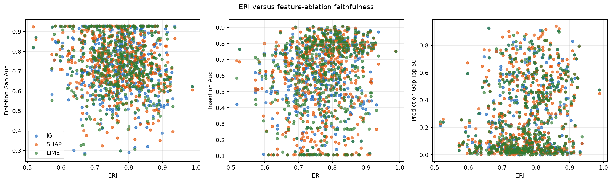
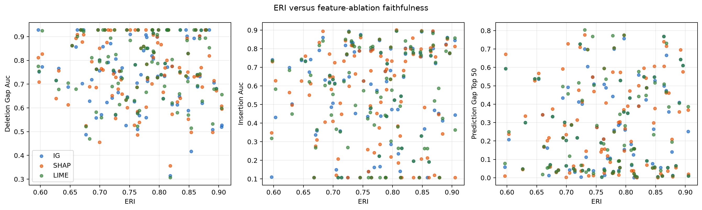
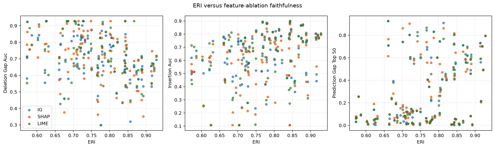
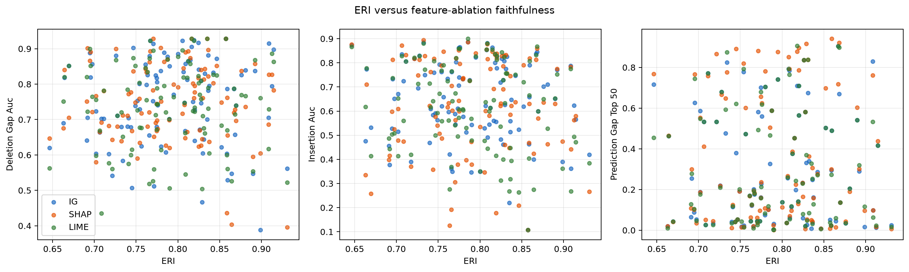
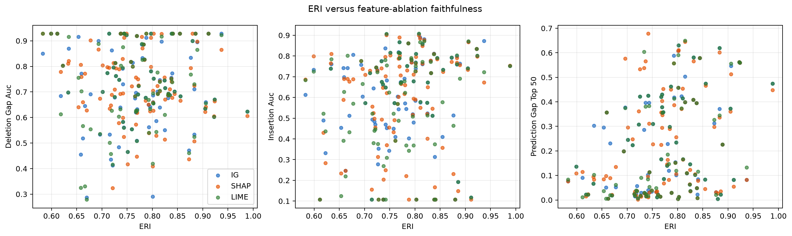
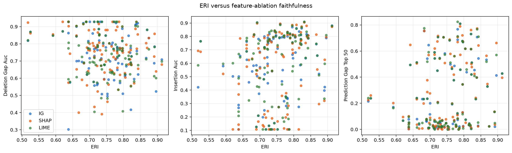

# ERI Faithfulness Benchmark: FD001 / gru / HI

- Model checkpoint seed(s): 42, 43, 44, 45, 46
- Explanation/perturbation RNG seed(s): 42, 43, 44, 45, 46
- Evaluated sample-seed rows: 500
- Seed scope: distinct seed-specific checkpoints were evaluated.
- The training seed controls both model initialization and the engine-wise train/validation split, so seed contrasts include both sources of variation.
- Engine-mean Pearson outcomes after BH adjustment: positive ERI association for top-50% prediction gap in 3/3 explainers, for insertion AUC in 3/3, and negative association for deletion-gap AUC in 0/3.
- Across seed-specific engine-mean tests (BH adjusted within each seed): positive top-50% prediction-gap associations in 6/15 explainer-seed tests, positive insertion-AUC associations in 2/15, and negative deletion-gap-AUC associations in 3/15.
- Attribution perturbation baseline: zero (standardized feature value)
- Deletion-gap AUC: larger normalized prediction change after removing top-ranked sensors is better (opposite direction to the conventional residual-prediction deletion AUC).
- Insertion AUC: higher fidelity to the full prediction while adding top-ranked sensors is better.
- Prediction gap: absolute prediction change after ablating the top 50% sensors.
- Agreement metrics are computed pairwise among IG, SHAP, and a LIME-style masking surrogate.
- ERI remains an agreement score; its attention component reweights IG, so correlations are validation evidence, not proof of causal faithfulness.
- The report includes correlations across sample-seed rows, after averaging within engine across all seeds, and separately after averaging within engine for each model seed. Use the per-seed engine means to assess consistency across checkpoints; the pooled engine mean can hide seed-specific differences.

## ERI-faithfulness correlations

| Analysis level | Agreement predictor | Faithfulness explainer | Faithfulness metric | n | Pearson r | Pearson p | Pearson q (BH) | Spearman rho | Spearman p | Spearman q (BH) |
|---|---|---|---|---:|---:|---:|---:|---:|---:|---:|
| sample-seed | eri | ig | prediction_gap_top_50 | 500 | 0.2058 | 3.493e-06 | 4.192e-05 | 0.1754 | 8.042e-05 | 0.0009473 |
| sample-seed | eri | ig | deletion_gap_auc | 500 | -0.1144 | 0.01044 | 0.03377 | -0.1081 | 0.01561 | 0.04961 |
| sample-seed | eri | ig | insertion_auc | 500 | 0.1347 | 0.002534 | 0.0114 | 0.1726 | 0.0001053 | 0.0009473 |
| sample-seed | eri | shap | prediction_gap_top_50 | 500 | 0.1959 | 1.026e-05 | 0.0001055 | 0.1653 | 0.0002045 | 0.001422 |
| sample-seed | eri | shap | deletion_gap_auc | 500 | -0.1777 | 6.433e-05 | 0.000421 | -0.1637 | 0.0002369 | 0.001422 |
| sample-seed | eri | shap | insertion_auc | 500 | 0.1264 | 0.004644 | 0.01932 | 0.1736 | 9.547e-05 | 0.0009473 |
| sample-seed | eri | lime | prediction_gap_top_50 | 500 | 0.2200 | 6.775e-07 | 1.219e-05 | 0.2010 | 5.906e-06 | 0.0001417 |
| sample-seed | eri | lime | deletion_gap_auc | 500 | -0.0896 | 0.04518 | 0.1162 | -0.0933 | 0.03709 | 0.1027 |
| sample-seed | eri | lime | insertion_auc | 500 | 0.1139 | 0.01079 | 0.03377 | 0.1521 | 0.0006434 | 0.003088 |
| sample-seed | agreement_ig__lime_rank_agreement_top_k | ig | prediction_gap_top_50 | 500 | 0.2111 | 1.913e-06 | 2.755e-05 | 0.1969 | 9.209e-06 | 0.0001518 |
| sample-seed | agreement_ig__lime_rank_agreement_top_k | ig | deletion_gap_auc | 500 | -0.0444 | 0.3213 | 0.4922 | -0.0521 | 0.2452 | 0.4203 |
| sample-seed | agreement_ig__lime_rank_agreement_top_k | ig | insertion_auc | 500 | 0.1927 | 1.435e-05 | 0.0001292 | 0.1638 | 0.0002354 | 0.001422 |
| sample-seed | agreement_ig__lime_rank_agreement_top_k | shap | prediction_gap_top_50 | 500 | 0.2278 | 2.616e-07 | 9.418e-06 | 0.2217 | 5.527e-07 | 3.979e-05 |
| sample-seed | agreement_ig__lime_rank_agreement_top_k | shap | deletion_gap_auc | 500 | 0.0285 | 0.5248 | 0.7261 | 0.0238 | 0.5951 | 0.779 |
| sample-seed | agreement_ig__lime_rank_agreement_top_k | shap | insertion_auc | 500 | 0.1668 | 0.0001798 | 0.0009957 | 0.1453 | 0.001117 | 0.005028 |
| sample-seed | agreement_ig__lime_rank_agreement_top_k | lime | prediction_gap_top_50 | 500 | 0.2290 | 2.248e-07 | 9.418e-06 | 0.2084 | 2.598e-06 | 9.353e-05 |
| sample-seed | agreement_ig__lime_rank_agreement_top_k | lime | deletion_gap_auc | 500 | 0.0083 | 0.8535 | 0.9454 | 0.0001 | 0.9982 | 0.9982 |
| sample-seed | agreement_ig__lime_rank_agreement_top_k | lime | insertion_auc | 500 | 0.2237 | 4.348e-07 | 1.044e-05 | 0.1956 | 1.054e-05 | 0.0001518 |
| sample-seed | agreement_ig__lime_rank_correlation_spearman | ig | prediction_gap_top_50 | 500 | 0.1727 | 0.0001039 | 0.0006235 | 0.1604 | 0.0003179 | 0.001635 |
| sample-seed | agreement_ig__lime_rank_correlation_spearman | ig | deletion_gap_auc | 500 | 0.0105 | 0.8147 | 0.9278 | 0.0141 | 0.7537 | 0.8753 |
| sample-seed | agreement_ig__lime_rank_correlation_spearman | ig | insertion_auc | 500 | 0.1148 | 0.01018 | 0.03377 | 0.0704 | 0.1159 | 0.2399 |
| sample-seed | agreement_ig__lime_rank_correlation_spearman | shap | prediction_gap_top_50 | 500 | 0.1886 | 2.193e-05 | 0.0001579 | 0.1608 | 0.0003068 | 0.001635 |
| sample-seed | agreement_ig__lime_rank_correlation_spearman | shap | deletion_gap_auc | 500 | 0.0447 | 0.3185 | 0.4922 | 0.0496 | 0.2686 | 0.4467 |
| sample-seed | agreement_ig__lime_rank_correlation_spearman | shap | insertion_auc | 500 | 0.1005 | 0.02457 | 0.07075 | 0.0770 | 0.08542 | 0.205 |
| sample-seed | agreement_ig__lime_rank_correlation_spearman | lime | prediction_gap_top_50 | 500 | 0.1909 | 1.726e-05 | 0.0001381 | 0.1643 | 0.0002254 | 0.001422 |
| sample-seed | agreement_ig__lime_rank_correlation_spearman | lime | deletion_gap_auc | 500 | 0.0566 | 0.2064 | 0.3715 | 0.0336 | 0.4539 | 0.6408 |
| sample-seed | agreement_ig__lime_rank_correlation_spearman | lime | insertion_auc | 500 | 0.1258 | 0.004831 | 0.01932 | 0.0914 | 0.04117 | 0.1083 |
| sample-seed | agreement_ig__lime_sign_agreement_top_k | ig | prediction_gap_top_50 | 500 | nan | nan | nan | nan | nan | nan |
| sample-seed | agreement_ig__lime_sign_agreement_top_k | ig | deletion_gap_auc | 500 | nan | nan | nan | nan | nan | nan |
| sample-seed | agreement_ig__lime_sign_agreement_top_k | ig | insertion_auc | 500 | nan | nan | nan | nan | nan | nan |
| sample-seed | agreement_ig__lime_sign_agreement_top_k | shap | prediction_gap_top_50 | 500 | nan | nan | nan | nan | nan | nan |
| sample-seed | agreement_ig__lime_sign_agreement_top_k | shap | deletion_gap_auc | 500 | nan | nan | nan | nan | nan | nan |
| sample-seed | agreement_ig__lime_sign_agreement_top_k | shap | insertion_auc | 500 | nan | nan | nan | nan | nan | nan |
| sample-seed | agreement_ig__lime_sign_agreement_top_k | lime | prediction_gap_top_50 | 500 | nan | nan | nan | nan | nan | nan |
| sample-seed | agreement_ig__lime_sign_agreement_top_k | lime | deletion_gap_auc | 500 | nan | nan | nan | nan | nan | nan |
| sample-seed | agreement_ig__lime_sign_agreement_top_k | lime | insertion_auc | 500 | nan | nan | nan | nan | nan | nan |
| sample-seed | agreement_ig__shap_rank_agreement_top_k | ig | prediction_gap_top_50 | 500 | 0.0061 | 0.8912 | 0.9541 | -0.0142 | 0.7509 | 0.8753 |
| sample-seed | agreement_ig__shap_rank_agreement_top_k | ig | deletion_gap_auc | 500 | 0.0528 | 0.2388 | 0.4194 | 0.0570 | 0.2035 | 0.3663 |
| sample-seed | agreement_ig__shap_rank_agreement_top_k | ig | insertion_auc | 500 | 0.0380 | 0.3961 | 0.5704 | 0.0278 | 0.5351 | 0.7269 |
| sample-seed | agreement_ig__shap_rank_agreement_top_k | shap | prediction_gap_top_50 | 500 | 0.0041 | 0.9276 | 0.9541 | -0.0106 | 0.8132 | 0.9293 |
| sample-seed | agreement_ig__shap_rank_agreement_top_k | shap | deletion_gap_auc | 500 | 0.0445 | 0.3211 | 0.4922 | 0.0397 | 0.3753 | 0.5749 |
| sample-seed | agreement_ig__shap_rank_agreement_top_k | shap | insertion_auc | 500 | 0.0160 | 0.7217 | 0.9116 | 0.0007 | 0.9871 | 0.9982 |
| sample-seed | agreement_ig__shap_rank_agreement_top_k | lime | prediction_gap_top_50 | 500 | 0.0179 | 0.69 | 0.8871 | 0.0063 | 0.8884 | 0.9757 |
| sample-seed | agreement_ig__shap_rank_agreement_top_k | lime | deletion_gap_auc | 500 | 0.0901 | 0.04413 | 0.1162 | 0.0751 | 0.09341 | 0.217 |
| sample-seed | agreement_ig__shap_rank_agreement_top_k | lime | insertion_auc | 500 | 0.0654 | 0.1441 | 0.2985 | 0.0480 | 0.284 | 0.4545 |
| sample-seed | agreement_ig__shap_rank_correlation_spearman | ig | prediction_gap_top_50 | 500 | -0.0612 | 0.172 | 0.3176 | -0.0995 | 0.02609 | 0.07828 |
| sample-seed | agreement_ig__shap_rank_correlation_spearman | ig | deletion_gap_auc | 500 | 0.1110 | 0.01299 | 0.03896 | 0.1317 | 0.003179 | 0.01346 |
| sample-seed | agreement_ig__shap_rank_correlation_spearman | ig | insertion_auc | 500 | -0.0278 | 0.5345 | 0.7261 | -0.0253 | 0.5726 | 0.7634 |
| sample-seed | agreement_ig__shap_rank_correlation_spearman | shap | prediction_gap_top_50 | 500 | -0.0842 | 0.06005 | 0.1491 | -0.1277 | 0.004247 | 0.01699 |
| sample-seed | agreement_ig__shap_rank_correlation_spearman | shap | deletion_gap_auc | 500 | 0.0703 | 0.1163 | 0.2538 | 0.0722 | 0.1069 | 0.2399 |
| sample-seed | agreement_ig__shap_rank_correlation_spearman | shap | insertion_auc | 500 | -0.0406 | 0.3653 | 0.548 | -0.0449 | 0.3164 | 0.4952 |
| sample-seed | agreement_ig__shap_rank_correlation_spearman | lime | prediction_gap_top_50 | 500 | -0.0514 | 0.2511 | 0.4305 | -0.0885 | 0.04791 | 0.119 |
| sample-seed | agreement_ig__shap_rank_correlation_spearman | lime | deletion_gap_auc | 500 | 0.1361 | 0.002286 | 0.01097 | 0.1254 | 0.00497 | 0.01789 |
| sample-seed | agreement_ig__shap_rank_correlation_spearman | lime | insertion_auc | 500 | 0.0110 | 0.8066 | 0.9278 | 0.0058 | 0.8963 | 0.9757 |
| sample-seed | agreement_ig__shap_sign_agreement_top_k | ig | prediction_gap_top_50 | 500 | nan | nan | nan | nan | nan | nan |
| sample-seed | agreement_ig__shap_sign_agreement_top_k | ig | deletion_gap_auc | 500 | nan | nan | nan | nan | nan | nan |
| sample-seed | agreement_ig__shap_sign_agreement_top_k | ig | insertion_auc | 500 | nan | nan | nan | nan | nan | nan |
| sample-seed | agreement_ig__shap_sign_agreement_top_k | shap | prediction_gap_top_50 | 500 | nan | nan | nan | nan | nan | nan |
| sample-seed | agreement_ig__shap_sign_agreement_top_k | shap | deletion_gap_auc | 500 | nan | nan | nan | nan | nan | nan |
| sample-seed | agreement_ig__shap_sign_agreement_top_k | shap | insertion_auc | 500 | nan | nan | nan | nan | nan | nan |
| sample-seed | agreement_ig__shap_sign_agreement_top_k | lime | prediction_gap_top_50 | 500 | nan | nan | nan | nan | nan | nan |
| sample-seed | agreement_ig__shap_sign_agreement_top_k | lime | deletion_gap_auc | 500 | nan | nan | nan | nan | nan | nan |
| sample-seed | agreement_ig__shap_sign_agreement_top_k | lime | insertion_auc | 500 | nan | nan | nan | nan | nan | nan |
| sample-seed | agreement_shap__lime_rank_agreement_top_k | ig | prediction_gap_top_50 | 500 | -0.0253 | 0.5718 | 0.7486 | -0.0151 | 0.7365 | 0.8753 |
| sample-seed | agreement_shap__lime_rank_agreement_top_k | ig | deletion_gap_auc | 500 | 0.1165 | 0.009104 | 0.03277 | 0.1257 | 0.004874 | 0.01789 |
| sample-seed | agreement_shap__lime_rank_agreement_top_k | ig | insertion_auc | 500 | 0.0152 | 0.7345 | 0.9118 | 0.0327 | 0.4658 | 0.6449 |
| sample-seed | agreement_shap__lime_rank_agreement_top_k | shap | prediction_gap_top_50 | 500 | -0.0052 | 0.9073 | 0.9541 | -0.0013 | 0.9769 | 0.9982 |
| sample-seed | agreement_shap__lime_rank_agreement_top_k | shap | deletion_gap_auc | 500 | 0.0953 | 0.03305 | 0.09151 | 0.0909 | 0.04213 | 0.1083 |
| sample-seed | agreement_shap__lime_rank_agreement_top_k | shap | insertion_auc | 500 | -0.0048 | 0.9146 | 0.9541 | -0.0032 | 0.9423 | 0.9977 |
| sample-seed | agreement_shap__lime_rank_agreement_top_k | lime | prediction_gap_top_50 | 500 | -0.0006 | 0.9897 | 0.9965 | 0.0052 | 0.9079 | 0.9757 |
| sample-seed | agreement_shap__lime_rank_agreement_top_k | lime | deletion_gap_auc | 500 | 0.1373 | 0.002098 | 0.01079 | 0.1226 | 0.006055 | 0.02076 |
| sample-seed | agreement_shap__lime_rank_agreement_top_k | lime | insertion_auc | 500 | 0.0451 | 0.3142 | 0.4922 | 0.0491 | 0.273 | 0.4467 |
| sample-seed | agreement_shap__lime_rank_correlation_spearman | ig | prediction_gap_top_50 | 500 | 0.0068 | 0.88 | 0.9541 | -0.0227 | 0.6123 | 0.7872 |
| sample-seed | agreement_shap__lime_rank_correlation_spearman | ig | deletion_gap_auc | 500 | 0.0801 | 0.0735 | 0.1764 | 0.0948 | 0.0341 | 0.09821 |
| sample-seed | agreement_shap__lime_rank_correlation_spearman | ig | insertion_auc | 500 | 0.0128 | 0.7754 | 0.9278 | 0.0161 | 0.72 | 0.8753 |
| sample-seed | agreement_shap__lime_rank_correlation_spearman | shap | prediction_gap_top_50 | 500 | 0.0002 | 0.9965 | 0.9965 | -0.0336 | 0.4533 | 0.6408 |
| sample-seed | agreement_shap__lime_rank_correlation_spearman | shap | deletion_gap_auc | 500 | 0.0617 | 0.1681 | 0.3176 | 0.0563 | 0.209 | 0.3669 |
| sample-seed | agreement_shap__lime_rank_correlation_spearman | shap | insertion_auc | 500 | 0.0118 | 0.7916 | 0.9278 | 0.0096 | 0.8298 | 0.9335 |
| sample-seed | agreement_shap__lime_rank_correlation_spearman | lime | prediction_gap_top_50 | 500 | 0.0340 | 0.4484 | 0.6331 | 0.0016 | 0.9708 | 0.9982 |
| sample-seed | agreement_shap__lime_rank_correlation_spearman | lime | deletion_gap_auc | 500 | 0.1248 | 0.005184 | 0.01965 | 0.1078 | 0.01585 | 0.04961 |
| sample-seed | agreement_shap__lime_rank_correlation_spearman | lime | insertion_auc | 500 | 0.0768 | 0.08639 | 0.1959 | 0.0601 | 0.1795 | 0.3328 |
| sample-seed | agreement_shap__lime_sign_agreement_top_k | ig | prediction_gap_top_50 | 500 | 0.0463 | 0.301 | 0.4922 | 0.0696 | 0.12 | 0.2399 |
| sample-seed | agreement_shap__lime_sign_agreement_top_k | ig | deletion_gap_auc | 500 | 0.0121 | 0.7869 | 0.9278 | 0.0175 | 0.6957 | 0.8637 |
| sample-seed | agreement_shap__lime_sign_agreement_top_k | ig | insertion_auc | 500 | 0.0766 | 0.08708 | 0.1959 | 0.0628 | 0.1608 | 0.3129 |
| sample-seed | agreement_shap__lime_sign_agreement_top_k | shap | prediction_gap_top_50 | 500 | 0.0392 | 0.3824 | 0.5618 | 0.0358 | 0.4241 | 0.6232 |
| sample-seed | agreement_shap__lime_sign_agreement_top_k | shap | deletion_gap_auc | 500 | -0.0633 | 0.1574 | 0.3063 | -0.0700 | 0.1181 | 0.2399 |
| sample-seed | agreement_shap__lime_sign_agreement_top_k | shap | insertion_auc | 500 | 0.0264 | 0.556 | 0.7413 | 0.0374 | 0.4042 | 0.6064 |
| sample-seed | agreement_shap__lime_sign_agreement_top_k | lime | prediction_gap_top_50 | 500 | -0.0099 | 0.8248 | 0.9278 | -0.0188 | 0.6755 | 0.8533 |
| sample-seed | agreement_shap__lime_sign_agreement_top_k | lime | deletion_gap_auc | 500 | -0.0639 | 0.1535 | 0.3063 | -0.0697 | 0.1198 | 0.2399 |
| sample-seed | agreement_shap__lime_sign_agreement_top_k | lime | insertion_auc | 500 | 0.0653 | 0.1451 | 0.2985 | 0.0600 | 0.1803 | 0.3328 |
| engine-mean | eri | ig | prediction_gap_top_50 | 100 | 0.3506 | 0.0003488 | 0.00314 | 0.2800 | 0.004786 | 0.02461 |
| engine-mean | eri | ig | deletion_gap_auc | 100 | -0.1677 | 0.09546 | 0.2217 | -0.1877 | 0.06144 | 0.1702 |
| engine-mean | eri | ig | insertion_auc | 100 | 0.2835 | 0.004264 | 0.01919 | 0.3201 | 0.001168 | 0.008289 |
| engine-mean | eri | shap | prediction_gap_top_50 | 100 | 0.3465 | 0.0004138 | 0.00331 | 0.2658 | 0.007518 | 0.03383 |
| engine-mean | eri | shap | deletion_gap_auc | 100 | -0.2033 | 0.04246 | 0.1223 | -0.2052 | 0.04057 | 0.127 |
| engine-mean | eri | shap | insertion_auc | 100 | 0.2974 | 0.002652 | 0.01469 | 0.3345 | 0.0006706 | 0.006035 |
| engine-mean | eri | lime | prediction_gap_top_50 | 100 | 0.3601 | 0.000233 | 0.002397 | 0.3239 | 0.00101 | 0.008083 |
| engine-mean | eri | lime | deletion_gap_auc | 100 | -0.1177 | 0.2434 | 0.4931 | -0.1203 | 0.2331 | 0.4662 |
| engine-mean | eri | lime | insertion_auc | 100 | 0.3066 | 0.001919 | 0.01152 | 0.3395 | 0.0005483 | 0.00564 |
| engine-mean | agreement_ig__lime_rank_agreement_top_k | ig | prediction_gap_top_50 | 100 | 0.4140 | 1.859e-05 | 0.0003346 | 0.4008 | 3.591e-05 | 0.0008618 |
| engine-mean | agreement_ig__lime_rank_agreement_top_k | ig | deletion_gap_auc | 100 | -0.1476 | 0.1428 | 0.3213 | -0.1305 | 0.1957 | 0.4027 |
| engine-mean | agreement_ig__lime_rank_agreement_top_k | ig | insertion_auc | 100 | 0.3763 | 0.0001143 | 0.001371 | 0.3603 | 0.0002315 | 0.003333 |
| engine-mean | agreement_ig__lime_rank_agreement_top_k | shap | prediction_gap_top_50 | 100 | 0.4343 | 6.339e-06 | 0.0003346 | 0.4176 | 1.541e-05 | 0.0005587 |
| engine-mean | agreement_ig__lime_rank_agreement_top_k | shap | deletion_gap_auc | 100 | 0.0017 | 0.9863 | 0.9863 | -0.0083 | 0.935 | 0.9753 |
| engine-mean | agreement_ig__lime_rank_agreement_top_k | shap | insertion_auc | 100 | 0.3774 | 0.0001087 | 0.001371 | 0.3530 | 0.0003156 | 0.003787 |
| engine-mean | agreement_ig__lime_rank_agreement_top_k | lime | prediction_gap_top_50 | 100 | 0.4231 | 1.159e-05 | 0.0003346 | 0.4175 | 1.552e-05 | 0.0005587 |
| engine-mean | agreement_ig__lime_rank_agreement_top_k | lime | deletion_gap_auc | 100 | -0.0842 | 0.405 | 0.6782 | -0.0706 | 0.4851 | 0.6985 |
| engine-mean | agreement_ig__lime_rank_agreement_top_k | lime | insertion_auc | 100 | 0.4184 | 1.479e-05 | 0.0003346 | 0.3812 | 9.117e-05 | 0.001641 |
| engine-mean | agreement_ig__lime_rank_correlation_spearman | ig | prediction_gap_top_50 | 100 | 0.2951 | 0.002876 | 0.01479 | 0.2843 | 0.004145 | 0.02295 |
| engine-mean | agreement_ig__lime_rank_correlation_spearman | ig | deletion_gap_auc | 100 | 0.0112 | 0.9123 | 0.966 | 0.0317 | 0.754 | 0.9524 |
| engine-mean | agreement_ig__lime_rank_correlation_spearman | ig | insertion_auc | 100 | 0.2043 | 0.04146 | 0.1223 | 0.1912 | 0.05672 | 0.1634 |
| engine-mean | agreement_ig__lime_rank_correlation_spearman | shap | prediction_gap_top_50 | 100 | 0.3160 | 0.001359 | 0.009783 | 0.2846 | 0.004103 | 0.02295 |
| engine-mean | agreement_ig__lime_rank_correlation_spearman | shap | deletion_gap_auc | 100 | 0.0990 | 0.3269 | 0.5885 | 0.0847 | 0.4024 | 0.6258 |
| engine-mean | agreement_ig__lime_rank_correlation_spearman | shap | insertion_auc | 100 | 0.2245 | 0.02474 | 0.08098 | 0.2054 | 0.04039 | 0.127 |
| engine-mean | agreement_ig__lime_rank_correlation_spearman | lime | prediction_gap_top_50 | 100 | 0.3088 | 0.001774 | 0.01152 | 0.3179 | 0.001266 | 0.008289 |
| engine-mean | agreement_ig__lime_rank_correlation_spearman | lime | deletion_gap_auc | 100 | 0.0756 | 0.4548 | 0.7276 | 0.0752 | 0.4571 | 0.6856 |
| engine-mean | agreement_ig__lime_rank_correlation_spearman | lime | insertion_auc | 100 | 0.2350 | 0.01858 | 0.06372 | 0.2074 | 0.03836 | 0.127 |
| engine-mean | agreement_ig__lime_sign_agreement_top_k | ig | prediction_gap_top_50 | 100 | nan | nan | nan | nan | nan | nan |
| engine-mean | agreement_ig__lime_sign_agreement_top_k | ig | deletion_gap_auc | 100 | nan | nan | nan | nan | nan | nan |
| engine-mean | agreement_ig__lime_sign_agreement_top_k | ig | insertion_auc | 100 | nan | nan | nan | nan | nan | nan |
| engine-mean | agreement_ig__lime_sign_agreement_top_k | shap | prediction_gap_top_50 | 100 | nan | nan | nan | nan | nan | nan |
| engine-mean | agreement_ig__lime_sign_agreement_top_k | shap | deletion_gap_auc | 100 | nan | nan | nan | nan | nan | nan |
| engine-mean | agreement_ig__lime_sign_agreement_top_k | shap | insertion_auc | 100 | nan | nan | nan | nan | nan | nan |
| engine-mean | agreement_ig__lime_sign_agreement_top_k | lime | prediction_gap_top_50 | 100 | nan | nan | nan | nan | nan | nan |
| engine-mean | agreement_ig__lime_sign_agreement_top_k | lime | deletion_gap_auc | 100 | nan | nan | nan | nan | nan | nan |
| engine-mean | agreement_ig__lime_sign_agreement_top_k | lime | insertion_auc | 100 | nan | nan | nan | nan | nan | nan |
| engine-mean | agreement_ig__shap_rank_agreement_top_k | ig | prediction_gap_top_50 | 100 | 0.0420 | 0.6783 | 0.8722 | 0.0558 | 0.5811 | 0.7608 |
| engine-mean | agreement_ig__shap_rank_agreement_top_k | ig | deletion_gap_auc | 100 | 0.1407 | 0.1627 | 0.3549 | 0.0883 | 0.3825 | 0.617 |
| engine-mean | agreement_ig__shap_rank_agreement_top_k | ig | insertion_auc | 100 | 0.1169 | 0.2466 | 0.4931 | 0.1587 | 0.1148 | 0.2666 |
| engine-mean | agreement_ig__shap_rank_agreement_top_k | shap | prediction_gap_top_50 | 100 | 0.0289 | 0.7756 | 0.9255 | 0.0569 | 0.574 | 0.7608 |
| engine-mean | agreement_ig__shap_rank_agreement_top_k | shap | deletion_gap_auc | 100 | 0.1965 | 0.05004 | 0.1334 | 0.1451 | 0.1498 | 0.3268 |
| engine-mean | agreement_ig__shap_rank_agreement_top_k | shap | insertion_auc | 100 | 0.1081 | 0.2843 | 0.5386 | 0.1354 | 0.1793 | 0.3797 |
| engine-mean | agreement_ig__shap_rank_agreement_top_k | lime | prediction_gap_top_50 | 100 | 0.0517 | 0.6091 | 0.8434 | 0.0714 | 0.4805 | 0.6985 |
| engine-mean | agreement_ig__shap_rank_agreement_top_k | lime | deletion_gap_auc | 100 | 0.1896 | 0.05887 | 0.1438 | 0.1488 | 0.1394 | 0.3137 |
| engine-mean | agreement_ig__shap_rank_agreement_top_k | lime | insertion_auc | 100 | 0.1341 | 0.1835 | 0.3885 | 0.1699 | 0.09106 | 0.2261 |
| engine-mean | agreement_ig__shap_rank_correlation_spearman | ig | prediction_gap_top_50 | 100 | -0.0788 | 0.4356 | 0.7129 | -0.0877 | 0.3856 | 0.617 |
| engine-mean | agreement_ig__shap_rank_correlation_spearman | ig | deletion_gap_auc | 100 | 0.2595 | 0.009133 | 0.03868 | 0.2418 | 0.01538 | 0.06154 |
| engine-mean | agreement_ig__shap_rank_correlation_spearman | ig | insertion_auc | 100 | -0.0077 | 0.9392 | 0.966 | 0.0051 | 0.9596 | 0.9753 |
| engine-mean | agreement_ig__shap_rank_correlation_spearman | shap | prediction_gap_top_50 | 100 | -0.1123 | 0.2659 | 0.5175 | -0.1152 | 0.2538 | 0.4812 |
| engine-mean | agreement_ig__shap_rank_correlation_spearman | shap | deletion_gap_auc | 100 | 0.2378 | 0.0172 | 0.06193 | 0.2255 | 0.02411 | 0.09136 |
| engine-mean | agreement_ig__shap_rank_correlation_spearman | shap | insertion_auc | 100 | -0.0321 | 0.7515 | 0.9171 | -0.0117 | 0.9079 | 0.9753 |
| engine-mean | agreement_ig__shap_rank_correlation_spearman | lime | prediction_gap_top_50 | 100 | -0.0690 | 0.4949 | 0.7527 | -0.0627 | 0.5353 | 0.7412 |
| engine-mean | agreement_ig__shap_rank_correlation_spearman | lime | deletion_gap_auc | 100 | 0.2842 | 0.004161 | 0.01919 | 0.2660 | 0.007483 | 0.03383 |
| engine-mean | agreement_ig__shap_rank_correlation_spearman | lime | insertion_auc | 100 | 0.0091 | 0.9281 | 0.966 | 0.0223 | 0.8259 | 0.9592 |
| engine-mean | agreement_ig__shap_sign_agreement_top_k | ig | prediction_gap_top_50 | 100 | nan | nan | nan | nan | nan | nan |
| engine-mean | agreement_ig__shap_sign_agreement_top_k | ig | deletion_gap_auc | 100 | nan | nan | nan | nan | nan | nan |
| engine-mean | agreement_ig__shap_sign_agreement_top_k | ig | insertion_auc | 100 | nan | nan | nan | nan | nan | nan |
| engine-mean | agreement_ig__shap_sign_agreement_top_k | shap | prediction_gap_top_50 | 100 | nan | nan | nan | nan | nan | nan |
| engine-mean | agreement_ig__shap_sign_agreement_top_k | shap | deletion_gap_auc | 100 | nan | nan | nan | nan | nan | nan |
| engine-mean | agreement_ig__shap_sign_agreement_top_k | shap | insertion_auc | 100 | nan | nan | nan | nan | nan | nan |
| engine-mean | agreement_ig__shap_sign_agreement_top_k | lime | prediction_gap_top_50 | 100 | nan | nan | nan | nan | nan | nan |
| engine-mean | agreement_ig__shap_sign_agreement_top_k | lime | deletion_gap_auc | 100 | nan | nan | nan | nan | nan | nan |
| engine-mean | agreement_ig__shap_sign_agreement_top_k | lime | insertion_auc | 100 | nan | nan | nan | nan | nan | nan |
| engine-mean | agreement_shap__lime_rank_agreement_top_k | ig | prediction_gap_top_50 | 100 | 0.0018 | 0.9862 | 0.9863 | -0.0020 | 0.9843 | 0.9843 |
| engine-mean | agreement_shap__lime_rank_agreement_top_k | ig | deletion_gap_auc | 100 | 0.1888 | 0.05994 | 0.1438 | 0.1612 | 0.109 | 0.2616 |
| engine-mean | agreement_shap__lime_rank_agreement_top_k | ig | insertion_auc | 100 | 0.0359 | 0.7228 | 0.9075 | 0.0593 | 0.5579 | 0.7578 |
| engine-mean | agreement_shap__lime_rank_agreement_top_k | shap | prediction_gap_top_50 | 100 | -0.0109 | 0.9141 | 0.966 | -0.0049 | 0.9617 | 0.9753 |
| engine-mean | agreement_shap__lime_rank_agreement_top_k | shap | deletion_gap_auc | 100 | 0.2167 | 0.03036 | 0.09503 | 0.1710 | 0.08897 | 0.2261 |
| engine-mean | agreement_shap__lime_rank_agreement_top_k | shap | insertion_auc | 100 | 0.0148 | 0.884 | 0.9643 | 0.0278 | 0.7834 | 0.9558 |
| engine-mean | agreement_shap__lime_rank_agreement_top_k | lime | prediction_gap_top_50 | 100 | 0.0179 | 0.8597 | 0.9522 | 0.0239 | 0.8137 | 0.9592 |
| engine-mean | agreement_shap__lime_rank_agreement_top_k | lime | deletion_gap_auc | 100 | 0.2421 | 0.01524 | 0.05775 | 0.2174 | 0.02982 | 0.1074 |
| engine-mean | agreement_shap__lime_rank_agreement_top_k | lime | insertion_auc | 100 | 0.0679 | 0.5018 | 0.7527 | 0.0836 | 0.4085 | 0.6258 |
| engine-mean | agreement_shap__lime_rank_correlation_spearman | ig | prediction_gap_top_50 | 100 | 0.0460 | 0.6498 | 0.86 | 0.0531 | 0.5996 | 0.7709 |
| engine-mean | agreement_shap__lime_rank_correlation_spearman | ig | deletion_gap_auc | 100 | 0.1930 | 0.05442 | 0.1399 | 0.1912 | 0.05675 | 0.1634 |
| engine-mean | agreement_shap__lime_rank_correlation_spearman | ig | insertion_auc | 100 | 0.0618 | 0.5414 | 0.7796 | 0.0878 | 0.3848 | 0.617 |
| engine-mean | agreement_shap__lime_rank_correlation_spearman | shap | prediction_gap_top_50 | 100 | 0.0235 | 0.8166 | 0.939 | 0.0270 | 0.7897 | 0.9558 |
| engine-mean | agreement_shap__lime_rank_correlation_spearman | shap | deletion_gap_auc | 100 | 0.1974 | 0.04895 | 0.1334 | 0.1771 | 0.07788 | 0.2077 |
| engine-mean | agreement_shap__lime_rank_correlation_spearman | shap | insertion_auc | 100 | 0.0348 | 0.731 | 0.9075 | 0.0680 | 0.5014 | 0.7079 |
| engine-mean | agreement_shap__lime_rank_correlation_spearman | lime | prediction_gap_top_50 | 100 | 0.0661 | 0.5133 | 0.7542 | 0.0883 | 0.3825 | 0.617 |
| engine-mean | agreement_shap__lime_rank_correlation_spearman | lime | deletion_gap_auc | 100 | 0.2534 | 0.01096 | 0.04382 | 0.2513 | 0.01167 | 0.04944 |
| engine-mean | agreement_shap__lime_rank_correlation_spearman | lime | insertion_auc | 100 | 0.0947 | 0.3485 | 0.5974 | 0.1151 | 0.254 | 0.4812 |
| engine-mean | agreement_shap__lime_sign_agreement_top_k | ig | prediction_gap_top_50 | 100 | 0.0467 | 0.6448 | 0.86 | 0.0122 | 0.9042 | 0.9753 |
| engine-mean | agreement_shap__lime_sign_agreement_top_k | ig | deletion_gap_auc | 100 | -0.0727 | 0.4722 | 0.7391 | -0.0923 | 0.3612 | 0.617 |
| engine-mean | agreement_shap__lime_sign_agreement_top_k | ig | insertion_auc | 100 | 0.0277 | 0.7841 | 0.9255 | 0.0261 | 0.7965 | 0.9558 |
| engine-mean | agreement_shap__lime_sign_agreement_top_k | shap | prediction_gap_top_50 | 100 | 0.0450 | 0.6569 | 0.86 | -0.0052 | 0.9589 | 0.9753 |
| engine-mean | agreement_shap__lime_sign_agreement_top_k | shap | deletion_gap_auc | 100 | -0.0971 | 0.3367 | 0.5913 | -0.1132 | 0.2623 | 0.4843 |
| engine-mean | agreement_shap__lime_sign_agreement_top_k | shap | insertion_auc | 100 | -0.0228 | 0.8219 | 0.939 | -0.0122 | 0.9042 | 0.9753 |
| engine-mean | agreement_shap__lime_sign_agreement_top_k | lime | prediction_gap_top_50 | 100 | 0.0552 | 0.5856 | 0.8267 | 0.0157 | 0.877 | 0.9753 |
| engine-mean | agreement_shap__lime_sign_agreement_top_k | lime | deletion_gap_auc | 100 | -0.0998 | 0.3233 | 0.5885 | -0.0992 | 0.326 | 0.5868 |
| engine-mean | agreement_shap__lime_sign_agreement_top_k | lime | insertion_auc | 100 | 0.0211 | 0.8347 | 0.939 | 0.0191 | 0.85 | 0.9714 |
| engine-mean-seed-42 | eri | ig | prediction_gap_top_50 | 100 | 0.0740 | 0.4641 | 0.9065 | 0.0527 | 0.6026 | 0.9852 |
| engine-mean-seed-42 | eri | ig | deletion_gap_auc | 100 | -0.0536 | 0.5966 | 0.9065 | -0.0158 | 0.8764 | 0.993 |
| engine-mean-seed-42 | eri | ig | insertion_auc | 100 | 0.0456 | 0.6525 | 0.9065 | 0.0836 | 0.4085 | 0.9852 |
| engine-mean-seed-42 | eri | shap | prediction_gap_top_50 | 100 | 0.0397 | 0.6951 | 0.9065 | 0.0138 | 0.892 | 0.993 |
| engine-mean-seed-42 | eri | shap | deletion_gap_auc | 100 | -0.0988 | 0.3282 | 0.9065 | -0.0831 | 0.4113 | 0.9852 |
| engine-mean-seed-42 | eri | shap | insertion_auc | 100 | -0.0179 | 0.8595 | 0.9065 | 0.0516 | 0.6099 | 0.9852 |
| engine-mean-seed-42 | eri | lime | prediction_gap_top_50 | 100 | 0.0891 | 0.3778 | 0.9065 | 0.0553 | 0.5849 | 0.9852 |
| engine-mean-seed-42 | eri | lime | deletion_gap_auc | 100 | -0.0561 | 0.5795 | 0.9065 | -0.0384 | 0.7045 | 0.993 |
| engine-mean-seed-42 | eri | lime | insertion_auc | 100 | 0.0349 | 0.7304 | 0.9065 | 0.0616 | 0.5426 | 0.9852 |
| engine-mean-seed-42 | agreement_ig__lime_rank_agreement_top_k | ig | prediction_gap_top_50 | 100 | 0.2697 | 0.006653 | 0.06985 | 0.2491 | 0.01246 | 0.1432 |
| engine-mean-seed-42 | agreement_ig__lime_rank_agreement_top_k | ig | deletion_gap_auc | 100 | -0.1870 | 0.06242 | 0.3932 | -0.2148 | 0.03184 | 0.2865 |
| engine-mean-seed-42 | agreement_ig__lime_rank_agreement_top_k | ig | insertion_auc | 100 | 0.3407 | 0.0005238 | 0.033 | 0.2759 | 0.005465 | 0.1432 |
| engine-mean-seed-42 | agreement_ig__lime_rank_agreement_top_k | shap | prediction_gap_top_50 | 100 | 0.3209 | 0.001133 | 0.0357 | 0.3125 | 0.001546 | 0.09742 |
| engine-mean-seed-42 | agreement_ig__lime_rank_agreement_top_k | shap | deletion_gap_auc | 100 | -0.0287 | 0.7766 | 0.9065 | -0.0574 | 0.5707 | 0.9852 |
| engine-mean-seed-42 | agreement_ig__lime_rank_agreement_top_k | shap | insertion_auc | 100 | 0.2760 | 0.005439 | 0.06854 | 0.2460 | 0.01364 | 0.1432 |
| engine-mean-seed-42 | agreement_ig__lime_rank_agreement_top_k | lime | prediction_gap_top_50 | 100 | 0.2801 | 0.004761 | 0.06854 | 0.2502 | 0.01206 | 0.1432 |
| engine-mean-seed-42 | agreement_ig__lime_rank_agreement_top_k | lime | deletion_gap_auc | 100 | -0.1525 | 0.13 | 0.5682 | -0.1574 | 0.1177 | 0.7841 |
| engine-mean-seed-42 | agreement_ig__lime_rank_agreement_top_k | lime | insertion_auc | 100 | 0.2816 | 0.004543 | 0.06854 | 0.2653 | 0.00763 | 0.1432 |
| engine-mean-seed-42 | agreement_ig__lime_rank_correlation_spearman | ig | prediction_gap_top_50 | 100 | 0.2265 | 0.02346 | 0.1642 | 0.1545 | 0.1247 | 0.7841 |
| engine-mean-seed-42 | agreement_ig__lime_rank_correlation_spearman | ig | deletion_gap_auc | 100 | 0.0530 | 0.6007 | 0.9065 | 0.0904 | 0.3712 | 0.9852 |
| engine-mean-seed-42 | agreement_ig__lime_rank_correlation_spearman | ig | insertion_auc | 100 | 0.2446 | 0.01418 | 0.1276 | 0.0852 | 0.3994 | 0.9852 |
| engine-mean-seed-42 | agreement_ig__lime_rank_correlation_spearman | shap | prediction_gap_top_50 | 100 | 0.2300 | 0.02135 | 0.1642 | 0.1716 | 0.08784 | 0.6917 |
| engine-mean-seed-42 | agreement_ig__lime_rank_correlation_spearman | shap | deletion_gap_auc | 100 | 0.0617 | 0.5418 | 0.9065 | 0.1249 | 0.2157 | 0.9852 |
| engine-mean-seed-42 | agreement_ig__lime_rank_correlation_spearman | shap | insertion_auc | 100 | 0.1504 | 0.1353 | 0.5682 | 0.0361 | 0.7211 | 0.993 |
| engine-mean-seed-42 | agreement_ig__lime_rank_correlation_spearman | lime | prediction_gap_top_50 | 100 | 0.1819 | 0.07003 | 0.4011 | 0.1189 | 0.2388 | 0.9852 |
| engine-mean-seed-42 | agreement_ig__lime_rank_correlation_spearman | lime | deletion_gap_auc | 100 | -0.0275 | 0.7858 | 0.9065 | 0.0279 | 0.783 | 0.993 |
| engine-mean-seed-42 | agreement_ig__lime_rank_correlation_spearman | lime | insertion_auc | 100 | 0.1382 | 0.1702 | 0.6702 | 0.0340 | 0.7372 | 0.993 |
| engine-mean-seed-42 | agreement_ig__lime_sign_agreement_top_k | ig | prediction_gap_top_50 | 100 | nan | nan | nan | nan | nan | nan |
| engine-mean-seed-42 | agreement_ig__lime_sign_agreement_top_k | ig | deletion_gap_auc | 100 | nan | nan | nan | nan | nan | nan |
| engine-mean-seed-42 | agreement_ig__lime_sign_agreement_top_k | ig | insertion_auc | 100 | nan | nan | nan | nan | nan | nan |
| engine-mean-seed-42 | agreement_ig__lime_sign_agreement_top_k | shap | prediction_gap_top_50 | 100 | nan | nan | nan | nan | nan | nan |
| engine-mean-seed-42 | agreement_ig__lime_sign_agreement_top_k | shap | deletion_gap_auc | 100 | nan | nan | nan | nan | nan | nan |
| engine-mean-seed-42 | agreement_ig__lime_sign_agreement_top_k | shap | insertion_auc | 100 | nan | nan | nan | nan | nan | nan |
| engine-mean-seed-42 | agreement_ig__lime_sign_agreement_top_k | lime | prediction_gap_top_50 | 100 | nan | nan | nan | nan | nan | nan |
| engine-mean-seed-42 | agreement_ig__lime_sign_agreement_top_k | lime | deletion_gap_auc | 100 | nan | nan | nan | nan | nan | nan |
| engine-mean-seed-42 | agreement_ig__lime_sign_agreement_top_k | lime | insertion_auc | 100 | nan | nan | nan | nan | nan | nan |
| engine-mean-seed-42 | agreement_ig__shap_rank_agreement_top_k | ig | prediction_gap_top_50 | 100 | -0.0362 | 0.7205 | 0.9065 | -0.0298 | 0.7685 | 0.993 |
| engine-mean-seed-42 | agreement_ig__shap_rank_agreement_top_k | ig | deletion_gap_auc | 100 | 0.0373 | 0.7123 | 0.9065 | 0.0089 | 0.93 | 0.993 |
| engine-mean-seed-42 | agreement_ig__shap_rank_agreement_top_k | ig | insertion_auc | 100 | 0.0930 | 0.3576 | 0.9065 | 0.1017 | 0.3142 | 0.9852 |
| engine-mean-seed-42 | agreement_ig__shap_rank_agreement_top_k | shap | prediction_gap_top_50 | 100 | -0.0200 | 0.8437 | 0.9065 | 0.0124 | 0.9024 | 0.993 |
| engine-mean-seed-42 | agreement_ig__shap_rank_agreement_top_k | shap | deletion_gap_auc | 100 | 0.0898 | 0.3744 | 0.9065 | 0.0651 | 0.52 | 0.9852 |
| engine-mean-seed-42 | agreement_ig__shap_rank_agreement_top_k | shap | insertion_auc | 100 | 0.0380 | 0.7072 | 0.9065 | 0.0519 | 0.6081 | 0.9852 |
| engine-mean-seed-42 | agreement_ig__shap_rank_agreement_top_k | lime | prediction_gap_top_50 | 100 | -0.0174 | 0.8633 | 0.9065 | -0.0180 | 0.859 | 0.993 |
| engine-mean-seed-42 | agreement_ig__shap_rank_agreement_top_k | lime | deletion_gap_auc | 100 | 0.0229 | 0.8212 | 0.9065 | -0.0006 | 0.9954 | 0.9995 |
| engine-mean-seed-42 | agreement_ig__shap_rank_agreement_top_k | lime | insertion_auc | 100 | 0.0734 | 0.4679 | 0.9065 | 0.0835 | 0.409 | 0.9852 |
| engine-mean-seed-42 | agreement_ig__shap_rank_correlation_spearman | ig | prediction_gap_top_50 | 100 | -0.0572 | 0.5717 | 0.9065 | -0.0703 | 0.487 | 0.9852 |
| engine-mean-seed-42 | agreement_ig__shap_rank_correlation_spearman | ig | deletion_gap_auc | 100 | 0.0728 | 0.4714 | 0.9065 | 0.0905 | 0.3706 | 0.9852 |
| engine-mean-seed-42 | agreement_ig__shap_rank_correlation_spearman | ig | insertion_auc | 100 | 0.0183 | 0.8568 | 0.9065 | 0.0293 | 0.7726 | 0.993 |
| engine-mean-seed-42 | agreement_ig__shap_rank_correlation_spearman | shap | prediction_gap_top_50 | 100 | -0.1105 | 0.2737 | 0.9065 | -0.1017 | 0.314 | 0.9852 |
| engine-mean-seed-42 | agreement_ig__shap_rank_correlation_spearman | shap | deletion_gap_auc | 100 | 0.0936 | 0.3544 | 0.9065 | 0.0562 | 0.5783 | 0.9852 |
| engine-mean-seed-42 | agreement_ig__shap_rank_correlation_spearman | shap | insertion_auc | 100 | -0.0698 | 0.4902 | 0.9065 | -0.0687 | 0.4973 | 0.9852 |
| engine-mean-seed-42 | agreement_ig__shap_rank_correlation_spearman | lime | prediction_gap_top_50 | 100 | -0.0451 | 0.6561 | 0.9065 | -0.0969 | 0.3373 | 0.9852 |
| engine-mean-seed-42 | agreement_ig__shap_rank_correlation_spearman | lime | deletion_gap_auc | 100 | 0.0508 | 0.6161 | 0.9065 | 0.0350 | 0.7297 | 0.993 |
| engine-mean-seed-42 | agreement_ig__shap_rank_correlation_spearman | lime | insertion_auc | 100 | 0.0045 | 0.9644 | 0.9644 | -0.0001 | 0.9995 | 0.9995 |
| engine-mean-seed-42 | agreement_ig__shap_sign_agreement_top_k | ig | prediction_gap_top_50 | 100 | nan | nan | nan | nan | nan | nan |
| engine-mean-seed-42 | agreement_ig__shap_sign_agreement_top_k | ig | deletion_gap_auc | 100 | nan | nan | nan | nan | nan | nan |
| engine-mean-seed-42 | agreement_ig__shap_sign_agreement_top_k | ig | insertion_auc | 100 | nan | nan | nan | nan | nan | nan |
| engine-mean-seed-42 | agreement_ig__shap_sign_agreement_top_k | shap | prediction_gap_top_50 | 100 | nan | nan | nan | nan | nan | nan |
| engine-mean-seed-42 | agreement_ig__shap_sign_agreement_top_k | shap | deletion_gap_auc | 100 | nan | nan | nan | nan | nan | nan |
| engine-mean-seed-42 | agreement_ig__shap_sign_agreement_top_k | shap | insertion_auc | 100 | nan | nan | nan | nan | nan | nan |
| engine-mean-seed-42 | agreement_ig__shap_sign_agreement_top_k | lime | prediction_gap_top_50 | 100 | nan | nan | nan | nan | nan | nan |
| engine-mean-seed-42 | agreement_ig__shap_sign_agreement_top_k | lime | deletion_gap_auc | 100 | nan | nan | nan | nan | nan | nan |
| engine-mean-seed-42 | agreement_ig__shap_sign_agreement_top_k | lime | insertion_auc | 100 | nan | nan | nan | nan | nan | nan |
| engine-mean-seed-42 | agreement_shap__lime_rank_agreement_top_k | ig | prediction_gap_top_50 | 100 | -0.0399 | 0.6938 | 0.9065 | -0.0158 | 0.8763 | 0.993 |
| engine-mean-seed-42 | agreement_shap__lime_rank_agreement_top_k | ig | deletion_gap_auc | 100 | 0.1670 | 0.09671 | 0.4687 | 0.1452 | 0.1493 | 0.7841 |
| engine-mean-seed-42 | agreement_shap__lime_rank_agreement_top_k | ig | insertion_auc | 100 | 0.0351 | 0.7291 | 0.9065 | 0.0573 | 0.5713 | 0.9852 |
| engine-mean-seed-42 | agreement_shap__lime_rank_agreement_top_k | shap | prediction_gap_top_50 | 100 | -0.0304 | 0.7642 | 0.9065 | -0.0001 | 0.9993 | 0.9995 |
| engine-mean-seed-42 | agreement_shap__lime_rank_agreement_top_k | shap | deletion_gap_auc | 100 | 0.1768 | 0.07844 | 0.4118 | 0.1495 | 0.1377 | 0.7841 |
| engine-mean-seed-42 | agreement_shap__lime_rank_agreement_top_k | shap | insertion_auc | 100 | -0.0187 | 0.8536 | 0.9065 | 0.0022 | 0.9823 | 0.9995 |
| engine-mean-seed-42 | agreement_shap__lime_rank_agreement_top_k | lime | prediction_gap_top_50 | 100 | -0.0327 | 0.7467 | 0.9065 | -0.0349 | 0.7301 | 0.993 |
| engine-mean-seed-42 | agreement_shap__lime_rank_agreement_top_k | lime | deletion_gap_auc | 100 | 0.1181 | 0.242 | 0.8967 | 0.0966 | 0.339 | 0.9852 |
| engine-mean-seed-42 | agreement_shap__lime_rank_agreement_top_k | lime | insertion_auc | 100 | 0.0091 | 0.9282 | 0.9431 | 0.0379 | 0.7082 | 0.993 |
| engine-mean-seed-42 | agreement_shap__lime_rank_correlation_spearman | ig | prediction_gap_top_50 | 100 | 0.0463 | 0.6475 | 0.9065 | 0.0223 | 0.8255 | 0.993 |
| engine-mean-seed-42 | agreement_shap__lime_rank_correlation_spearman | ig | deletion_gap_auc | 100 | 0.0720 | 0.4764 | 0.9065 | 0.1093 | 0.279 | 0.9852 |
| engine-mean-seed-42 | agreement_shap__lime_rank_correlation_spearman | ig | insertion_auc | 100 | 0.0817 | 0.4193 | 0.9065 | 0.0641 | 0.526 | 0.9852 |
| engine-mean-seed-42 | agreement_shap__lime_rank_correlation_spearman | shap | prediction_gap_top_50 | 100 | 0.0100 | 0.9212 | 0.9431 | 0.0105 | 0.9175 | 0.993 |
| engine-mean-seed-42 | agreement_shap__lime_rank_correlation_spearman | shap | deletion_gap_auc | 100 | 0.0928 | 0.3586 | 0.9065 | 0.1038 | 0.3041 | 0.9852 |
| engine-mean-seed-42 | agreement_shap__lime_rank_correlation_spearman | shap | insertion_auc | 100 | -0.0184 | 0.8559 | 0.9065 | -0.0171 | 0.8661 | 0.993 |
| engine-mean-seed-42 | agreement_shap__lime_rank_correlation_spearman | lime | prediction_gap_top_50 | 100 | 0.0741 | 0.4638 | 0.9065 | 0.0093 | 0.927 | 0.993 |
| engine-mean-seed-42 | agreement_shap__lime_rank_correlation_spearman | lime | deletion_gap_auc | 100 | 0.0580 | 0.5663 | 0.9065 | 0.0796 | 0.4309 | 0.9852 |
| engine-mean-seed-42 | agreement_shap__lime_rank_correlation_spearman | lime | insertion_auc | 100 | 0.0724 | 0.4744 | 0.9065 | 0.0480 | 0.6351 | 0.993 |
| engine-mean-seed-42 | agreement_shap__lime_sign_agreement_top_k | ig | prediction_gap_top_50 | 100 | nan | nan | nan | nan | nan | nan |
| engine-mean-seed-42 | agreement_shap__lime_sign_agreement_top_k | ig | deletion_gap_auc | 100 | nan | nan | nan | nan | nan | nan |
| engine-mean-seed-42 | agreement_shap__lime_sign_agreement_top_k | ig | insertion_auc | 100 | nan | nan | nan | nan | nan | nan |
| engine-mean-seed-42 | agreement_shap__lime_sign_agreement_top_k | shap | prediction_gap_top_50 | 100 | nan | nan | nan | nan | nan | nan |
| engine-mean-seed-42 | agreement_shap__lime_sign_agreement_top_k | shap | deletion_gap_auc | 100 | nan | nan | nan | nan | nan | nan |
| engine-mean-seed-42 | agreement_shap__lime_sign_agreement_top_k | shap | insertion_auc | 100 | nan | nan | nan | nan | nan | nan |
| engine-mean-seed-42 | agreement_shap__lime_sign_agreement_top_k | lime | prediction_gap_top_50 | 100 | nan | nan | nan | nan | nan | nan |
| engine-mean-seed-42 | agreement_shap__lime_sign_agreement_top_k | lime | deletion_gap_auc | 100 | nan | nan | nan | nan | nan | nan |
| engine-mean-seed-42 | agreement_shap__lime_sign_agreement_top_k | lime | insertion_auc | 100 | nan | nan | nan | nan | nan | nan |
| engine-mean-seed-43 | eri | ig | prediction_gap_top_50 | 100 | 0.3874 | 6.833e-05 | 0.001781 | 0.3061 | 0.001951 | 0.01536 |
| engine-mean-seed-43 | eri | ig | deletion_gap_auc | 100 | -0.3685 | 0.0001615 | 0.002433 | -0.3855 | 7.479e-05 | 0.001873 |
| engine-mean-seed-43 | eri | ig | insertion_auc | 100 | 0.2572 | 0.009773 | 0.06157 | 0.3128 | 0.001531 | 0.01378 |
| engine-mean-seed-43 | eri | shap | prediction_gap_top_50 | 100 | 0.3828 | 8.479e-05 | 0.001781 | 0.3014 | 0.002305 | 0.01614 |
| engine-mean-seed-43 | eri | shap | deletion_gap_auc | 100 | -0.3645 | 0.0001931 | 0.002433 | -0.3966 | 4.407e-05 | 0.001873 |
| engine-mean-seed-43 | eri | shap | insertion_auc | 100 | 0.3202 | 0.001162 | 0.0122 | 0.3817 | 8.918e-05 | 0.001873 |
| engine-mean-seed-43 | eri | lime | prediction_gap_top_50 | 100 | 0.3834 | 8.244e-05 | 0.001781 | 0.3269 | 0.0009014 | 0.009465 |
| engine-mean-seed-43 | eri | lime | deletion_gap_auc | 100 | -0.3103 | 0.001679 | 0.01507 | -0.3286 | 0.0008435 | 0.009465 |
| engine-mean-seed-43 | eri | lime | insertion_auc | 100 | 0.2782 | 0.005077 | 0.03554 | 0.3349 | 0.0006597 | 0.009465 |
| engine-mean-seed-43 | agreement_ig__lime_rank_agreement_top_k | ig | prediction_gap_top_50 | 100 | 0.0942 | 0.3514 | 0.7141 | 0.0843 | 0.4043 | 0.7076 |
| engine-mean-seed-43 | agreement_ig__lime_rank_agreement_top_k | ig | deletion_gap_auc | 100 | -0.1761 | 0.07971 | 0.2879 | -0.1382 | 0.1703 | 0.4752 |
| engine-mean-seed-43 | agreement_ig__lime_rank_agreement_top_k | ig | insertion_auc | 100 | 0.1870 | 0.06243 | 0.2458 | 0.0579 | 0.5669 | 0.8504 |
| engine-mean-seed-43 | agreement_ig__lime_rank_agreement_top_k | shap | prediction_gap_top_50 | 100 | 0.1309 | 0.1943 | 0.5157 | 0.1043 | 0.3019 | 0.6356 |
| engine-mean-seed-43 | agreement_ig__lime_rank_agreement_top_k | shap | deletion_gap_auc | 100 | -0.0890 | 0.3783 | 0.7448 | -0.0430 | 0.6713 | 0.8792 |
| engine-mean-seed-43 | agreement_ig__lime_rank_agreement_top_k | shap | insertion_auc | 100 | 0.3067 | 0.001913 | 0.01507 | 0.1403 | 0.1638 | 0.4752 |
| engine-mean-seed-43 | agreement_ig__lime_rank_agreement_top_k | lime | prediction_gap_top_50 | 100 | 0.1015 | 0.3149 | 0.6863 | 0.0995 | 0.3248 | 0.6356 |
| engine-mean-seed-43 | agreement_ig__lime_rank_agreement_top_k | lime | deletion_gap_auc | 100 | -0.0808 | 0.4244 | 0.7633 | -0.0394 | 0.6973 | 0.8792 |
| engine-mean-seed-43 | agreement_ig__lime_rank_agreement_top_k | lime | insertion_auc | 100 | 0.2128 | 0.03357 | 0.1511 | 0.1167 | 0.2477 | 0.5925 |
| engine-mean-seed-43 | agreement_ig__lime_rank_correlation_spearman | ig | prediction_gap_top_50 | 100 | 0.1542 | 0.1255 | 0.3764 | 0.2083 | 0.03753 | 0.197 |
| engine-mean-seed-43 | agreement_ig__lime_rank_correlation_spearman | ig | deletion_gap_auc | 100 | -0.1315 | 0.1922 | 0.5157 | -0.1736 | 0.08404 | 0.3115 |
| engine-mean-seed-43 | agreement_ig__lime_rank_correlation_spearman | ig | insertion_auc | 100 | 0.2200 | 0.02788 | 0.1351 | 0.1375 | 0.1726 | 0.4752 |
| engine-mean-seed-43 | agreement_ig__lime_rank_correlation_spearman | shap | prediction_gap_top_50 | 100 | 0.1906 | 0.05756 | 0.2417 | 0.2039 | 0.0419 | 0.203 |
| engine-mean-seed-43 | agreement_ig__lime_rank_correlation_spearman | shap | deletion_gap_auc | 100 | -0.0730 | 0.4705 | 0.7633 | -0.1372 | 0.1735 | 0.4752 |
| engine-mean-seed-43 | agreement_ig__lime_rank_correlation_spearman | shap | insertion_auc | 100 | 0.2378 | 0.01722 | 0.09041 | 0.2183 | 0.02909 | 0.1666 |
| engine-mean-seed-43 | agreement_ig__lime_rank_correlation_spearman | lime | prediction_gap_top_50 | 100 | 0.1746 | 0.08224 | 0.2879 | 0.2215 | 0.02677 | 0.1666 |
| engine-mean-seed-43 | agreement_ig__lime_rank_correlation_spearman | lime | deletion_gap_auc | 100 | -0.0213 | 0.8333 | 0.8898 | -0.0601 | 0.5526 | 0.8504 |
| engine-mean-seed-43 | agreement_ig__lime_rank_correlation_spearman | lime | insertion_auc | 100 | 0.2408 | 0.01582 | 0.09041 | 0.1877 | 0.06142 | 0.2579 |
| engine-mean-seed-43 | agreement_ig__lime_sign_agreement_top_k | ig | prediction_gap_top_50 | 100 | nan | nan | nan | nan | nan | nan |
| engine-mean-seed-43 | agreement_ig__lime_sign_agreement_top_k | ig | deletion_gap_auc | 100 | nan | nan | nan | nan | nan | nan |
| engine-mean-seed-43 | agreement_ig__lime_sign_agreement_top_k | ig | insertion_auc | 100 | nan | nan | nan | nan | nan | nan |
| engine-mean-seed-43 | agreement_ig__lime_sign_agreement_top_k | shap | prediction_gap_top_50 | 100 | nan | nan | nan | nan | nan | nan |
| engine-mean-seed-43 | agreement_ig__lime_sign_agreement_top_k | shap | deletion_gap_auc | 100 | nan | nan | nan | nan | nan | nan |
| engine-mean-seed-43 | agreement_ig__lime_sign_agreement_top_k | shap | insertion_auc | 100 | nan | nan | nan | nan | nan | nan |
| engine-mean-seed-43 | agreement_ig__lime_sign_agreement_top_k | lime | prediction_gap_top_50 | 100 | nan | nan | nan | nan | nan | nan |
| engine-mean-seed-43 | agreement_ig__lime_sign_agreement_top_k | lime | deletion_gap_auc | 100 | nan | nan | nan | nan | nan | nan |
| engine-mean-seed-43 | agreement_ig__lime_sign_agreement_top_k | lime | insertion_auc | 100 | nan | nan | nan | nan | nan | nan |
| engine-mean-seed-43 | agreement_ig__shap_rank_agreement_top_k | ig | prediction_gap_top_50 | 100 | 0.0320 | 0.752 | 0.8773 | 0.0345 | 0.7335 | 0.8874 |
| engine-mean-seed-43 | agreement_ig__shap_rank_agreement_top_k | ig | deletion_gap_auc | 100 | -0.0584 | 0.5638 | 0.8213 | -0.0582 | 0.5655 | 0.8504 |
| engine-mean-seed-43 | agreement_ig__shap_rank_agreement_top_k | ig | insertion_auc | 100 | 0.0724 | 0.4742 | 0.7633 | 0.0406 | 0.6882 | 0.8792 |
| engine-mean-seed-43 | agreement_ig__shap_rank_agreement_top_k | shap | prediction_gap_top_50 | 100 | 0.0468 | 0.6439 | 0.8336 | 0.0393 | 0.6977 | 0.8792 |
| engine-mean-seed-43 | agreement_ig__shap_rank_agreement_top_k | shap | deletion_gap_auc | 100 | -0.0550 | 0.5866 | 0.8213 | -0.0787 | 0.4365 | 0.7433 |
| engine-mean-seed-43 | agreement_ig__shap_rank_agreement_top_k | shap | insertion_auc | 100 | 0.1279 | 0.2047 | 0.5157 | 0.0975 | 0.3348 | 0.6356 |
| engine-mean-seed-43 | agreement_ig__shap_rank_agreement_top_k | lime | prediction_gap_top_50 | 100 | 0.0228 | 0.8222 | 0.8898 | 0.0415 | 0.6819 | 0.8792 |
| engine-mean-seed-43 | agreement_ig__shap_rank_agreement_top_k | lime | deletion_gap_auc | 100 | -0.0403 | 0.6906 | 0.8531 | -0.0528 | 0.6017 | 0.8792 |
| engine-mean-seed-43 | agreement_ig__shap_rank_agreement_top_k | lime | insertion_auc | 100 | 0.1191 | 0.2379 | 0.5552 | 0.1137 | 0.2598 | 0.5925 |
| engine-mean-seed-43 | agreement_ig__shap_rank_correlation_spearman | ig | prediction_gap_top_50 | 100 | 0.0254 | 0.8016 | 0.886 | 0.0361 | 0.7216 | 0.8874 |
| engine-mean-seed-43 | agreement_ig__shap_rank_correlation_spearman | ig | deletion_gap_auc | 100 | 0.0358 | 0.724 | 0.8606 | -0.0025 | 0.98 | 0.98 |
| engine-mean-seed-43 | agreement_ig__shap_rank_correlation_spearman | ig | insertion_auc | 100 | 0.0820 | 0.4173 | 0.7633 | 0.0750 | 0.4584 | 0.76 |
| engine-mean-seed-43 | agreement_ig__shap_rank_correlation_spearman | shap | prediction_gap_top_50 | 100 | 0.0585 | 0.5635 | 0.8213 | 0.0227 | 0.8228 | 0.9095 |
| engine-mean-seed-43 | agreement_ig__shap_rank_correlation_spearman | shap | deletion_gap_auc | 100 | 0.0443 | 0.6616 | 0.8336 | -0.0269 | 0.7908 | 0.8959 |
| engine-mean-seed-43 | agreement_ig__shap_rank_correlation_spearman | shap | insertion_auc | 100 | 0.1201 | 0.234 | 0.5552 | 0.1494 | 0.1379 | 0.4752 |
| engine-mean-seed-43 | agreement_ig__shap_rank_correlation_spearman | lime | prediction_gap_top_50 | 100 | 0.0194 | 0.8481 | 0.8905 | 0.0281 | 0.7811 | 0.8959 |
| engine-mean-seed-43 | agreement_ig__shap_rank_correlation_spearman | lime | deletion_gap_auc | 100 | 0.0291 | 0.7736 | 0.886 | -0.0095 | 0.9251 | 0.9554 |
| engine-mean-seed-43 | agreement_ig__shap_rank_correlation_spearman | lime | insertion_auc | 100 | 0.1280 | 0.2044 | 0.5157 | 0.1442 | 0.1524 | 0.4752 |
| engine-mean-seed-43 | agreement_ig__shap_sign_agreement_top_k | ig | prediction_gap_top_50 | 100 | nan | nan | nan | nan | nan | nan |
| engine-mean-seed-43 | agreement_ig__shap_sign_agreement_top_k | ig | deletion_gap_auc | 100 | nan | nan | nan | nan | nan | nan |
| engine-mean-seed-43 | agreement_ig__shap_sign_agreement_top_k | ig | insertion_auc | 100 | nan | nan | nan | nan | nan | nan |
| engine-mean-seed-43 | agreement_ig__shap_sign_agreement_top_k | shap | prediction_gap_top_50 | 100 | nan | nan | nan | nan | nan | nan |
| engine-mean-seed-43 | agreement_ig__shap_sign_agreement_top_k | shap | deletion_gap_auc | 100 | nan | nan | nan | nan | nan | nan |
| engine-mean-seed-43 | agreement_ig__shap_sign_agreement_top_k | shap | insertion_auc | 100 | nan | nan | nan | nan | nan | nan |
| engine-mean-seed-43 | agreement_ig__shap_sign_agreement_top_k | lime | prediction_gap_top_50 | 100 | nan | nan | nan | nan | nan | nan |
| engine-mean-seed-43 | agreement_ig__shap_sign_agreement_top_k | lime | deletion_gap_auc | 100 | nan | nan | nan | nan | nan | nan |
| engine-mean-seed-43 | agreement_ig__shap_sign_agreement_top_k | lime | insertion_auc | 100 | nan | nan | nan | nan | nan | nan |
| engine-mean-seed-43 | agreement_shap__lime_rank_agreement_top_k | ig | prediction_gap_top_50 | 100 | -0.0738 | 0.4655 | 0.7633 | -0.0399 | 0.6934 | 0.8792 |
| engine-mean-seed-43 | agreement_shap__lime_rank_agreement_top_k | ig | deletion_gap_auc | 100 | -0.0025 | 0.9804 | 0.9804 | -0.0099 | 0.9223 | 0.9554 |
| engine-mean-seed-43 | agreement_shap__lime_rank_agreement_top_k | ig | insertion_auc | 100 | 0.0132 | 0.8962 | 0.9256 | 0.0193 | 0.8487 | 0.9219 |
| engine-mean-seed-43 | agreement_shap__lime_rank_agreement_top_k | shap | prediction_gap_top_50 | 100 | -0.0510 | 0.6145 | 0.8336 | -0.0261 | 0.7964 | 0.8959 |
| engine-mean-seed-43 | agreement_shap__lime_rank_agreement_top_k | shap | deletion_gap_auc | 100 | -0.0364 | 0.719 | 0.8606 | -0.0396 | 0.6958 | 0.8792 |
| engine-mean-seed-43 | agreement_shap__lime_rank_agreement_top_k | shap | insertion_auc | 100 | 0.1013 | 0.3159 | 0.6863 | 0.0890 | 0.3788 | 0.6818 |
| engine-mean-seed-43 | agreement_shap__lime_rank_agreement_top_k | lime | prediction_gap_top_50 | 100 | -0.0707 | 0.4846 | 0.7633 | -0.0123 | 0.903 | 0.9554 |
| engine-mean-seed-43 | agreement_shap__lime_rank_agreement_top_k | lime | deletion_gap_auc | 100 | 0.0268 | 0.7913 | 0.886 | 0.0075 | 0.9406 | 0.9558 |
| engine-mean-seed-43 | agreement_shap__lime_rank_agreement_top_k | lime | insertion_auc | 100 | 0.0444 | 0.6609 | 0.8336 | 0.0599 | 0.5536 | 0.8504 |
| engine-mean-seed-43 | agreement_shap__lime_rank_correlation_spearman | ig | prediction_gap_top_50 | 100 | 0.0595 | 0.5562 | 0.8213 | 0.1015 | 0.3151 | 0.6356 |
| engine-mean-seed-43 | agreement_shap__lime_rank_correlation_spearman | ig | deletion_gap_auc | 100 | -0.0496 | 0.6238 | 0.8336 | -0.0989 | 0.3275 | 0.6356 |
| engine-mean-seed-43 | agreement_shap__lime_rank_correlation_spearman | ig | insertion_auc | 100 | 0.0807 | 0.4247 | 0.7633 | 0.1129 | 0.2633 | 0.5925 |
| engine-mean-seed-43 | agreement_shap__lime_rank_correlation_spearman | shap | prediction_gap_top_50 | 100 | 0.0959 | 0.3427 | 0.7141 | 0.0958 | 0.343 | 0.6356 |
| engine-mean-seed-43 | agreement_shap__lime_rank_correlation_spearman | shap | deletion_gap_auc | 100 | -0.0551 | 0.586 | 0.8213 | -0.1131 | 0.2626 | 0.5925 |
| engine-mean-seed-43 | agreement_shap__lime_rank_correlation_spearman | shap | insertion_auc | 100 | 0.1618 | 0.1077 | 0.357 | 0.1945 | 0.0525 | 0.2362 |
| engine-mean-seed-43 | agreement_shap__lime_rank_correlation_spearman | lime | prediction_gap_top_50 | 100 | 0.0764 | 0.4497 | 0.7633 | 0.1274 | 0.2066 | 0.5424 |
| engine-mean-seed-43 | agreement_shap__lime_rank_correlation_spearman | lime | deletion_gap_auc | 100 | -0.0105 | 0.9177 | 0.9325 | -0.0327 | 0.7466 | 0.8874 |
| engine-mean-seed-43 | agreement_shap__lime_rank_correlation_spearman | lime | insertion_auc | 100 | 0.1587 | 0.1147 | 0.3613 | 0.1848 | 0.06564 | 0.2585 |
| engine-mean-seed-43 | agreement_shap__lime_sign_agreement_top_k | ig | prediction_gap_top_50 | 100 | nan | nan | nan | nan | nan | nan |
| engine-mean-seed-43 | agreement_shap__lime_sign_agreement_top_k | ig | deletion_gap_auc | 100 | nan | nan | nan | nan | nan | nan |
| engine-mean-seed-43 | agreement_shap__lime_sign_agreement_top_k | ig | insertion_auc | 100 | nan | nan | nan | nan | nan | nan |
| engine-mean-seed-43 | agreement_shap__lime_sign_agreement_top_k | shap | prediction_gap_top_50 | 100 | nan | nan | nan | nan | nan | nan |
| engine-mean-seed-43 | agreement_shap__lime_sign_agreement_top_k | shap | deletion_gap_auc | 100 | nan | nan | nan | nan | nan | nan |
| engine-mean-seed-43 | agreement_shap__lime_sign_agreement_top_k | shap | insertion_auc | 100 | nan | nan | nan | nan | nan | nan |
| engine-mean-seed-43 | agreement_shap__lime_sign_agreement_top_k | lime | prediction_gap_top_50 | 100 | nan | nan | nan | nan | nan | nan |
| engine-mean-seed-43 | agreement_shap__lime_sign_agreement_top_k | lime | deletion_gap_auc | 100 | nan | nan | nan | nan | nan | nan |
| engine-mean-seed-43 | agreement_shap__lime_sign_agreement_top_k | lime | insertion_auc | 100 | nan | nan | nan | nan | nan | nan |
| engine-mean-seed-44 | eri | ig | prediction_gap_top_50 | 100 | -0.0190 | 0.8508 | 0.9624 | -0.0263 | 0.7954 | 0.9492 |
| engine-mean-seed-44 | eri | ig | deletion_gap_auc | 100 | 0.0295 | 0.7708 | 0.9624 | 0.0726 | 0.4731 | 0.8734 |
| engine-mean-seed-44 | eri | ig | insertion_auc | 100 | -0.0976 | 0.3338 | 0.866 | -0.0563 | 0.578 | 0.8848 |
| engine-mean-seed-44 | eri | shap | prediction_gap_top_50 | 100 | -0.0069 | 0.9454 | 0.9624 | 0.0008 | 0.9936 | 0.9993 |
| engine-mean-seed-44 | eri | shap | deletion_gap_auc | 100 | -0.0603 | 0.5511 | 0.9624 | 0.0218 | 0.8296 | 0.9492 |
| engine-mean-seed-44 | eri | shap | insertion_auc | 100 | -0.0169 | 0.8678 | 0.9624 | -0.0095 | 0.9255 | 0.9799 |
| engine-mean-seed-44 | eri | lime | prediction_gap_top_50 | 100 | -0.0129 | 0.8983 | 0.9624 | 0.0001 | 0.9993 | 0.9993 |
| engine-mean-seed-44 | eri | lime | deletion_gap_auc | 100 | 0.0229 | 0.8209 | 0.9624 | 0.0166 | 0.8701 | 0.9492 |
| engine-mean-seed-44 | eri | lime | insertion_auc | 100 | -0.1859 | 0.06401 | 0.3073 | -0.1567 | 0.1195 | 0.4302 |
| engine-mean-seed-44 | agreement_ig__lime_rank_agreement_top_k | ig | prediction_gap_top_50 | 100 | 0.2711 | 0.006374 | 0.06556 | 0.2192 | 0.02843 | 0.1861 |
| engine-mean-seed-44 | agreement_ig__lime_rank_agreement_top_k | ig | deletion_gap_auc | 100 | -0.0101 | 0.9204 | 0.9624 | -0.0614 | 0.5438 | 0.8848 |
| engine-mean-seed-44 | agreement_ig__lime_rank_agreement_top_k | ig | insertion_auc | 100 | 0.2436 | 0.01459 | 0.09549 | 0.2462 | 0.01356 | 0.09761 |
| engine-mean-seed-44 | agreement_ig__lime_rank_agreement_top_k | shap | prediction_gap_top_50 | 100 | 0.2158 | 0.03104 | 0.1863 | 0.1752 | 0.08124 | 0.424 |
| engine-mean-seed-44 | agreement_ig__lime_rank_agreement_top_k | shap | deletion_gap_auc | 100 | -0.0068 | 0.9467 | 0.9624 | -0.0204 | 0.8407 | 0.9492 |
| engine-mean-seed-44 | agreement_ig__lime_rank_agreement_top_k | shap | insertion_auc | 100 | 0.1417 | 0.1597 | 0.5475 | 0.1584 | 0.1154 | 0.4302 |
| engine-mean-seed-44 | agreement_ig__lime_rank_agreement_top_k | lime | prediction_gap_top_50 | 100 | 0.2656 | 0.00757 | 0.06813 | 0.1995 | 0.04662 | 0.2797 |
| engine-mean-seed-44 | agreement_ig__lime_rank_agreement_top_k | lime | deletion_gap_auc | 100 | 0.0041 | 0.9675 | 0.9675 | -0.0333 | 0.742 | 0.9373 |
| engine-mean-seed-44 | agreement_ig__lime_rank_agreement_top_k | lime | insertion_auc | 100 | 0.2767 | 0.005321 | 0.06556 | 0.2602 | 0.008939 | 0.07837 |
| engine-mean-seed-44 | agreement_ig__lime_rank_correlation_spearman | ig | prediction_gap_top_50 | 100 | 0.3022 | 0.002243 | 0.06556 | 0.3364 | 0.0006211 | 0.04472 |
| engine-mean-seed-44 | agreement_ig__lime_rank_correlation_spearman | ig | deletion_gap_auc | 100 | 0.0711 | 0.482 | 0.8898 | 0.0508 | 0.6157 | 0.8848 |
| engine-mean-seed-44 | agreement_ig__lime_rank_correlation_spearman | ig | insertion_auc | 100 | 0.2734 | 0.005912 | 0.06556 | 0.2572 | 0.009796 | 0.07837 |
| engine-mean-seed-44 | agreement_ig__lime_rank_correlation_spearman | shap | prediction_gap_top_50 | 100 | 0.2527 | 0.0112 | 0.08064 | 0.2770 | 0.005271 | 0.06876 |
| engine-mean-seed-44 | agreement_ig__lime_rank_correlation_spearman | shap | deletion_gap_auc | 100 | 0.0284 | 0.7789 | 0.9624 | 0.0677 | 0.5032 | 0.8848 |
| engine-mean-seed-44 | agreement_ig__lime_rank_correlation_spearman | shap | insertion_auc | 100 | 0.3164 | 0.001339 | 0.06556 | 0.2897 | 0.003456 | 0.0687 |
| engine-mean-seed-44 | agreement_ig__lime_rank_correlation_spearman | lime | prediction_gap_top_50 | 100 | 0.2808 | 0.004659 | 0.06556 | 0.2979 | 0.002607 | 0.0687 |
| engine-mean-seed-44 | agreement_ig__lime_rank_correlation_spearman | lime | deletion_gap_auc | 100 | 0.0381 | 0.7069 | 0.9624 | 0.0498 | 0.6227 | 0.8848 |
| engine-mean-seed-44 | agreement_ig__lime_rank_correlation_spearman | lime | insertion_auc | 100 | 0.2799 | 0.004802 | 0.06556 | 0.2868 | 0.003817 | 0.0687 |
| engine-mean-seed-44 | agreement_ig__lime_sign_agreement_top_k | ig | prediction_gap_top_50 | 100 | nan | nan | nan | nan | nan | nan |
| engine-mean-seed-44 | agreement_ig__lime_sign_agreement_top_k | ig | deletion_gap_auc | 100 | nan | nan | nan | nan | nan | nan |
| engine-mean-seed-44 | agreement_ig__lime_sign_agreement_top_k | ig | insertion_auc | 100 | nan | nan | nan | nan | nan | nan |
| engine-mean-seed-44 | agreement_ig__lime_sign_agreement_top_k | shap | prediction_gap_top_50 | 100 | nan | nan | nan | nan | nan | nan |
| engine-mean-seed-44 | agreement_ig__lime_sign_agreement_top_k | shap | deletion_gap_auc | 100 | nan | nan | nan | nan | nan | nan |
| engine-mean-seed-44 | agreement_ig__lime_sign_agreement_top_k | shap | insertion_auc | 100 | nan | nan | nan | nan | nan | nan |
| engine-mean-seed-44 | agreement_ig__lime_sign_agreement_top_k | lime | prediction_gap_top_50 | 100 | nan | nan | nan | nan | nan | nan |
| engine-mean-seed-44 | agreement_ig__lime_sign_agreement_top_k | lime | deletion_gap_auc | 100 | nan | nan | nan | nan | nan | nan |
| engine-mean-seed-44 | agreement_ig__lime_sign_agreement_top_k | lime | insertion_auc | 100 | nan | nan | nan | nan | nan | nan |
| engine-mean-seed-44 | agreement_ig__shap_rank_agreement_top_k | ig | prediction_gap_top_50 | 100 | 0.0553 | 0.585 | 0.9624 | 0.0263 | 0.7954 | 0.9492 |
| engine-mean-seed-44 | agreement_ig__shap_rank_agreement_top_k | ig | deletion_gap_auc | 100 | 0.1431 | 0.1554 | 0.5475 | 0.1521 | 0.1309 | 0.4487 |
| engine-mean-seed-44 | agreement_ig__shap_rank_agreement_top_k | ig | insertion_auc | 100 | 0.1433 | 0.155 | 0.5475 | 0.1284 | 0.2031 | 0.6093 |
| engine-mean-seed-44 | agreement_ig__shap_rank_agreement_top_k | shap | prediction_gap_top_50 | 100 | 0.0098 | 0.9232 | 0.9624 | -0.0235 | 0.8169 | 0.9492 |
| engine-mean-seed-44 | agreement_ig__shap_rank_agreement_top_k | shap | deletion_gap_auc | 100 | 0.0530 | 0.6007 | 0.9624 | 0.0907 | 0.3694 | 0.8506 |
| engine-mean-seed-44 | agreement_ig__shap_rank_agreement_top_k | shap | insertion_auc | 100 | 0.0947 | 0.3488 | 0.866 | 0.0647 | 0.5222 | 0.8848 |
| engine-mean-seed-44 | agreement_ig__shap_rank_agreement_top_k | lime | prediction_gap_top_50 | 100 | 0.0323 | 0.7495 | 0.9624 | -0.0180 | 0.8591 | 0.9492 |
| engine-mean-seed-44 | agreement_ig__shap_rank_agreement_top_k | lime | deletion_gap_auc | 100 | 0.0800 | 0.4288 | 0.8821 | 0.0840 | 0.4062 | 0.8734 |
| engine-mean-seed-44 | agreement_ig__shap_rank_agreement_top_k | lime | insertion_auc | 100 | 0.0859 | 0.3952 | 0.866 | 0.0740 | 0.4642 | 0.8734 |
| engine-mean-seed-44 | agreement_ig__shap_rank_correlation_spearman | ig | prediction_gap_top_50 | 100 | 0.0065 | 0.9491 | 0.9624 | -0.0201 | 0.8426 | 0.9492 |
| engine-mean-seed-44 | agreement_ig__shap_rank_correlation_spearman | ig | deletion_gap_auc | 100 | 0.1816 | 0.07063 | 0.3178 | 0.2744 | 0.00573 | 0.06876 |
| engine-mean-seed-44 | agreement_ig__shap_rank_correlation_spearman | ig | insertion_auc | 100 | 0.0398 | 0.694 | 0.9624 | -0.0144 | 0.8866 | 0.9528 |
| engine-mean-seed-44 | agreement_ig__shap_rank_correlation_spearman | shap | prediction_gap_top_50 | 100 | -0.0370 | 0.7146 | 0.9624 | -0.0731 | 0.4696 | 0.8734 |
| engine-mean-seed-44 | agreement_ig__shap_rank_correlation_spearman | shap | deletion_gap_auc | 100 | 0.0422 | 0.6769 | 0.9624 | 0.1388 | 0.1685 | 0.5514 |
| engine-mean-seed-44 | agreement_ig__shap_rank_correlation_spearman | shap | insertion_auc | 100 | -0.0097 | 0.924 | 0.9624 | -0.0742 | 0.4633 | 0.8734 |
| engine-mean-seed-44 | agreement_ig__shap_rank_correlation_spearman | lime | prediction_gap_top_50 | 100 | -0.0237 | 0.815 | 0.9624 | -0.0492 | 0.6267 | 0.8848 |
| engine-mean-seed-44 | agreement_ig__shap_rank_correlation_spearman | lime | deletion_gap_auc | 100 | 0.1924 | 0.05518 | 0.2888 | 0.2626 | 0.008311 | 0.07837 |
| engine-mean-seed-44 | agreement_ig__shap_rank_correlation_spearman | lime | insertion_auc | 100 | 0.0526 | 0.6032 | 0.9624 | -0.0049 | 0.9611 | 0.9993 |
| engine-mean-seed-44 | agreement_ig__shap_sign_agreement_top_k | ig | prediction_gap_top_50 | 100 | nan | nan | nan | nan | nan | nan |
| engine-mean-seed-44 | agreement_ig__shap_sign_agreement_top_k | ig | deletion_gap_auc | 100 | nan | nan | nan | nan | nan | nan |
| engine-mean-seed-44 | agreement_ig__shap_sign_agreement_top_k | ig | insertion_auc | 100 | nan | nan | nan | nan | nan | nan |
| engine-mean-seed-44 | agreement_ig__shap_sign_agreement_top_k | shap | prediction_gap_top_50 | 100 | nan | nan | nan | nan | nan | nan |
| engine-mean-seed-44 | agreement_ig__shap_sign_agreement_top_k | shap | deletion_gap_auc | 100 | nan | nan | nan | nan | nan | nan |
| engine-mean-seed-44 | agreement_ig__shap_sign_agreement_top_k | shap | insertion_auc | 100 | nan | nan | nan | nan | nan | nan |
| engine-mean-seed-44 | agreement_ig__shap_sign_agreement_top_k | lime | prediction_gap_top_50 | 100 | nan | nan | nan | nan | nan | nan |
| engine-mean-seed-44 | agreement_ig__shap_sign_agreement_top_k | lime | deletion_gap_auc | 100 | nan | nan | nan | nan | nan | nan |
| engine-mean-seed-44 | agreement_ig__shap_sign_agreement_top_k | lime | insertion_auc | 100 | nan | nan | nan | nan | nan | nan |
| engine-mean-seed-44 | agreement_shap__lime_rank_agreement_top_k | ig | prediction_gap_top_50 | 100 | 0.0456 | 0.6524 | 0.9624 | 0.0532 | 0.5993 | 0.8848 |
| engine-mean-seed-44 | agreement_shap__lime_rank_agreement_top_k | ig | deletion_gap_auc | 100 | 0.0745 | 0.4611 | 0.8898 | 0.0593 | 0.5579 | 0.8848 |
| engine-mean-seed-44 | agreement_shap__lime_rank_agreement_top_k | ig | insertion_auc | 100 | 0.1285 | 0.2027 | 0.6081 | 0.1301 | 0.1971 | 0.6093 |
| engine-mean-seed-44 | agreement_shap__lime_rank_agreement_top_k | shap | prediction_gap_top_50 | 100 | 0.0313 | 0.7576 | 0.9624 | 0.0456 | 0.6524 | 0.8926 |
| engine-mean-seed-44 | agreement_shap__lime_rank_agreement_top_k | shap | deletion_gap_auc | 100 | 0.0167 | 0.869 | 0.9624 | 0.0536 | 0.5963 | 0.8848 |
| engine-mean-seed-44 | agreement_shap__lime_rank_agreement_top_k | shap | insertion_auc | 100 | 0.0368 | 0.716 | 0.9624 | 0.0344 | 0.7343 | 0.9373 |
| engine-mean-seed-44 | agreement_shap__lime_rank_agreement_top_k | lime | prediction_gap_top_50 | 100 | 0.0188 | 0.8525 | 0.9624 | -0.0009 | 0.993 | 0.9993 |
| engine-mean-seed-44 | agreement_shap__lime_rank_agreement_top_k | lime | deletion_gap_auc | 100 | 0.0305 | 0.7635 | 0.9624 | 0.0167 | 0.8693 | 0.9492 |
| engine-mean-seed-44 | agreement_shap__lime_rank_agreement_top_k | lime | insertion_auc | 100 | 0.0915 | 0.3652 | 0.866 | 0.0898 | 0.3741 | 0.8506 |
| engine-mean-seed-44 | agreement_shap__lime_rank_correlation_spearman | ig | prediction_gap_top_50 | 100 | 0.0856 | 0.3969 | 0.866 | 0.0575 | 0.57 | 0.8848 |
| engine-mean-seed-44 | agreement_shap__lime_rank_correlation_spearman | ig | deletion_gap_auc | 100 | 0.0432 | 0.6695 | 0.9624 | 0.0764 | 0.45 | 0.8734 |
| engine-mean-seed-44 | agreement_shap__lime_rank_correlation_spearman | ig | insertion_auc | 100 | 0.1341 | 0.1834 | 0.5742 | 0.0965 | 0.3393 | 0.8506 |
| engine-mean-seed-44 | agreement_shap__lime_rank_correlation_spearman | shap | prediction_gap_top_50 | 100 | 0.0826 | 0.414 | 0.8768 | 0.0774 | 0.4443 | 0.8734 |
| engine-mean-seed-44 | agreement_shap__lime_rank_correlation_spearman | shap | deletion_gap_auc | 100 | 0.0396 | 0.6959 | 0.9624 | 0.0891 | 0.3781 | 0.8506 |
| engine-mean-seed-44 | agreement_shap__lime_rank_correlation_spearman | shap | insertion_auc | 100 | 0.0717 | 0.4783 | 0.8898 | 0.0409 | 0.6861 | 0.9065 |
| engine-mean-seed-44 | agreement_shap__lime_rank_correlation_spearman | lime | prediction_gap_top_50 | 100 | 0.0726 | 0.473 | 0.8898 | 0.0449 | 0.657 | 0.8926 |
| engine-mean-seed-44 | agreement_shap__lime_rank_correlation_spearman | lime | deletion_gap_auc | 100 | 0.1041 | 0.3025 | 0.8376 | 0.1005 | 0.3197 | 0.8506 |
| engine-mean-seed-44 | agreement_shap__lime_rank_correlation_spearman | lime | insertion_auc | 100 | 0.1389 | 0.1682 | 0.5506 | 0.0990 | 0.3269 | 0.8506 |
| engine-mean-seed-44 | agreement_shap__lime_sign_agreement_top_k | ig | prediction_gap_top_50 | 100 | 0.1067 | 0.2905 | 0.8367 | 0.1654 | 0.1001 | 0.424 |
| engine-mean-seed-44 | agreement_shap__lime_sign_agreement_top_k | ig | deletion_gap_auc | 100 | 0.0404 | 0.6899 | 0.9624 | 0.0609 | 0.547 | 0.8848 |
| engine-mean-seed-44 | agreement_shap__lime_sign_agreement_top_k | ig | insertion_auc | 100 | 0.2539 | 0.01081 | 0.08064 | 0.1689 | 0.09306 | 0.424 |
| engine-mean-seed-44 | agreement_shap__lime_sign_agreement_top_k | shap | prediction_gap_top_50 | 100 | 0.0925 | 0.3602 | 0.866 | 0.0957 | 0.3433 | 0.8506 |
| engine-mean-seed-44 | agreement_shap__lime_sign_agreement_top_k | shap | deletion_gap_auc | 100 | -0.1672 | 0.09637 | 0.4029 | -0.1671 | 0.09652 | 0.424 |
| engine-mean-seed-44 | agreement_shap__lime_sign_agreement_top_k | shap | insertion_auc | 100 | 0.0890 | 0.3784 | 0.866 | 0.1062 | 0.293 | 0.8439 |
| engine-mean-seed-44 | agreement_shap__lime_sign_agreement_top_k | lime | prediction_gap_top_50 | 100 | -0.0077 | 0.9393 | 0.9624 | -0.0400 | 0.6925 | 0.9065 |
| engine-mean-seed-44 | agreement_shap__lime_sign_agreement_top_k | lime | deletion_gap_auc | 100 | -0.1651 | 0.1007 | 0.4029 | -0.1689 | 0.09305 | 0.424 |
| engine-mean-seed-44 | agreement_shap__lime_sign_agreement_top_k | lime | insertion_auc | 100 | 0.1916 | 0.05616 | 0.2888 | 0.1619 | 0.1076 | 0.4302 |
| engine-mean-seed-45 | eri | ig | prediction_gap_top_50 | 100 | 0.3325 | 0.0007256 | 0.01705 | 0.3202 | 0.001162 | 0.03661 |
| engine-mean-seed-45 | eri | ig | deletion_gap_auc | 100 | 0.0106 | 0.9166 | 0.997 | 0.0053 | 0.9585 | 0.9739 |
| engine-mean-seed-45 | eri | ig | insertion_auc | 100 | 0.1289 | 0.2011 | 0.6007 | 0.2162 | 0.03074 | 0.2421 |
| engine-mean-seed-45 | eri | shap | prediction_gap_top_50 | 100 | 0.3042 | 0.002088 | 0.02192 | 0.2910 | 0.003316 | 0.05223 |
| engine-mean-seed-45 | eri | shap | deletion_gap_auc | 100 | -0.1587 | 0.1148 | 0.5056 | -0.1537 | 0.1269 | 0.5978 |
| engine-mean-seed-45 | eri | shap | insertion_auc | 100 | 0.0826 | 0.4137 | 0.8341 | 0.1457 | 0.148 | 0.6055 |
| engine-mean-seed-45 | eri | lime | prediction_gap_top_50 | 100 | 0.3812 | 9.121e-05 | 0.005747 | 0.3672 | 0.0001712 | 0.01078 |
| engine-mean-seed-45 | eri | lime | deletion_gap_auc | 100 | 0.0754 | 0.4556 | 0.8443 | 0.0632 | 0.5323 | 0.7984 |
| engine-mean-seed-45 | eri | lime | insertion_auc | 100 | 0.1649 | 0.1012 | 0.5056 | 0.2305 | 0.02106 | 0.1895 |
| engine-mean-seed-45 | agreement_ig__lime_rank_agreement_top_k | ig | prediction_gap_top_50 | 100 | 0.0906 | 0.3699 | 0.8341 | 0.0883 | 0.3821 | 0.738 |
| engine-mean-seed-45 | agreement_ig__lime_rank_agreement_top_k | ig | deletion_gap_auc | 100 | 0.0139 | 0.891 | 0.997 | 0.0199 | 0.8443 | 0.8837 |
| engine-mean-seed-45 | agreement_ig__lime_rank_agreement_top_k | ig | insertion_auc | 100 | 0.0004 | 0.997 | 0.997 | 0.0260 | 0.797 | 0.8539 |
| engine-mean-seed-45 | agreement_ig__lime_rank_agreement_top_k | shap | prediction_gap_top_50 | 100 | 0.1443 | 0.1522 | 0.5326 | 0.1120 | 0.2671 | 0.653 |
| engine-mean-seed-45 | agreement_ig__lime_rank_agreement_top_k | shap | deletion_gap_auc | 100 | 0.0009 | 0.9926 | 0.997 | 0.0316 | 0.7549 | 0.8366 |
| engine-mean-seed-45 | agreement_ig__lime_rank_agreement_top_k | shap | insertion_auc | 100 | 0.0507 | 0.6162 | 0.938 | 0.0462 | 0.6482 | 0.8366 |
| engine-mean-seed-45 | agreement_ig__lime_rank_agreement_top_k | lime | prediction_gap_top_50 | 100 | 0.1500 | 0.1364 | 0.5056 | 0.1373 | 0.173 | 0.6055 |
| engine-mean-seed-45 | agreement_ig__lime_rank_agreement_top_k | lime | deletion_gap_auc | 100 | 0.0509 | 0.6151 | 0.938 | 0.0682 | 0.5 | 0.7964 |
| engine-mean-seed-45 | agreement_ig__lime_rank_agreement_top_k | lime | insertion_auc | 100 | 0.1583 | 0.1158 | 0.5056 | 0.1137 | 0.2598 | 0.653 |
| engine-mean-seed-45 | agreement_ig__lime_rank_correlation_spearman | ig | prediction_gap_top_50 | 100 | 0.0432 | 0.6692 | 0.938 | 0.1046 | 0.3006 | 0.653 |
| engine-mean-seed-45 | agreement_ig__lime_rank_correlation_spearman | ig | deletion_gap_auc | 100 | -0.0119 | 0.9065 | 0.997 | 0.0711 | 0.4824 | 0.7964 |
| engine-mean-seed-45 | agreement_ig__lime_rank_correlation_spearman | ig | insertion_auc | 100 | -0.0838 | 0.4071 | 0.8341 | -0.0499 | 0.622 | 0.8366 |
| engine-mean-seed-45 | agreement_ig__lime_rank_correlation_spearman | shap | prediction_gap_top_50 | 100 | 0.1501 | 0.1362 | 0.5056 | 0.1419 | 0.1589 | 0.6055 |
| engine-mean-seed-45 | agreement_ig__lime_rank_correlation_spearman | shap | deletion_gap_auc | 100 | 0.0153 | 0.8802 | 0.997 | 0.0444 | 0.6606 | 0.8366 |
| engine-mean-seed-45 | agreement_ig__lime_rank_correlation_spearman | shap | insertion_auc | 100 | -0.0054 | 0.9576 | 0.997 | 0.0184 | 0.8556 | 0.8837 |
| engine-mean-seed-45 | agreement_ig__lime_rank_correlation_spearman | lime | prediction_gap_top_50 | 100 | 0.1631 | 0.1049 | 0.5056 | 0.1639 | 0.1032 | 0.5419 |
| engine-mean-seed-45 | agreement_ig__lime_rank_correlation_spearman | lime | deletion_gap_auc | 100 | 0.0635 | 0.5305 | 0.8795 | 0.0880 | 0.3841 | 0.738 |
| engine-mean-seed-45 | agreement_ig__lime_rank_correlation_spearman | lime | insertion_auc | 100 | 0.0792 | 0.4335 | 0.8341 | 0.0313 | 0.757 | 0.8366 |
| engine-mean-seed-45 | agreement_ig__lime_sign_agreement_top_k | ig | prediction_gap_top_50 | 100 | nan | nan | nan | nan | nan | nan |
| engine-mean-seed-45 | agreement_ig__lime_sign_agreement_top_k | ig | deletion_gap_auc | 100 | nan | nan | nan | nan | nan | nan |
| engine-mean-seed-45 | agreement_ig__lime_sign_agreement_top_k | ig | insertion_auc | 100 | nan | nan | nan | nan | nan | nan |
| engine-mean-seed-45 | agreement_ig__lime_sign_agreement_top_k | shap | prediction_gap_top_50 | 100 | nan | nan | nan | nan | nan | nan |
| engine-mean-seed-45 | agreement_ig__lime_sign_agreement_top_k | shap | deletion_gap_auc | 100 | nan | nan | nan | nan | nan | nan |
| engine-mean-seed-45 | agreement_ig__lime_sign_agreement_top_k | shap | insertion_auc | 100 | nan | nan | nan | nan | nan | nan |
| engine-mean-seed-45 | agreement_ig__lime_sign_agreement_top_k | lime | prediction_gap_top_50 | 100 | nan | nan | nan | nan | nan | nan |
| engine-mean-seed-45 | agreement_ig__lime_sign_agreement_top_k | lime | deletion_gap_auc | 100 | nan | nan | nan | nan | nan | nan |
| engine-mean-seed-45 | agreement_ig__lime_sign_agreement_top_k | lime | insertion_auc | 100 | nan | nan | nan | nan | nan | nan |
| engine-mean-seed-45 | agreement_ig__shap_rank_agreement_top_k | ig | prediction_gap_top_50 | 100 | -0.0234 | 0.8174 | 0.997 | -0.0875 | 0.3866 | 0.738 |
| engine-mean-seed-45 | agreement_ig__shap_rank_agreement_top_k | ig | deletion_gap_auc | 100 | 0.1982 | 0.04803 | 0.3034 | 0.1737 | 0.08386 | 0.4803 |
| engine-mean-seed-45 | agreement_ig__shap_rank_agreement_top_k | ig | insertion_auc | 100 | -0.1265 | 0.2098 | 0.6007 | -0.1376 | 0.172 | 0.6055 |
| engine-mean-seed-45 | agreement_ig__shap_rank_agreement_top_k | shap | prediction_gap_top_50 | 100 | 0.0064 | 0.9499 | 0.997 | -0.0700 | 0.4892 | 0.7964 |
| engine-mean-seed-45 | agreement_ig__shap_rank_agreement_top_k | shap | deletion_gap_auc | 100 | 0.1316 | 0.1917 | 0.6007 | 0.0971 | 0.3367 | 0.707 |
| engine-mean-seed-45 | agreement_ig__shap_rank_agreement_top_k | shap | insertion_auc | 100 | -0.1008 | 0.3185 | 0.8027 | -0.1065 | 0.2916 | 0.653 |
| engine-mean-seed-45 | agreement_ig__shap_rank_agreement_top_k | lime | prediction_gap_top_50 | 100 | 0.0522 | 0.6063 | 0.938 | 0.0004 | 0.9972 | 0.9972 |
| engine-mean-seed-45 | agreement_ig__shap_rank_agreement_top_k | lime | deletion_gap_auc | 100 | 0.3190 | 0.001216 | 0.01916 | 0.2683 | 0.00695 | 0.08756 |
| engine-mean-seed-45 | agreement_ig__shap_rank_agreement_top_k | lime | insertion_auc | 100 | 0.0083 | 0.9346 | 0.997 | -0.0653 | 0.5183 | 0.7964 |
| engine-mean-seed-45 | agreement_ig__shap_rank_correlation_spearman | ig | prediction_gap_top_50 | 100 | -0.0461 | 0.6489 | 0.938 | -0.1081 | 0.2843 | 0.653 |
| engine-mean-seed-45 | agreement_ig__shap_rank_correlation_spearman | ig | deletion_gap_auc | 100 | 0.1560 | 0.1212 | 0.5056 | 0.1262 | 0.211 | 0.653 |
| engine-mean-seed-45 | agreement_ig__shap_rank_correlation_spearman | ig | insertion_auc | 100 | -0.0669 | 0.5082 | 0.8795 | -0.0827 | 0.4132 | 0.7482 |
| engine-mean-seed-45 | agreement_ig__shap_rank_correlation_spearman | shap | prediction_gap_top_50 | 100 | -0.0491 | 0.6275 | 0.938 | -0.1115 | 0.2694 | 0.653 |
| engine-mean-seed-45 | agreement_ig__shap_rank_correlation_spearman | shap | deletion_gap_auc | 100 | 0.0845 | 0.4031 | 0.8341 | 0.0257 | 0.7997 | 0.8539 |
| engine-mean-seed-45 | agreement_ig__shap_rank_correlation_spearman | shap | insertion_auc | 100 | -0.0411 | 0.6849 | 0.938 | -0.0589 | 0.5603 | 0.8068 |
| engine-mean-seed-45 | agreement_ig__shap_rank_correlation_spearman | lime | prediction_gap_top_50 | 100 | 0.0380 | 0.7077 | 0.9486 | -0.0367 | 0.7173 | 0.8366 |
| engine-mean-seed-45 | agreement_ig__shap_rank_correlation_spearman | lime | deletion_gap_auc | 100 | 0.2621 | 0.008438 | 0.07595 | 0.1765 | 0.07894 | 0.4803 |
| engine-mean-seed-45 | agreement_ig__shap_rank_correlation_spearman | lime | insertion_auc | 100 | 0.0298 | 0.7683 | 0.9878 | -0.0332 | 0.7428 | 0.8366 |
| engine-mean-seed-45 | agreement_ig__shap_sign_agreement_top_k | ig | prediction_gap_top_50 | 100 | nan | nan | nan | nan | nan | nan |
| engine-mean-seed-45 | agreement_ig__shap_sign_agreement_top_k | ig | deletion_gap_auc | 100 | nan | nan | nan | nan | nan | nan |
| engine-mean-seed-45 | agreement_ig__shap_sign_agreement_top_k | ig | insertion_auc | 100 | nan | nan | nan | nan | nan | nan |
| engine-mean-seed-45 | agreement_ig__shap_sign_agreement_top_k | shap | prediction_gap_top_50 | 100 | nan | nan | nan | nan | nan | nan |
| engine-mean-seed-45 | agreement_ig__shap_sign_agreement_top_k | shap | deletion_gap_auc | 100 | nan | nan | nan | nan | nan | nan |
| engine-mean-seed-45 | agreement_ig__shap_sign_agreement_top_k | shap | insertion_auc | 100 | nan | nan | nan | nan | nan | nan |
| engine-mean-seed-45 | agreement_ig__shap_sign_agreement_top_k | lime | prediction_gap_top_50 | 100 | nan | nan | nan | nan | nan | nan |
| engine-mean-seed-45 | agreement_ig__shap_sign_agreement_top_k | lime | deletion_gap_auc | 100 | nan | nan | nan | nan | nan | nan |
| engine-mean-seed-45 | agreement_ig__shap_sign_agreement_top_k | lime | insertion_auc | 100 | nan | nan | nan | nan | nan | nan |
| engine-mean-seed-45 | agreement_shap__lime_rank_agreement_top_k | ig | prediction_gap_top_50 | 100 | -0.0420 | 0.6779 | 0.938 | -0.0585 | 0.5635 | 0.8068 |
| engine-mean-seed-45 | agreement_shap__lime_rank_agreement_top_k | ig | deletion_gap_auc | 100 | 0.2182 | 0.02919 | 0.2299 | 0.2405 | 0.01593 | 0.1672 |
| engine-mean-seed-45 | agreement_shap__lime_rank_agreement_top_k | ig | insertion_auc | 100 | -0.1070 | 0.2894 | 0.7596 | -0.0823 | 0.4156 | 0.7482 |
| engine-mean-seed-45 | agreement_shap__lime_rank_agreement_top_k | shap | prediction_gap_top_50 | 100 | 0.0306 | 0.7627 | 0.9878 | -0.0356 | 0.7249 | 0.8366 |
| engine-mean-seed-45 | agreement_shap__lime_rank_agreement_top_k | shap | deletion_gap_auc | 100 | 0.1354 | 0.1791 | 0.5939 | 0.1068 | 0.2904 | 0.653 |
| engine-mean-seed-45 | agreement_shap__lime_rank_agreement_top_k | shap | insertion_auc | 100 | -0.0647 | 0.5226 | 0.8795 | -0.0659 | 0.515 | 0.7964 |
| engine-mean-seed-45 | agreement_shap__lime_rank_agreement_top_k | lime | prediction_gap_top_50 | 100 | 0.0786 | 0.4369 | 0.8341 | 0.0364 | 0.7196 | 0.8366 |
| engine-mean-seed-45 | agreement_shap__lime_rank_agreement_top_k | lime | deletion_gap_auc | 100 | 0.3296 | 0.0008119 | 0.01705 | 0.3056 | 0.001987 | 0.04172 |
| engine-mean-seed-45 | agreement_shap__lime_rank_agreement_top_k | lime | insertion_auc | 100 | 0.0196 | 0.8469 | 0.997 | -0.0323 | 0.7495 | 0.8366 |
| engine-mean-seed-45 | agreement_shap__lime_rank_correlation_spearman | ig | prediction_gap_top_50 | 100 | -0.0205 | 0.8392 | 0.997 | -0.1060 | 0.294 | 0.653 |
| engine-mean-seed-45 | agreement_shap__lime_rank_correlation_spearman | ig | deletion_gap_auc | 100 | 0.1981 | 0.04816 | 0.3034 | 0.1513 | 0.1328 | 0.5978 |
| engine-mean-seed-45 | agreement_shap__lime_rank_correlation_spearman | ig | insertion_auc | 100 | -0.0790 | 0.4344 | 0.8341 | -0.1184 | 0.2409 | 0.653 |
| engine-mean-seed-45 | agreement_shap__lime_rank_correlation_spearman | shap | prediction_gap_top_50 | 100 | -0.0161 | 0.8735 | 0.997 | -0.1113 | 0.2704 | 0.653 |
| engine-mean-seed-45 | agreement_shap__lime_rank_correlation_spearman | shap | deletion_gap_auc | 100 | 0.1125 | 0.2653 | 0.7267 | 0.0322 | 0.7508 | 0.8366 |
| engine-mean-seed-45 | agreement_shap__lime_rank_correlation_spearman | shap | insertion_auc | 100 | -0.0008 | 0.9938 | 0.997 | -0.0680 | 0.5012 | 0.7964 |
| engine-mean-seed-45 | agreement_shap__lime_rank_correlation_spearman | lime | prediction_gap_top_50 | 100 | 0.0681 | 0.5006 | 0.8795 | -0.0322 | 0.7505 | 0.8366 |
| engine-mean-seed-45 | agreement_shap__lime_rank_correlation_spearman | lime | deletion_gap_auc | 100 | 0.3043 | 0.002081 | 0.02192 | 0.1985 | 0.04774 | 0.3342 |
| engine-mean-seed-45 | agreement_shap__lime_rank_correlation_spearman | lime | insertion_auc | 100 | 0.0973 | 0.3354 | 0.8127 | -0.0357 | 0.7244 | 0.8366 |
| engine-mean-seed-45 | agreement_shap__lime_sign_agreement_top_k | ig | prediction_gap_top_50 | 100 | nan | nan | nan | nan | nan | nan |
| engine-mean-seed-45 | agreement_shap__lime_sign_agreement_top_k | ig | deletion_gap_auc | 100 | nan | nan | nan | nan | nan | nan |
| engine-mean-seed-45 | agreement_shap__lime_sign_agreement_top_k | ig | insertion_auc | 100 | nan | nan | nan | nan | nan | nan |
| engine-mean-seed-45 | agreement_shap__lime_sign_agreement_top_k | shap | prediction_gap_top_50 | 100 | nan | nan | nan | nan | nan | nan |
| engine-mean-seed-45 | agreement_shap__lime_sign_agreement_top_k | shap | deletion_gap_auc | 100 | nan | nan | nan | nan | nan | nan |
| engine-mean-seed-45 | agreement_shap__lime_sign_agreement_top_k | shap | insertion_auc | 100 | nan | nan | nan | nan | nan | nan |
| engine-mean-seed-45 | agreement_shap__lime_sign_agreement_top_k | lime | prediction_gap_top_50 | 100 | nan | nan | nan | nan | nan | nan |
| engine-mean-seed-45 | agreement_shap__lime_sign_agreement_top_k | lime | deletion_gap_auc | 100 | nan | nan | nan | nan | nan | nan |
| engine-mean-seed-45 | agreement_shap__lime_sign_agreement_top_k | lime | insertion_auc | 100 | nan | nan | nan | nan | nan | nan |
| engine-mean-seed-46 | eri | ig | prediction_gap_top_50 | 100 | 0.1840 | 0.06694 | 0.2088 | 0.1530 | 0.1285 | 0.2698 |
| engine-mean-seed-46 | eri | ig | deletion_gap_auc | 100 | -0.1643 | 0.1023 | 0.2622 | -0.2002 | 0.04577 | 0.1674 |
| engine-mean-seed-46 | eri | ig | insertion_auc | 100 | 0.2407 | 0.01586 | 0.0999 | 0.3236 | 0.001021 | 0.01287 |
| engine-mean-seed-46 | eri | shap | prediction_gap_top_50 | 100 | 0.2043 | 0.04147 | 0.1633 | 0.1932 | 0.05409 | 0.1674 |
| engine-mean-seed-46 | eri | shap | deletion_gap_auc | 100 | -0.1603 | 0.1111 | 0.2622 | -0.1919 | 0.0558 | 0.1674 |
| engine-mean-seed-46 | eri | shap | insertion_auc | 100 | 0.2145 | 0.0321 | 0.1503 | 0.3296 | 0.0008129 | 0.0128 |
| engine-mean-seed-46 | eri | lime | prediction_gap_top_50 | 100 | 0.2127 | 0.03364 | 0.1503 | 0.1814 | 0.07096 | 0.2032 |
| engine-mean-seed-46 | eri | lime | deletion_gap_auc | 100 | -0.1603 | 0.1112 | 0.2622 | -0.1613 | 0.1088 | 0.2449 |
| engine-mean-seed-46 | eri | lime | insertion_auc | 100 | 0.1842 | 0.06662 | 0.2088 | 0.2829 | 0.004347 | 0.04564 |
| engine-mean-seed-46 | agreement_ig__lime_rank_agreement_top_k | ig | prediction_gap_top_50 | 100 | 0.3774 | 0.0001086 | 0.00228 | 0.3749 | 0.0001217 | 0.002556 |
| engine-mean-seed-46 | agreement_ig__lime_rank_agreement_top_k | ig | deletion_gap_auc | 100 | 0.1244 | 0.2176 | 0.3916 | 0.1165 | 0.2485 | 0.4015 |
| engine-mean-seed-46 | agreement_ig__lime_rank_agreement_top_k | ig | insertion_auc | 100 | 0.2627 | 0.008289 | 0.06527 | 0.2557 | 0.01022 | 0.07801 |
| engine-mean-seed-46 | agreement_ig__lime_rank_agreement_top_k | shap | prediction_gap_top_50 | 100 | 0.4191 | 1.425e-05 | 0.0008977 | 0.4270 | 9.386e-06 | 0.0005913 |
| engine-mean-seed-46 | agreement_ig__lime_rank_agreement_top_k | shap | deletion_gap_auc | 100 | 0.2361 | 0.01803 | 0.1033 | 0.1774 | 0.0774 | 0.212 |
| engine-mean-seed-46 | agreement_ig__lime_rank_agreement_top_k | shap | insertion_auc | 100 | 0.1539 | 0.1263 | 0.2679 | 0.1751 | 0.08143 | 0.2138 |
| engine-mean-seed-46 | agreement_ig__lime_rank_agreement_top_k | lime | prediction_gap_top_50 | 100 | 0.4052 | 2.894e-05 | 0.0009116 | 0.3827 | 8.493e-05 | 0.002556 |
| engine-mean-seed-46 | agreement_ig__lime_rank_agreement_top_k | lime | deletion_gap_auc | 100 | 0.1902 | 0.05806 | 0.2088 | 0.1670 | 0.09674 | 0.2267 |
| engine-mean-seed-46 | agreement_ig__lime_rank_agreement_top_k | lime | insertion_auc | 100 | 0.2723 | 0.006132 | 0.05519 | 0.2529 | 0.01114 | 0.07801 |
| engine-mean-seed-46 | agreement_ig__lime_rank_correlation_spearman | ig | prediction_gap_top_50 | 100 | 0.2464 | 0.01347 | 0.09432 | 0.1720 | 0.08711 | 0.2195 |
| engine-mean-seed-46 | agreement_ig__lime_rank_correlation_spearman | ig | deletion_gap_auc | 100 | 0.1321 | 0.1901 | 0.3628 | 0.1248 | 0.2161 | 0.3583 |
| engine-mean-seed-46 | agreement_ig__lime_rank_correlation_spearman | ig | insertion_auc | 100 | 0.0466 | 0.6453 | 0.7671 | 0.0589 | 0.5603 | 0.6921 |
| engine-mean-seed-46 | agreement_ig__lime_rank_correlation_spearman | shap | prediction_gap_top_50 | 100 | 0.2852 | 0.004022 | 0.04224 | 0.2007 | 0.04522 | 0.1674 |
| engine-mean-seed-46 | agreement_ig__lime_rank_correlation_spearman | shap | deletion_gap_auc | 100 | 0.2102 | 0.03578 | 0.1503 | 0.1943 | 0.05269 | 0.1674 |
| engine-mean-seed-46 | agreement_ig__lime_rank_correlation_spearman | shap | insertion_auc | 100 | -0.0174 | 0.8638 | 0.9073 | 0.0117 | 0.9084 | 0.9084 |
| engine-mean-seed-46 | agreement_ig__lime_rank_correlation_spearman | lime | prediction_gap_top_50 | 100 | 0.2855 | 0.003982 | 0.04224 | 0.1936 | 0.05362 | 0.1674 |
| engine-mean-seed-46 | agreement_ig__lime_rank_correlation_spearman | lime | deletion_gap_auc | 100 | 0.2882 | 0.003638 | 0.04224 | 0.1564 | 0.1201 | 0.261 |
| engine-mean-seed-46 | agreement_ig__lime_rank_correlation_spearman | lime | insertion_auc | 100 | 0.0292 | 0.7728 | 0.8541 | 0.0281 | 0.7813 | 0.834 |
| engine-mean-seed-46 | agreement_ig__lime_sign_agreement_top_k | ig | prediction_gap_top_50 | 100 | nan | nan | nan | nan | nan | nan |
| engine-mean-seed-46 | agreement_ig__lime_sign_agreement_top_k | ig | deletion_gap_auc | 100 | nan | nan | nan | nan | nan | nan |
| engine-mean-seed-46 | agreement_ig__lime_sign_agreement_top_k | ig | insertion_auc | 100 | nan | nan | nan | nan | nan | nan |
| engine-mean-seed-46 | agreement_ig__lime_sign_agreement_top_k | shap | prediction_gap_top_50 | 100 | nan | nan | nan | nan | nan | nan |
| engine-mean-seed-46 | agreement_ig__lime_sign_agreement_top_k | shap | deletion_gap_auc | 100 | nan | nan | nan | nan | nan | nan |
| engine-mean-seed-46 | agreement_ig__lime_sign_agreement_top_k | shap | insertion_auc | 100 | nan | nan | nan | nan | nan | nan |
| engine-mean-seed-46 | agreement_ig__lime_sign_agreement_top_k | lime | prediction_gap_top_50 | 100 | nan | nan | nan | nan | nan | nan |
| engine-mean-seed-46 | agreement_ig__lime_sign_agreement_top_k | lime | deletion_gap_auc | 100 | nan | nan | nan | nan | nan | nan |
| engine-mean-seed-46 | agreement_ig__lime_sign_agreement_top_k | lime | insertion_auc | 100 | nan | nan | nan | nan | nan | nan |
| engine-mean-seed-46 | agreement_ig__shap_rank_agreement_top_k | ig | prediction_gap_top_50 | 100 | 0.0429 | 0.6717 | 0.7836 | 0.0458 | 0.6509 | 0.7594 |
| engine-mean-seed-46 | agreement_ig__shap_rank_agreement_top_k | ig | deletion_gap_auc | 100 | -0.0126 | 0.9006 | 0.9152 | 0.0389 | 0.7007 | 0.7745 |
| engine-mean-seed-46 | agreement_ig__shap_rank_agreement_top_k | ig | insertion_auc | 100 | 0.0652 | 0.5194 | 0.6678 | 0.0525 | 0.6038 | 0.7315 |
| engine-mean-seed-46 | agreement_ig__shap_rank_agreement_top_k | shap | prediction_gap_top_50 | 100 | 0.0570 | 0.5732 | 0.7222 | 0.0864 | 0.3926 | 0.5378 |
| engine-mean-seed-46 | agreement_ig__shap_rank_agreement_top_k | shap | deletion_gap_auc | 100 | 0.0320 | 0.7521 | 0.8462 | 0.0614 | 0.5436 | 0.6916 |
| engine-mean-seed-46 | agreement_ig__shap_rank_agreement_top_k | shap | insertion_auc | 100 | -0.0162 | 0.8733 | 0.9073 | -0.0149 | 0.8828 | 0.897 |
| engine-mean-seed-46 | agreement_ig__shap_rank_agreement_top_k | lime | prediction_gap_top_50 | 100 | 0.0719 | 0.477 | 0.6535 | 0.0911 | 0.3672 | 0.5257 |
| engine-mean-seed-46 | agreement_ig__shap_rank_agreement_top_k | lime | deletion_gap_auc | 100 | 0.0805 | 0.4257 | 0.6321 | 0.1004 | 0.3202 | 0.492 |
| engine-mean-seed-46 | agreement_ig__shap_rank_agreement_top_k | lime | insertion_auc | 100 | 0.0795 | 0.4314 | 0.6321 | 0.0606 | 0.5489 | 0.6916 |
| engine-mean-seed-46 | agreement_ig__shap_rank_correlation_spearman | ig | prediction_gap_top_50 | 100 | -0.1624 | 0.1066 | 0.2622 | -0.2376 | 0.0173 | 0.0934 |
| engine-mean-seed-46 | agreement_ig__shap_rank_correlation_spearman | ig | deletion_gap_auc | 100 | 0.1754 | 0.08083 | 0.2315 | 0.2627 | 0.008285 | 0.07456 |
| engine-mean-seed-46 | agreement_ig__shap_rank_correlation_spearman | ig | insertion_auc | 100 | -0.1579 | 0.1165 | 0.2622 | -0.1506 | 0.1348 | 0.274 |
| engine-mean-seed-46 | agreement_ig__shap_rank_correlation_spearman | shap | prediction_gap_top_50 | 100 | -0.1881 | 0.06089 | 0.2088 | -0.2366 | 0.01779 | 0.0934 |
| engine-mean-seed-46 | agreement_ig__shap_rank_correlation_spearman | shap | deletion_gap_auc | 100 | 0.0853 | 0.3986 | 0.6277 | 0.1668 | 0.09717 | 0.2267 |
| engine-mean-seed-46 | agreement_ig__shap_rank_correlation_spearman | shap | insertion_auc | 100 | -0.1342 | 0.1832 | 0.3607 | -0.1396 | 0.1659 | 0.3166 |
| engine-mean-seed-46 | agreement_ig__shap_rank_correlation_spearman | lime | prediction_gap_top_50 | 100 | -0.1349 | 0.1807 | 0.3607 | -0.1989 | 0.04727 | 0.1674 |
| engine-mean-seed-46 | agreement_ig__shap_rank_correlation_spearman | lime | deletion_gap_auc | 100 | 0.2149 | 0.03175 | 0.1503 | 0.2404 | 0.01601 | 0.0934 |
| engine-mean-seed-46 | agreement_ig__shap_rank_correlation_spearman | lime | insertion_auc | 100 | -0.1047 | 0.2997 | 0.4841 | -0.0876 | 0.3859 | 0.5378 |
| engine-mean-seed-46 | agreement_ig__shap_sign_agreement_top_k | ig | prediction_gap_top_50 | 100 | nan | nan | nan | nan | nan | nan |
| engine-mean-seed-46 | agreement_ig__shap_sign_agreement_top_k | ig | deletion_gap_auc | 100 | nan | nan | nan | nan | nan | nan |
| engine-mean-seed-46 | agreement_ig__shap_sign_agreement_top_k | ig | insertion_auc | 100 | nan | nan | nan | nan | nan | nan |
| engine-mean-seed-46 | agreement_ig__shap_sign_agreement_top_k | shap | prediction_gap_top_50 | 100 | nan | nan | nan | nan | nan | nan |
| engine-mean-seed-46 | agreement_ig__shap_sign_agreement_top_k | shap | deletion_gap_auc | 100 | nan | nan | nan | nan | nan | nan |
| engine-mean-seed-46 | agreement_ig__shap_sign_agreement_top_k | shap | insertion_auc | 100 | nan | nan | nan | nan | nan | nan |
| engine-mean-seed-46 | agreement_ig__shap_sign_agreement_top_k | lime | prediction_gap_top_50 | 100 | nan | nan | nan | nan | nan | nan |
| engine-mean-seed-46 | agreement_ig__shap_sign_agreement_top_k | lime | deletion_gap_auc | 100 | nan | nan | nan | nan | nan | nan |
| engine-mean-seed-46 | agreement_ig__shap_sign_agreement_top_k | lime | insertion_auc | 100 | nan | nan | nan | nan | nan | nan |
| engine-mean-seed-46 | agreement_shap__lime_rank_agreement_top_k | ig | prediction_gap_top_50 | 100 | 0.0364 | 0.7188 | 0.8234 | 0.0440 | 0.6641 | 0.7607 |
| engine-mean-seed-46 | agreement_shap__lime_rank_agreement_top_k | ig | deletion_gap_auc | 100 | 0.1077 | 0.2864 | 0.4841 | 0.1254 | 0.2137 | 0.3583 |
| engine-mean-seed-46 | agreement_shap__lime_rank_agreement_top_k | ig | insertion_auc | 100 | 0.0683 | 0.4998 | 0.6657 | 0.1063 | 0.2926 | 0.4609 |
| engine-mean-seed-46 | agreement_shap__lime_rank_agreement_top_k | shap | prediction_gap_top_50 | 100 | 0.0548 | 0.5884 | 0.7269 | 0.0927 | 0.3592 | 0.5257 |
| engine-mean-seed-46 | agreement_shap__lime_rank_agreement_top_k | shap | deletion_gap_auc | 100 | 0.1584 | 0.1155 | 0.2622 | 0.1434 | 0.1546 | 0.3043 |
| engine-mean-seed-46 | agreement_shap__lime_rank_agreement_top_k | shap | insertion_auc | 100 | -0.0155 | 0.8785 | 0.9073 | 0.0407 | 0.6874 | 0.7734 |
| engine-mean-seed-46 | agreement_shap__lime_rank_agreement_top_k | lime | prediction_gap_top_50 | 100 | 0.0719 | 0.4772 | 0.6535 | 0.0748 | 0.4597 | 0.6059 |
| engine-mean-seed-46 | agreement_shap__lime_rank_agreement_top_k | lime | deletion_gap_auc | 100 | 0.1246 | 0.2168 | 0.3916 | 0.1334 | 0.1859 | 0.3445 |
| engine-mean-seed-46 | agreement_shap__lime_rank_agreement_top_k | lime | insertion_auc | 100 | 0.1047 | 0.2997 | 0.4841 | 0.1285 | 0.2028 | 0.3548 |
| engine-mean-seed-46 | agreement_shap__lime_rank_correlation_spearman | ig | prediction_gap_top_50 | 100 | -0.0484 | 0.6323 | 0.7661 | -0.0918 | 0.3639 | 0.5257 |
| engine-mean-seed-46 | agreement_shap__lime_rank_correlation_spearman | ig | deletion_gap_auc | 100 | 0.1534 | 0.1276 | 0.2679 | 0.2163 | 0.03069 | 0.1381 |
| engine-mean-seed-46 | agreement_shap__lime_rank_correlation_spearman | ig | insertion_auc | 100 | -0.0836 | 0.4085 | 0.6278 | -0.0487 | 0.6302 | 0.7491 |
| engine-mean-seed-46 | agreement_shap__lime_rank_correlation_spearman | shap | prediction_gap_top_50 | 100 | -0.0671 | 0.5072 | 0.6657 | -0.0744 | 0.4617 | 0.6059 |
| engine-mean-seed-46 | agreement_shap__lime_rank_correlation_spearman | shap | deletion_gap_auc | 100 | 0.1207 | 0.2315 | 0.4051 | 0.1286 | 0.2024 | 0.3548 |
| engine-mean-seed-46 | agreement_shap__lime_rank_correlation_spearman | shap | insertion_auc | 100 | -0.0722 | 0.4753 | 0.6535 | -0.0341 | 0.7366 | 0.8001 |
| engine-mean-seed-46 | agreement_shap__lime_rank_correlation_spearman | lime | prediction_gap_top_50 | 100 | -0.0082 | 0.9356 | 0.9356 | -0.0264 | 0.7943 | 0.834 |
| engine-mean-seed-46 | agreement_shap__lime_rank_correlation_spearman | lime | deletion_gap_auc | 100 | 0.1822 | 0.06961 | 0.2088 | 0.2250 | 0.02444 | 0.1184 |
| engine-mean-seed-46 | agreement_shap__lime_rank_correlation_spearman | lime | insertion_auc | 100 | -0.0233 | 0.8178 | 0.8883 | 0.0193 | 0.8486 | 0.8764 |
| engine-mean-seed-46 | agreement_shap__lime_sign_agreement_top_k | ig | prediction_gap_top_50 | 100 | nan | nan | nan | nan | nan | nan |
| engine-mean-seed-46 | agreement_shap__lime_sign_agreement_top_k | ig | deletion_gap_auc | 100 | nan | nan | nan | nan | nan | nan |
| engine-mean-seed-46 | agreement_shap__lime_sign_agreement_top_k | ig | insertion_auc | 100 | nan | nan | nan | nan | nan | nan |
| engine-mean-seed-46 | agreement_shap__lime_sign_agreement_top_k | shap | prediction_gap_top_50 | 100 | nan | nan | nan | nan | nan | nan |
| engine-mean-seed-46 | agreement_shap__lime_sign_agreement_top_k | shap | deletion_gap_auc | 100 | nan | nan | nan | nan | nan | nan |
| engine-mean-seed-46 | agreement_shap__lime_sign_agreement_top_k | shap | insertion_auc | 100 | nan | nan | nan | nan | nan | nan |
| engine-mean-seed-46 | agreement_shap__lime_sign_agreement_top_k | lime | prediction_gap_top_50 | 100 | nan | nan | nan | nan | nan | nan |
| engine-mean-seed-46 | agreement_shap__lime_sign_agreement_top_k | lime | deletion_gap_auc | 100 | nan | nan | nan | nan | nan | nan |
| engine-mean-seed-46 | agreement_shap__lime_sign_agreement_top_k | lime | insertion_auc | 100 | nan | nan | nan | nan | nan | nan |

## Agreement metric summary

| Pair | Top-k rank agreement | Sign agreement | Spearman rank correlation |
|---|---:|---:|---:|
| ig / lime | 0.8892 | 1.0000 | 0.9082 |
| ig / shap | 0.8124 | 1.0000 | 0.7749 |
| shap / lime | 0.8048 | 0.9993 | 0.7658 |

Agreement is reported per sample in the CSV; pairwise columns include top-k overlap, sign agreement among shared top-k features, and full-vector Spearman correlation.
A positive, statistically significant coefficient is an empirical outcome, not an acceptance criterion imposed by the benchmark. Report null or negative outcomes as observed; do not tune on the test set to force significance.
