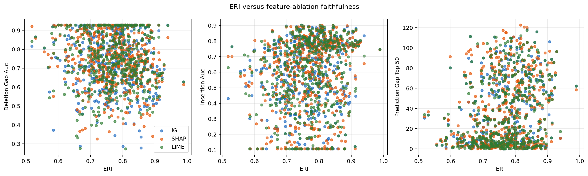
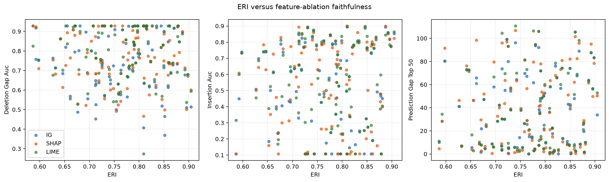
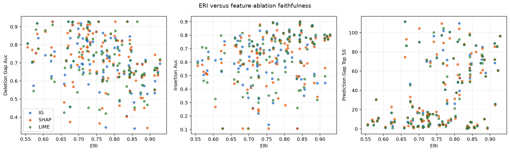
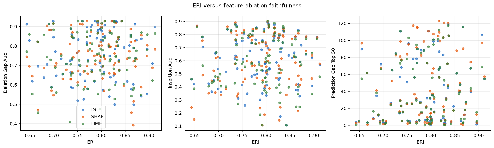
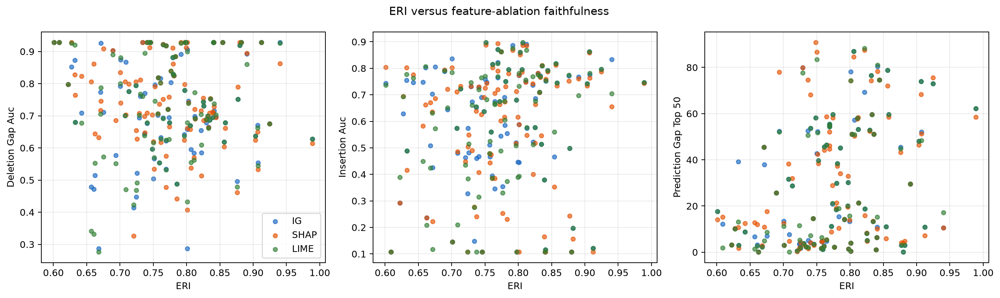
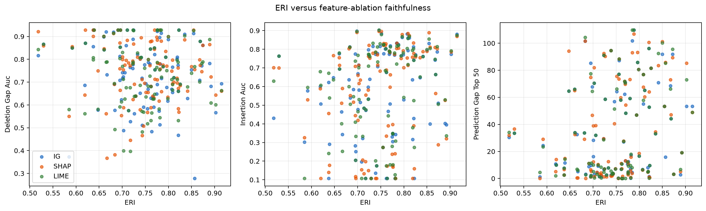

# ERI Faithfulness Benchmark: FD001 / gru / RUL

- Model checkpoint seed(s): 42, 43, 44, 45, 46
- Explanation/perturbation RNG seed(s): 42, 43, 44, 45, 46
- Evaluated sample-seed rows: 500
- Seed scope: distinct seed-specific checkpoints were evaluated.
- The training seed controls both model initialization and the engine-wise train/validation split, so seed contrasts include both sources of variation.
- Engine-mean Pearson outcomes after BH adjustment: positive ERI association for top-50% prediction gap in 3/3 explainers, for insertion AUC in 3/3, and negative association for deletion-gap AUC in 0/3.
- Across seed-specific engine-mean tests (BH adjusted within each seed): positive top-50% prediction-gap associations in 5/15 explainer-seed tests, positive insertion-AUC associations in 2/15, and negative deletion-gap-AUC associations in 3/15.
- Attribution perturbation baseline: zero (standardized feature value)
- Deletion-gap AUC: larger normalized prediction change after removing top-ranked sensors is better (opposite direction to the conventional residual-prediction deletion AUC).
- Insertion AUC: higher fidelity to the full prediction while adding top-ranked sensors is better.
- Prediction gap: absolute prediction change after ablating the top 50% sensors.
- Agreement metrics are computed pairwise among IG, SHAP, and a LIME-style masking surrogate.
- ERI remains an agreement score; its attention component reweights IG, so correlations are validation evidence, not proof of causal faithfulness.
- The report includes correlations across sample-seed rows, after averaging within engine across all seeds, and separately after averaging within engine for each model seed. Use the per-seed engine means to assess consistency across checkpoints; the pooled engine mean can hide seed-specific differences.

## ERI-faithfulness correlations

| Analysis level | Agreement predictor | Faithfulness explainer | Faithfulness metric | n | Pearson r | Pearson p | Pearson q (BH) | Spearman rho | Spearman p | Spearman q (BH) |
|---|---|---|---|---:|---:|---:|---:|---:|---:|---:|
| sample-seed | eri | ig | prediction_gap_top_50 | 500 | 0.2297 | 2.063e-07 | 7.428e-06 | 0.2079 | 2.755e-06 | 3.306e-05 |
| sample-seed | eri | ig | deletion_gap_auc | 500 | -0.1037 | 0.02043 | 0.06396 | -0.0982 | 0.02805 | 0.09181 |
| sample-seed | eri | ig | insertion_auc | 500 | 0.1318 | 0.003146 | 0.01333 | 0.1666 | 0.0001823 | 0.00101 |
| sample-seed | eri | shap | prediction_gap_top_50 | 500 | 0.2237 | 4.324e-07 | 1.038e-05 | 0.2103 | 2.094e-06 | 3.306e-05 |
| sample-seed | eri | shap | deletion_gap_auc | 500 | -0.1439 | 0.001249 | 0.006422 | -0.1340 | 0.00267 | 0.01201 |
| sample-seed | eri | shap | insertion_auc | 500 | 0.1415 | 0.001512 | 0.007255 | 0.1734 | 9.756e-05 | 0.0006385 |
| sample-seed | eri | lime | prediction_gap_top_50 | 500 | 0.2471 | 2.168e-08 | 1.561e-06 | 0.2359 | 9.477e-08 | 6.824e-06 |
| sample-seed | eri | lime | deletion_gap_auc | 500 | -0.0572 | 0.2015 | 0.3589 | -0.0634 | 0.1569 | 0.2689 |
| sample-seed | eri | lime | insertion_auc | 500 | 0.1310 | 0.003335 | 0.01334 | 0.1618 | 0.00028 | 0.001344 |
| sample-seed | agreement_ig__lime_rank_agreement_top_k | ig | prediction_gap_top_50 | 500 | 0.2140 | 1.366e-06 | 1.662e-05 | 0.1970 | 9.118e-06 | 9.379e-05 |
| sample-seed | agreement_ig__lime_rank_agreement_top_k | ig | deletion_gap_auc | 500 | -0.0336 | 0.4539 | 0.5975 | -0.0832 | 0.06312 | 0.1623 |
| sample-seed | agreement_ig__lime_rank_agreement_top_k | ig | insertion_auc | 500 | 0.2096 | 2.281e-06 | 2.053e-05 | 0.1826 | 3.999e-05 | 0.0003599 |
| sample-seed | agreement_ig__lime_rank_agreement_top_k | shap | prediction_gap_top_50 | 500 | 0.2138 | 1.402e-06 | 1.662e-05 | 0.2213 | 5.795e-07 | 2.086e-05 |
| sample-seed | agreement_ig__lime_rank_agreement_top_k | shap | deletion_gap_auc | 500 | 0.0215 | 0.6319 | 0.7 | 0.0056 | 0.9014 | 0.9352 |
| sample-seed | agreement_ig__lime_rank_agreement_top_k | shap | insertion_auc | 500 | 0.1742 | 9.051e-05 | 0.0007054 | 0.1701 | 0.0001326 | 0.0007956 |
| sample-seed | agreement_ig__lime_rank_agreement_top_k | lime | prediction_gap_top_50 | 500 | 0.2126 | 1.616e-06 | 1.662e-05 | 0.2173 | 9.297e-07 | 2.231e-05 |
| sample-seed | agreement_ig__lime_rank_agreement_top_k | lime | deletion_gap_auc | 500 | 0.0064 | 0.8864 | 0.9386 | -0.0122 | 0.7864 | 0.8847 |
| sample-seed | agreement_ig__lime_rank_agreement_top_k | lime | insertion_auc | 500 | 0.2150 | 1.227e-06 | 1.662e-05 | 0.2092 | 2.367e-06 | 3.306e-05 |
| sample-seed | agreement_ig__lime_rank_correlation_spearman | ig | prediction_gap_top_50 | 500 | 0.1733 | 9.797e-05 | 0.0007054 | 0.1656 | 0.0001989 | 0.001023 |
| sample-seed | agreement_ig__lime_rank_correlation_spearman | ig | deletion_gap_auc | 500 | 0.0321 | 0.4739 | 0.6093 | -0.0476 | 0.2884 | 0.4277 |
| sample-seed | agreement_ig__lime_rank_correlation_spearman | ig | insertion_auc | 500 | 0.1550 | 0.0005049 | 0.003305 | 0.1165 | 0.009106 | 0.03451 |
| sample-seed | agreement_ig__lime_rank_correlation_spearman | shap | prediction_gap_top_50 | 500 | 0.1493 | 0.0008138 | 0.004507 | 0.1783 | 6.087e-05 | 0.0004382 |
| sample-seed | agreement_ig__lime_rank_correlation_spearman | shap | deletion_gap_auc | 500 | -0.0035 | 0.937 | 0.9638 | -0.0105 | 0.8143 | 0.8884 |
| sample-seed | agreement_ig__lime_rank_correlation_spearman | shap | insertion_auc | 500 | 0.1140 | 0.01074 | 0.03867 | 0.1191 | 0.007695 | 0.03078 |
| sample-seed | agreement_ig__lime_rank_correlation_spearman | lime | prediction_gap_top_50 | 500 | 0.1530 | 0.0005989 | 0.003593 | 0.1810 | 4.706e-05 | 0.0003765 |
| sample-seed | agreement_ig__lime_rank_correlation_spearman | lime | deletion_gap_auc | 500 | 0.0037 | 0.9343 | 0.9638 | -0.0142 | 0.7507 | 0.8579 |
| sample-seed | agreement_ig__lime_rank_correlation_spearman | lime | insertion_auc | 500 | 0.1384 | 0.00193 | 0.008683 | 0.1283 | 0.004049 | 0.01715 |
| sample-seed | agreement_ig__lime_sign_agreement_top_k | ig | prediction_gap_top_50 | 499 | nan | nan | nan | nan | nan | nan |
| sample-seed | agreement_ig__lime_sign_agreement_top_k | ig | deletion_gap_auc | 499 | nan | nan | nan | nan | nan | nan |
| sample-seed | agreement_ig__lime_sign_agreement_top_k | ig | insertion_auc | 499 | nan | nan | nan | nan | nan | nan |
| sample-seed | agreement_ig__lime_sign_agreement_top_k | shap | prediction_gap_top_50 | 499 | nan | nan | nan | nan | nan | nan |
| sample-seed | agreement_ig__lime_sign_agreement_top_k | shap | deletion_gap_auc | 499 | nan | nan | nan | nan | nan | nan |
| sample-seed | agreement_ig__lime_sign_agreement_top_k | shap | insertion_auc | 499 | nan | nan | nan | nan | nan | nan |
| sample-seed | agreement_ig__lime_sign_agreement_top_k | lime | prediction_gap_top_50 | 499 | nan | nan | nan | nan | nan | nan |
| sample-seed | agreement_ig__lime_sign_agreement_top_k | lime | deletion_gap_auc | 499 | nan | nan | nan | nan | nan | nan |
| sample-seed | agreement_ig__lime_sign_agreement_top_k | lime | insertion_auc | 499 | nan | nan | nan | nan | nan | nan |
| sample-seed | agreement_ig__shap_rank_agreement_top_k | ig | prediction_gap_top_50 | 500 | 0.0423 | 0.3456 | 0.5165 | 0.0209 | 0.6417 | 0.7701 |
| sample-seed | agreement_ig__shap_rank_agreement_top_k | ig | deletion_gap_auc | 500 | 0.0358 | 0.4247 | 0.588 | 0.0084 | 0.8512 | 0.9012 |
| sample-seed | agreement_ig__shap_rank_agreement_top_k | ig | insertion_auc | 500 | 0.0872 | 0.05143 | 0.1234 | 0.0725 | 0.1055 | 0.2233 |
| sample-seed | agreement_ig__shap_rank_agreement_top_k | shap | prediction_gap_top_50 | 500 | 0.0228 | 0.6112 | 0.6895 | 0.0272 | 0.5434 | 0.6659 |
| sample-seed | agreement_ig__shap_rank_agreement_top_k | shap | deletion_gap_auc | 500 | 0.0362 | 0.419 | 0.588 | 0.0325 | 0.4683 | 0.6021 |
| sample-seed | agreement_ig__shap_rank_agreement_top_k | shap | insertion_auc | 500 | 0.0621 | 0.1655 | 0.3135 | 0.0573 | 0.201 | 0.329 |
| sample-seed | agreement_ig__shap_rank_agreement_top_k | lime | prediction_gap_top_50 | 500 | 0.0388 | 0.3863 | 0.5562 | 0.0437 | 0.329 | 0.4645 |
| sample-seed | agreement_ig__shap_rank_agreement_top_k | lime | deletion_gap_auc | 500 | 0.0454 | 0.3111 | 0.4869 | 0.0361 | 0.4199 | 0.5599 |
| sample-seed | agreement_ig__shap_rank_agreement_top_k | lime | insertion_auc | 500 | 0.1017 | 0.02301 | 0.06902 | 0.0923 | 0.0391 | 0.1083 |
| sample-seed | agreement_ig__shap_rank_correlation_spearman | ig | prediction_gap_top_50 | 500 | -0.0174 | 0.6987 | 0.7574 | -0.0760 | 0.08941 | 0.2186 |
| sample-seed | agreement_ig__shap_rank_correlation_spearman | ig | deletion_gap_auc | 500 | 0.1200 | 0.007202 | 0.02729 | 0.1016 | 0.02309 | 0.07945 |
| sample-seed | agreement_ig__shap_rank_correlation_spearman | ig | insertion_auc | 500 | 0.0227 | 0.6129 | 0.6895 | -0.0051 | 0.9092 | 0.9352 |
| sample-seed | agreement_ig__shap_rank_correlation_spearman | shap | prediction_gap_top_50 | 500 | -0.0630 | 0.1599 | 0.3135 | -0.0915 | 0.04074 | 0.1086 |
| sample-seed | agreement_ig__shap_rank_correlation_spearman | shap | deletion_gap_auc | 500 | 0.0791 | 0.07734 | 0.1796 | 0.0752 | 0.09309 | 0.2186 |
| sample-seed | agreement_ig__shap_rank_correlation_spearman | shap | insertion_auc | 500 | -0.0018 | 0.9676 | 0.9709 | -0.0113 | 0.8018 | 0.8882 |
| sample-seed | agreement_ig__shap_rank_correlation_spearman | lime | prediction_gap_top_50 | 500 | -0.0336 | 0.4536 | 0.5975 | -0.0649 | 0.1475 | 0.259 |
| sample-seed | agreement_ig__shap_rank_correlation_spearman | lime | deletion_gap_auc | 500 | 0.0926 | 0.03846 | 0.1026 | 0.0934 | 0.03685 | 0.1061 |
| sample-seed | agreement_ig__shap_rank_correlation_spearman | lime | insertion_auc | 500 | 0.0264 | 0.5552 | 0.6695 | 0.0144 | 0.7479 | 0.8579 |
| sample-seed | agreement_ig__shap_sign_agreement_top_k | ig | prediction_gap_top_50 | 499 | nan | nan | nan | nan | nan | nan |
| sample-seed | agreement_ig__shap_sign_agreement_top_k | ig | deletion_gap_auc | 499 | nan | nan | nan | nan | nan | nan |
| sample-seed | agreement_ig__shap_sign_agreement_top_k | ig | insertion_auc | 499 | nan | nan | nan | nan | nan | nan |
| sample-seed | agreement_ig__shap_sign_agreement_top_k | shap | prediction_gap_top_50 | 499 | nan | nan | nan | nan | nan | nan |
| sample-seed | agreement_ig__shap_sign_agreement_top_k | shap | deletion_gap_auc | 499 | nan | nan | nan | nan | nan | nan |
| sample-seed | agreement_ig__shap_sign_agreement_top_k | shap | insertion_auc | 499 | nan | nan | nan | nan | nan | nan |
| sample-seed | agreement_ig__shap_sign_agreement_top_k | lime | prediction_gap_top_50 | 499 | nan | nan | nan | nan | nan | nan |
| sample-seed | agreement_ig__shap_sign_agreement_top_k | lime | deletion_gap_auc | 499 | nan | nan | nan | nan | nan | nan |
| sample-seed | agreement_ig__shap_sign_agreement_top_k | lime | insertion_auc | 499 | nan | nan | nan | nan | nan | nan |
| sample-seed | agreement_shap__lime_rank_agreement_top_k | ig | prediction_gap_top_50 | 500 | -0.0016 | 0.9709 | 0.9709 | 0.0031 | 0.9454 | 0.9588 |
| sample-seed | agreement_shap__lime_rank_agreement_top_k | ig | deletion_gap_auc | 500 | 0.0872 | 0.05138 | 0.1234 | 0.0943 | 0.0351 | 0.1061 |
| sample-seed | agreement_shap__lime_rank_agreement_top_k | ig | insertion_auc | 500 | 0.0269 | 0.5481 | 0.6695 | 0.0410 | 0.3598 | 0.4982 |
| sample-seed | agreement_shap__lime_rank_agreement_top_k | shap | prediction_gap_top_50 | 500 | 0.0170 | 0.7048 | 0.7574 | 0.0178 | 0.6916 | 0.8164 |
| sample-seed | agreement_shap__lime_rank_agreement_top_k | shap | deletion_gap_auc | 500 | 0.0776 | 0.08318 | 0.1815 | 0.0750 | 0.09411 | 0.2186 |
| sample-seed | agreement_shap__lime_rank_agreement_top_k | shap | insertion_auc | 500 | 0.0236 | 0.5982 | 0.6895 | 0.0271 | 0.5457 | 0.6659 |
| sample-seed | agreement_shap__lime_rank_agreement_top_k | lime | prediction_gap_top_50 | 500 | 0.0277 | 0.5371 | 0.6695 | 0.0369 | 0.4099 | 0.5568 |
| sample-seed | agreement_shap__lime_rank_agreement_top_k | lime | deletion_gap_auc | 500 | 0.1120 | 0.01225 | 0.04199 | 0.1015 | 0.02317 | 0.07945 |
| sample-seed | agreement_shap__lime_rank_agreement_top_k | lime | insertion_auc | 500 | 0.0673 | 0.1326 | 0.2809 | 0.0660 | 0.1403 | 0.254 |
| sample-seed | agreement_shap__lime_rank_correlation_spearman | ig | prediction_gap_top_50 | 500 | 0.0256 | 0.5673 | 0.6695 | -0.0090 | 0.8414 | 0.9012 |
| sample-seed | agreement_shap__lime_rank_correlation_spearman | ig | deletion_gap_auc | 500 | 0.0491 | 0.273 | 0.4572 | 0.0554 | 0.2164 | 0.3463 |
| sample-seed | agreement_shap__lime_rank_correlation_spearman | ig | insertion_auc | 500 | 0.0334 | 0.4564 | 0.5975 | 0.0338 | 0.4506 | 0.5899 |
| sample-seed | agreement_shap__lime_rank_correlation_spearman | shap | prediction_gap_top_50 | 500 | 0.0261 | 0.5611 | 0.6695 | -0.0007 | 0.9883 | 0.9883 |
| sample-seed | agreement_shap__lime_rank_correlation_spearman | shap | deletion_gap_auc | 500 | 0.0780 | 0.08156 | 0.1815 | 0.0609 | 0.1741 | 0.2915 |
| sample-seed | agreement_shap__lime_rank_correlation_spearman | shap | insertion_auc | 500 | 0.0538 | 0.2297 | 0.3938 | 0.0517 | 0.2489 | 0.3816 |
| sample-seed | agreement_shap__lime_rank_correlation_spearman | lime | prediction_gap_top_50 | 500 | 0.0569 | 0.2044 | 0.3589 | 0.0272 | 0.5446 | 0.6659 |
| sample-seed | agreement_shap__lime_rank_correlation_spearman | lime | deletion_gap_auc | 500 | 0.1083 | 0.01536 | 0.05026 | 0.0938 | 0.03602 | 0.1061 |
| sample-seed | agreement_shap__lime_rank_correlation_spearman | lime | insertion_auc | 500 | 0.0889 | 0.04699 | 0.1208 | 0.0692 | 0.1225 | 0.232 |
| sample-seed | agreement_shap__lime_sign_agreement_top_k | ig | prediction_gap_top_50 | 500 | 0.0433 | 0.3344 | 0.5122 | 0.0516 | 0.2491 | 0.3816 |
| sample-seed | agreement_shap__lime_sign_agreement_top_k | ig | deletion_gap_auc | 500 | -0.0599 | 0.1808 | 0.3338 | -0.0695 | 0.1206 | 0.232 |
| sample-seed | agreement_shap__lime_sign_agreement_top_k | ig | insertion_auc | 500 | 0.0978 | 0.02869 | 0.08002 | 0.0730 | 0.1028 | 0.2233 |
| sample-seed | agreement_shap__lime_sign_agreement_top_k | shap | prediction_gap_top_50 | 500 | 0.0418 | 0.3515 | 0.5165 | 0.0445 | 0.3206 | 0.4617 |
| sample-seed | agreement_shap__lime_sign_agreement_top_k | shap | deletion_gap_auc | 500 | -0.0623 | 0.1641 | 0.3135 | -0.0704 | 0.1157 | 0.232 |
| sample-seed | agreement_shap__lime_sign_agreement_top_k | shap | insertion_auc | 500 | 0.0456 | 0.3091 | 0.4869 | 0.0473 | 0.2911 | 0.4277 |
| sample-seed | agreement_shap__lime_sign_agreement_top_k | lime | prediction_gap_top_50 | 500 | 0.0454 | 0.3106 | 0.4869 | 0.0659 | 0.1411 | 0.254 |
| sample-seed | agreement_shap__lime_sign_agreement_top_k | lime | deletion_gap_auc | 500 | -0.0622 | 0.1651 | 0.3135 | -0.0695 | 0.1206 | 0.232 |
| sample-seed | agreement_shap__lime_sign_agreement_top_k | lime | insertion_auc | 500 | 0.0977 | 0.0289 | 0.08002 | 0.0737 | 0.0999 | 0.2233 |
| engine-mean | eri | ig | prediction_gap_top_50 | 100 | 0.3685 | 0.0001621 | 0.001297 | 0.3050 | 0.002032 | 0.01219 |
| engine-mean | eri | ig | deletion_gap_auc | 100 | -0.2079 | 0.03792 | 0.1116 | -0.2213 | 0.02695 | 0.08821 |
| engine-mean | eri | ig | insertion_auc | 100 | 0.3046 | 0.002064 | 0.01238 | 0.3272 | 0.0008911 | 0.006416 |
| engine-mean | eri | shap | prediction_gap_top_50 | 100 | 0.3687 | 0.0001602 | 0.001297 | 0.2911 | 0.003304 | 0.01586 |
| engine-mean | eri | shap | deletion_gap_auc | 100 | -0.2135 | 0.03293 | 0.1031 | -0.2219 | 0.0265 | 0.08821 |
| engine-mean | eri | shap | insertion_auc | 100 | 0.3284 | 0.00085 | 0.005844 | 0.3337 | 0.0006929 | 0.005543 |
| engine-mean | eri | lime | prediction_gap_top_50 | 100 | 0.3851 | 7.608e-05 | 0.0007826 | 0.3443 | 0.0004515 | 0.004234 |
| engine-mean | eri | lime | deletion_gap_auc | 100 | -0.1165 | 0.2482 | 0.4877 | -0.0966 | 0.339 | 0.5532 |
| engine-mean | eri | lime | insertion_auc | 100 | 0.3272 | 0.0008928 | 0.005844 | 0.3433 | 0.0004704 | 0.004234 |
| engine-mean | agreement_ig__lime_rank_agreement_top_k | ig | prediction_gap_top_50 | 100 | 0.3988 | 3.964e-05 | 0.0005708 | 0.3560 | 0.0002784 | 0.003341 |
| engine-mean | agreement_ig__lime_rank_agreement_top_k | ig | deletion_gap_auc | 100 | -0.2646 | 0.0078 | 0.0351 | -0.2350 | 0.01859 | 0.06693 |
| engine-mean | agreement_ig__lime_rank_agreement_top_k | ig | insertion_auc | 100 | 0.3921 | 5.477e-05 | 0.0006573 | 0.3676 | 0.0001683 | 0.00282 |
| engine-mean | agreement_ig__lime_rank_agreement_top_k | shap | prediction_gap_top_50 | 100 | 0.4212 | 1.276e-05 | 0.0003415 | 0.3823 | 8.686e-05 | 0.002085 |
| engine-mean | agreement_ig__lime_rank_agreement_top_k | shap | deletion_gap_auc | 100 | -0.0806 | 0.4254 | 0.6251 | -0.0640 | 0.5268 | 0.7078 |
| engine-mean | agreement_ig__lime_rank_agreement_top_k | shap | insertion_auc | 100 | 0.4136 | 1.897e-05 | 0.0003415 | 0.3641 | 0.0001959 | 0.00282 |
| engine-mean | agreement_ig__lime_rank_agreement_top_k | lime | prediction_gap_top_50 | 100 | 0.4187 | 1.455e-05 | 0.0003415 | 0.4017 | 3.438e-05 | 0.002085 |
| engine-mean | agreement_ig__lime_rank_agreement_top_k | lime | deletion_gap_auc | 100 | -0.1829 | 0.06857 | 0.179 | -0.1359 | 0.1775 | 0.3759 |
| engine-mean | agreement_ig__lime_rank_agreement_top_k | lime | insertion_auc | 100 | 0.4268 | 9.523e-06 | 0.0003415 | 0.3863 | 7.213e-05 | 0.002085 |
| engine-mean | agreement_ig__lime_rank_correlation_spearman | ig | prediction_gap_top_50 | 100 | 0.2775 | 0.005184 | 0.02488 | 0.2912 | 0.003291 | 0.01586 |
| engine-mean | agreement_ig__lime_rank_correlation_spearman | ig | deletion_gap_auc | 100 | -0.0355 | 0.7262 | 0.8008 | -0.0403 | 0.6907 | 0.8021 |
| engine-mean | agreement_ig__lime_rank_correlation_spearman | ig | insertion_auc | 100 | 0.2444 | 0.01428 | 0.05142 | 0.2481 | 0.0128 | 0.05422 |
| engine-mean | agreement_ig__lime_rank_correlation_spearman | shap | prediction_gap_top_50 | 100 | 0.2866 | 0.003839 | 0.02126 | 0.2912 | 0.003289 | 0.01586 |
| engine-mean | agreement_ig__lime_rank_correlation_spearman | shap | deletion_gap_auc | 100 | 0.0172 | 0.8651 | 0.916 | 0.0122 | 0.9039 | 0.9758 |
| engine-mean | agreement_ig__lime_rank_correlation_spearman | shap | insertion_auc | 100 | 0.2589 | 0.009304 | 0.03722 | 0.2413 | 0.01559 | 0.05908 |
| engine-mean | agreement_ig__lime_rank_correlation_spearman | lime | prediction_gap_top_50 | 100 | 0.2830 | 0.004332 | 0.02228 | 0.3231 | 0.001043 | 0.006826 |
| engine-mean | agreement_ig__lime_rank_correlation_spearman | lime | deletion_gap_auc | 100 | 0.0053 | 0.958 | 0.9755 | 0.0082 | 0.9352 | 0.9758 |
| engine-mean | agreement_ig__lime_rank_correlation_spearman | lime | insertion_auc | 100 | 0.2518 | 0.0115 | 0.0436 | 0.2440 | 0.01444 | 0.05777 |
| engine-mean | agreement_ig__lime_sign_agreement_top_k | ig | prediction_gap_top_50 | 100 | nan | nan | nan | nan | nan | nan |
| engine-mean | agreement_ig__lime_sign_agreement_top_k | ig | deletion_gap_auc | 100 | nan | nan | nan | nan | nan | nan |
| engine-mean | agreement_ig__lime_sign_agreement_top_k | ig | insertion_auc | 100 | nan | nan | nan | nan | nan | nan |
| engine-mean | agreement_ig__lime_sign_agreement_top_k | shap | prediction_gap_top_50 | 100 | nan | nan | nan | nan | nan | nan |
| engine-mean | agreement_ig__lime_sign_agreement_top_k | shap | deletion_gap_auc | 100 | nan | nan | nan | nan | nan | nan |
| engine-mean | agreement_ig__lime_sign_agreement_top_k | shap | insertion_auc | 100 | nan | nan | nan | nan | nan | nan |
| engine-mean | agreement_ig__lime_sign_agreement_top_k | lime | prediction_gap_top_50 | 100 | nan | nan | nan | nan | nan | nan |
| engine-mean | agreement_ig__lime_sign_agreement_top_k | lime | deletion_gap_auc | 100 | nan | nan | nan | nan | nan | nan |
| engine-mean | agreement_ig__lime_sign_agreement_top_k | lime | insertion_auc | 100 | nan | nan | nan | nan | nan | nan |
| engine-mean | agreement_ig__shap_rank_agreement_top_k | ig | prediction_gap_top_50 | 100 | 0.0738 | 0.4655 | 0.6446 | 0.0718 | 0.4777 | 0.6614 |
| engine-mean | agreement_ig__shap_rank_agreement_top_k | ig | deletion_gap_auc | 100 | 0.0926 | 0.3594 | 0.5626 | 0.0780 | 0.4403 | 0.6341 |
| engine-mean | agreement_ig__shap_rank_agreement_top_k | ig | insertion_auc | 100 | 0.1531 | 0.1282 | 0.2715 | 0.1615 | 0.1083 | 0.26 |
| engine-mean | agreement_ig__shap_rank_agreement_top_k | shap | prediction_gap_top_50 | 100 | 0.0604 | 0.5504 | 0.7082 | 0.0728 | 0.4714 | 0.6614 |
| engine-mean | agreement_ig__shap_rank_agreement_top_k | shap | deletion_gap_auc | 100 | 0.1632 | 0.1047 | 0.2355 | 0.1366 | 0.1754 | 0.3759 |
| engine-mean | agreement_ig__shap_rank_agreement_top_k | shap | insertion_auc | 100 | 0.1775 | 0.0772 | 0.1853 | 0.1627 | 0.1058 | 0.26 |
| engine-mean | agreement_ig__shap_rank_agreement_top_k | lime | prediction_gap_top_50 | 100 | 0.0854 | 0.3982 | 0.61 | 0.0953 | 0.3458 | 0.5532 |
| engine-mean | agreement_ig__shap_rank_agreement_top_k | lime | deletion_gap_auc | 100 | 0.1558 | 0.1216 | 0.2652 | 0.1629 | 0.1054 | 0.26 |
| engine-mean | agreement_ig__shap_rank_agreement_top_k | lime | insertion_auc | 100 | 0.1822 | 0.06962 | 0.179 | 0.1788 | 0.07511 | 0.2003 |
| engine-mean | agreement_ig__shap_rank_correlation_spearman | ig | prediction_gap_top_50 | 100 | -0.0589 | 0.5607 | 0.7082 | -0.0809 | 0.4235 | 0.6222 |
| engine-mean | agreement_ig__shap_rank_correlation_spearman | ig | deletion_gap_auc | 100 | 0.2194 | 0.02833 | 0.09669 | 0.2027 | 0.0431 | 0.1259 |
| engine-mean | agreement_ig__shap_rank_correlation_spearman | ig | insertion_auc | 100 | 0.0092 | 0.9274 | 0.9677 | 0.0100 | 0.9214 | 0.9758 |
| engine-mean | agreement_ig__shap_rank_correlation_spearman | shap | prediction_gap_top_50 | 100 | -0.0940 | 0.3521 | 0.5626 | -0.1137 | 0.26 | 0.4567 |
| engine-mean | agreement_ig__shap_rank_correlation_spearman | shap | deletion_gap_auc | 100 | 0.2177 | 0.02954 | 0.09669 | 0.2021 | 0.04373 | 0.1259 |
| engine-mean | agreement_ig__shap_rank_correlation_spearman | shap | insertion_auc | 100 | 0.0031 | 0.9755 | 0.9755 | -0.0047 | 0.9628 | 0.9764 |
| engine-mean | agreement_ig__shap_rank_correlation_spearman | lime | prediction_gap_top_50 | 100 | -0.0487 | 0.6302 | 0.7529 | -0.0589 | 0.5607 | 0.7126 |
| engine-mean | agreement_ig__shap_rank_correlation_spearman | lime | deletion_gap_auc | 100 | 0.2619 | 0.008474 | 0.03589 | 0.2503 | 0.01202 | 0.05407 |
| engine-mean | agreement_ig__shap_rank_correlation_spearman | lime | insertion_auc | 100 | 0.0198 | 0.8449 | 0.908 | 0.0204 | 0.8407 | 0.9458 |
| engine-mean | agreement_ig__shap_sign_agreement_top_k | ig | prediction_gap_top_50 | 100 | nan | nan | nan | nan | nan | nan |
| engine-mean | agreement_ig__shap_sign_agreement_top_k | ig | deletion_gap_auc | 100 | nan | nan | nan | nan | nan | nan |
| engine-mean | agreement_ig__shap_sign_agreement_top_k | ig | insertion_auc | 100 | nan | nan | nan | nan | nan | nan |
| engine-mean | agreement_ig__shap_sign_agreement_top_k | shap | prediction_gap_top_50 | 100 | nan | nan | nan | nan | nan | nan |
| engine-mean | agreement_ig__shap_sign_agreement_top_k | shap | deletion_gap_auc | 100 | nan | nan | nan | nan | nan | nan |
| engine-mean | agreement_ig__shap_sign_agreement_top_k | shap | insertion_auc | 100 | nan | nan | nan | nan | nan | nan |
| engine-mean | agreement_ig__shap_sign_agreement_top_k | lime | prediction_gap_top_50 | 100 | nan | nan | nan | nan | nan | nan |
| engine-mean | agreement_ig__shap_sign_agreement_top_k | lime | deletion_gap_auc | 100 | nan | nan | nan | nan | nan | nan |
| engine-mean | agreement_ig__shap_sign_agreement_top_k | lime | insertion_auc | 100 | nan | nan | nan | nan | nan | nan |
| engine-mean | agreement_shap__lime_rank_agreement_top_k | ig | prediction_gap_top_50 | 100 | 0.0436 | 0.6663 | 0.7529 | 0.0349 | 0.7306 | 0.8349 |
| engine-mean | agreement_shap__lime_rank_agreement_top_k | ig | deletion_gap_auc | 100 | 0.1131 | 0.2625 | 0.4974 | 0.0958 | 0.343 | 0.5532 |
| engine-mean | agreement_shap__lime_rank_agreement_top_k | ig | insertion_auc | 100 | 0.0495 | 0.6251 | 0.7529 | 0.0570 | 0.573 | 0.7126 |
| engine-mean | agreement_shap__lime_rank_agreement_top_k | shap | prediction_gap_top_50 | 100 | 0.0344 | 0.7341 | 0.8008 | 0.0165 | 0.8705 | 0.9642 |
| engine-mean | agreement_shap__lime_rank_agreement_top_k | shap | deletion_gap_auc | 100 | 0.1744 | 0.08276 | 0.1922 | 0.1155 | 0.2525 | 0.4567 |
| engine-mean | agreement_shap__lime_rank_agreement_top_k | shap | insertion_auc | 100 | 0.0678 | 0.5028 | 0.6704 | 0.0541 | 0.5928 | 0.7126 |
| engine-mean | agreement_shap__lime_rank_agreement_top_k | lime | prediction_gap_top_50 | 100 | 0.0691 | 0.4944 | 0.6704 | 0.0634 | 0.5308 | 0.7078 |
| engine-mean | agreement_shap__lime_rank_agreement_top_k | lime | deletion_gap_auc | 100 | 0.1848 | 0.06568 | 0.179 | 0.1876 | 0.06166 | 0.1708 |
| engine-mean | agreement_shap__lime_rank_agreement_top_k | lime | insertion_auc | 100 | 0.0937 | 0.3538 | 0.5626 | 0.0927 | 0.3592 | 0.5623 |
| engine-mean | agreement_shap__lime_rank_correlation_spearman | ig | prediction_gap_top_50 | 100 | 0.0747 | 0.4601 | 0.6446 | 0.0887 | 0.3799 | 0.5699 |
| engine-mean | agreement_shap__lime_rank_correlation_spearman | ig | deletion_gap_auc | 100 | 0.1160 | 0.2506 | 0.4877 | 0.1122 | 0.2664 | 0.4567 |
| engine-mean | agreement_shap__lime_rank_correlation_spearman | ig | insertion_auc | 100 | 0.1061 | 0.2936 | 0.5391 | 0.1281 | 0.2041 | 0.4199 |
| engine-mean | agreement_shap__lime_rank_correlation_spearman | shap | prediction_gap_top_50 | 100 | 0.0593 | 0.5581 | 0.7082 | 0.0565 | 0.5765 | 0.7126 |
| engine-mean | agreement_shap__lime_rank_correlation_spearman | shap | deletion_gap_auc | 100 | 0.1801 | 0.073 | 0.1812 | 0.1495 | 0.1377 | 0.3099 |
| engine-mean | agreement_shap__lime_rank_correlation_spearman | shap | insertion_auc | 100 | 0.1003 | 0.3208 | 0.5399 | 0.1164 | 0.2488 | 0.4567 |
| engine-mean | agreement_shap__lime_rank_correlation_spearman | lime | prediction_gap_top_50 | 100 | 0.1029 | 0.3085 | 0.5399 | 0.1156 | 0.2519 | 0.4567 |
| engine-mean | agreement_shap__lime_rank_correlation_spearman | lime | deletion_gap_auc | 100 | 0.2071 | 0.03874 | 0.1116 | 0.2180 | 0.02931 | 0.09176 |
| engine-mean | agreement_shap__lime_rank_correlation_spearman | lime | insertion_auc | 100 | 0.1354 | 0.1794 | 0.369 | 0.1547 | 0.1243 | 0.2886 |
| engine-mean | agreement_shap__lime_sign_agreement_top_k | ig | prediction_gap_top_50 | 100 | 0.0446 | 0.6597 | 0.7529 | 0.0087 | 0.9315 | 0.9758 |
| engine-mean | agreement_shap__lime_sign_agreement_top_k | ig | deletion_gap_auc | 100 | -0.1048 | 0.2995 | 0.5391 | -0.1166 | 0.2478 | 0.4567 |
| engine-mean | agreement_shap__lime_sign_agreement_top_k | ig | insertion_auc | 100 | 0.0562 | 0.5785 | 0.7182 | 0.0540 | 0.5938 | 0.7126 |
| engine-mean | agreement_shap__lime_sign_agreement_top_k | shap | prediction_gap_top_50 | 100 | 0.0432 | 0.6693 | 0.7529 | -0.0052 | 0.9589 | 0.9764 |
| engine-mean | agreement_shap__lime_sign_agreement_top_k | shap | deletion_gap_auc | 100 | -0.1000 | 0.3224 | 0.5399 | -0.1132 | 0.2623 | 0.4567 |
| engine-mean | agreement_shap__lime_sign_agreement_top_k | shap | insertion_auc | 100 | -0.0042 | 0.9668 | 0.9755 | 0.0017 | 0.9863 | 0.9863 |
| engine-mean | agreement_shap__lime_sign_agreement_top_k | lime | prediction_gap_top_50 | 100 | 0.0820 | 0.4171 | 0.6251 | 0.0540 | 0.5938 | 0.7126 |
| engine-mean | agreement_shap__lime_sign_agreement_top_k | lime | deletion_gap_auc | 100 | -0.0786 | 0.4371 | 0.6294 | -0.0888 | 0.3797 | 0.5699 |
| engine-mean | agreement_shap__lime_sign_agreement_top_k | lime | insertion_auc | 100 | 0.0437 | 0.6663 | 0.7529 | 0.0435 | 0.6672 | 0.7876 |
| engine-mean-seed-42 | eri | ig | prediction_gap_top_50 | 100 | 0.0581 | 0.5658 | 0.884 | 0.0407 | 0.6879 | 0.9703 |
| engine-mean-seed-42 | eri | ig | deletion_gap_auc | 100 | -0.0374 | 0.7118 | 0.884 | -0.0015 | 0.9886 | 0.9886 |
| engine-mean-seed-42 | eri | ig | insertion_auc | 100 | 0.0648 | 0.5216 | 0.884 | 0.0919 | 0.3634 | 0.9703 |
| engine-mean-seed-42 | eri | shap | prediction_gap_top_50 | 100 | 0.0410 | 0.6856 | 0.884 | 0.0296 | 0.7697 | 0.9703 |
| engine-mean-seed-42 | eri | shap | deletion_gap_auc | 100 | -0.0705 | 0.4859 | 0.884 | -0.0338 | 0.7381 | 0.9703 |
| engine-mean-seed-42 | eri | shap | insertion_auc | 100 | 0.0369 | 0.7155 | 0.884 | 0.0696 | 0.4914 | 0.9703 |
| engine-mean-seed-42 | eri | lime | prediction_gap_top_50 | 100 | 0.0777 | 0.4424 | 0.884 | 0.0489 | 0.6287 | 0.9703 |
| engine-mean-seed-42 | eri | lime | deletion_gap_auc | 100 | -0.0421 | 0.6777 | 0.884 | -0.0089 | 0.9301 | 0.9886 |
| engine-mean-seed-42 | eri | lime | insertion_auc | 100 | 0.0374 | 0.7117 | 0.884 | 0.0541 | 0.5929 | 0.9703 |
| engine-mean-seed-42 | agreement_ig__lime_rank_agreement_top_k | ig | prediction_gap_top_50 | 100 | 0.2266 | 0.02337 | 0.2103 | 0.2118 | 0.03441 | 0.4517 |
| engine-mean-seed-42 | agreement_ig__lime_rank_agreement_top_k | ig | deletion_gap_auc | 100 | -0.1314 | 0.1926 | 0.8087 | -0.1761 | 0.07963 | 0.6271 |
| engine-mean-seed-42 | agreement_ig__lime_rank_agreement_top_k | ig | insertion_auc | 100 | 0.2815 | 0.004545 | 0.187 | 0.2384 | 0.01692 | 0.4225 |
| engine-mean-seed-42 | agreement_ig__lime_rank_agreement_top_k | shap | prediction_gap_top_50 | 100 | 0.2535 | 0.01093 | 0.2103 | 0.2321 | 0.02012 | 0.4225 |
| engine-mean-seed-42 | agreement_ig__lime_rank_agreement_top_k | shap | deletion_gap_auc | 100 | 0.0137 | 0.8925 | 0.9694 | 0.0023 | 0.982 | 0.9886 |
| engine-mean-seed-42 | agreement_ig__lime_rank_agreement_top_k | shap | insertion_auc | 100 | 0.2733 | 0.005937 | 0.187 | 0.2354 | 0.0184 | 0.4225 |
| engine-mean-seed-42 | agreement_ig__lime_rank_agreement_top_k | lime | prediction_gap_top_50 | 100 | 0.2278 | 0.02267 | 0.2103 | 0.2028 | 0.04305 | 0.452 |
| engine-mean-seed-42 | agreement_ig__lime_rank_agreement_top_k | lime | deletion_gap_auc | 100 | -0.0811 | 0.4227 | 0.884 | -0.0994 | 0.3253 | 0.9703 |
| engine-mean-seed-42 | agreement_ig__lime_rank_agreement_top_k | lime | insertion_auc | 100 | 0.2074 | 0.03845 | 0.2692 | 0.2102 | 0.03585 | 0.4517 |
| engine-mean-seed-42 | agreement_ig__lime_rank_correlation_spearman | ig | prediction_gap_top_50 | 100 | 0.2344 | 0.01891 | 0.2103 | 0.1769 | 0.07822 | 0.6271 |
| engine-mean-seed-42 | agreement_ig__lime_rank_correlation_spearman | ig | deletion_gap_auc | 100 | 0.0139 | 0.891 | 0.9694 | 0.0231 | 0.8196 | 0.9703 |
| engine-mean-seed-42 | agreement_ig__lime_rank_correlation_spearman | ig | insertion_auc | 100 | 0.2410 | 0.0157 | 0.2103 | 0.0969 | 0.3376 | 0.9703 |
| engine-mean-seed-42 | agreement_ig__lime_rank_correlation_spearman | shap | prediction_gap_top_50 | 100 | 0.2137 | 0.0328 | 0.2583 | 0.1687 | 0.09341 | 0.6538 |
| engine-mean-seed-42 | agreement_ig__lime_rank_correlation_spearman | shap | deletion_gap_auc | 100 | 0.0024 | 0.9808 | 0.9895 | 0.0419 | 0.6788 | 0.9703 |
| engine-mean-seed-42 | agreement_ig__lime_rank_correlation_spearman | shap | insertion_auc | 100 | 0.1794 | 0.0741 | 0.4453 | 0.0807 | 0.4246 | 0.9703 |
| engine-mean-seed-42 | agreement_ig__lime_rank_correlation_spearman | lime | prediction_gap_top_50 | 100 | 0.1772 | 0.07776 | 0.4453 | 0.1192 | 0.2373 | 0.9703 |
| engine-mean-seed-42 | agreement_ig__lime_rank_correlation_spearman | lime | deletion_gap_auc | 100 | -0.0598 | 0.5546 | 0.884 | -0.0195 | 0.8471 | 0.9703 |
| engine-mean-seed-42 | agreement_ig__lime_rank_correlation_spearman | lime | insertion_auc | 100 | 0.1403 | 0.1638 | 0.7939 | 0.0363 | 0.7202 | 0.9703 |
| engine-mean-seed-42 | agreement_ig__lime_sign_agreement_top_k | ig | prediction_gap_top_50 | 100 | nan | nan | nan | nan | nan | nan |
| engine-mean-seed-42 | agreement_ig__lime_sign_agreement_top_k | ig | deletion_gap_auc | 100 | nan | nan | nan | nan | nan | nan |
| engine-mean-seed-42 | agreement_ig__lime_sign_agreement_top_k | ig | insertion_auc | 100 | nan | nan | nan | nan | nan | nan |
| engine-mean-seed-42 | agreement_ig__lime_sign_agreement_top_k | shap | prediction_gap_top_50 | 100 | nan | nan | nan | nan | nan | nan |
| engine-mean-seed-42 | agreement_ig__lime_sign_agreement_top_k | shap | deletion_gap_auc | 100 | nan | nan | nan | nan | nan | nan |
| engine-mean-seed-42 | agreement_ig__lime_sign_agreement_top_k | shap | insertion_auc | 100 | nan | nan | nan | nan | nan | nan |
| engine-mean-seed-42 | agreement_ig__lime_sign_agreement_top_k | lime | prediction_gap_top_50 | 100 | nan | nan | nan | nan | nan | nan |
| engine-mean-seed-42 | agreement_ig__lime_sign_agreement_top_k | lime | deletion_gap_auc | 100 | nan | nan | nan | nan | nan | nan |
| engine-mean-seed-42 | agreement_ig__lime_sign_agreement_top_k | lime | insertion_auc | 100 | nan | nan | nan | nan | nan | nan |
| engine-mean-seed-42 | agreement_ig__shap_rank_agreement_top_k | ig | prediction_gap_top_50 | 100 | -0.0517 | 0.6098 | 0.884 | -0.0437 | 0.666 | 0.9703 |
| engine-mean-seed-42 | agreement_ig__shap_rank_agreement_top_k | ig | deletion_gap_auc | 100 | -0.0413 | 0.6833 | 0.884 | -0.0697 | 0.4906 | 0.9703 |
| engine-mean-seed-42 | agreement_ig__shap_rank_agreement_top_k | ig | insertion_auc | 100 | 0.1237 | 0.2201 | 0.8666 | 0.1218 | 0.2275 | 0.9703 |
| engine-mean-seed-42 | agreement_ig__shap_rank_agreement_top_k | shap | prediction_gap_top_50 | 100 | -0.0419 | 0.6793 | 0.884 | -0.0275 | 0.7858 | 0.9703 |
| engine-mean-seed-42 | agreement_ig__shap_rank_agreement_top_k | shap | deletion_gap_auc | 100 | 0.0601 | 0.5526 | 0.884 | 0.0276 | 0.7852 | 0.9703 |
| engine-mean-seed-42 | agreement_ig__shap_rank_agreement_top_k | shap | insertion_auc | 100 | 0.0900 | 0.3734 | 0.884 | 0.0913 | 0.3661 | 0.9703 |
| engine-mean-seed-42 | agreement_ig__shap_rank_agreement_top_k | lime | prediction_gap_top_50 | 100 | -0.0414 | 0.6828 | 0.884 | -0.0584 | 0.5641 | 0.9703 |
| engine-mean-seed-42 | agreement_ig__shap_rank_agreement_top_k | lime | deletion_gap_auc | 100 | -0.0741 | 0.4639 | 0.884 | -0.0960 | 0.3422 | 0.9703 |
| engine-mean-seed-42 | agreement_ig__shap_rank_agreement_top_k | lime | insertion_auc | 100 | 0.0756 | 0.4547 | 0.884 | 0.0776 | 0.4429 | 0.9703 |
| engine-mean-seed-42 | agreement_ig__shap_rank_correlation_spearman | ig | prediction_gap_top_50 | 100 | -0.0822 | 0.4164 | 0.884 | -0.1027 | 0.3095 | 0.9703 |
| engine-mean-seed-42 | agreement_ig__shap_rank_correlation_spearman | ig | deletion_gap_auc | 100 | 0.0637 | 0.529 | 0.884 | 0.0757 | 0.454 | 0.9703 |
| engine-mean-seed-42 | agreement_ig__shap_rank_correlation_spearman | ig | insertion_auc | 100 | 0.0042 | 0.9668 | 0.9895 | -0.0234 | 0.8174 | 0.9703 |
| engine-mean-seed-42 | agreement_ig__shap_rank_correlation_spearman | shap | prediction_gap_top_50 | 100 | -0.1340 | 0.1838 | 0.8087 | -0.1321 | 0.19 | 0.9703 |
| engine-mean-seed-42 | agreement_ig__shap_rank_correlation_spearman | shap | deletion_gap_auc | 100 | 0.0856 | 0.3973 | 0.884 | 0.0605 | 0.5499 | 0.9703 |
| engine-mean-seed-42 | agreement_ig__shap_rank_correlation_spearman | shap | insertion_auc | 100 | -0.0583 | 0.5642 | 0.884 | -0.0852 | 0.3993 | 0.9703 |
| engine-mean-seed-42 | agreement_ig__shap_rank_correlation_spearman | lime | prediction_gap_top_50 | 100 | -0.0778 | 0.442 | 0.884 | -0.1417 | 0.1596 | 0.9703 |
| engine-mean-seed-42 | agreement_ig__shap_rank_correlation_spearman | lime | deletion_gap_auc | 100 | 0.0408 | 0.6872 | 0.884 | 0.0358 | 0.7239 | 0.9703 |
| engine-mean-seed-42 | agreement_ig__shap_rank_correlation_spearman | lime | insertion_auc | 100 | 0.0021 | 0.9833 | 0.9895 | -0.0416 | 0.6814 | 0.9703 |
| engine-mean-seed-42 | agreement_ig__shap_sign_agreement_top_k | ig | prediction_gap_top_50 | 100 | nan | nan | nan | nan | nan | nan |
| engine-mean-seed-42 | agreement_ig__shap_sign_agreement_top_k | ig | deletion_gap_auc | 100 | nan | nan | nan | nan | nan | nan |
| engine-mean-seed-42 | agreement_ig__shap_sign_agreement_top_k | ig | insertion_auc | 100 | nan | nan | nan | nan | nan | nan |
| engine-mean-seed-42 | agreement_ig__shap_sign_agreement_top_k | shap | prediction_gap_top_50 | 100 | nan | nan | nan | nan | nan | nan |
| engine-mean-seed-42 | agreement_ig__shap_sign_agreement_top_k | shap | deletion_gap_auc | 100 | nan | nan | nan | nan | nan | nan |
| engine-mean-seed-42 | agreement_ig__shap_sign_agreement_top_k | shap | insertion_auc | 100 | nan | nan | nan | nan | nan | nan |
| engine-mean-seed-42 | agreement_ig__shap_sign_agreement_top_k | lime | prediction_gap_top_50 | 100 | nan | nan | nan | nan | nan | nan |
| engine-mean-seed-42 | agreement_ig__shap_sign_agreement_top_k | lime | deletion_gap_auc | 100 | nan | nan | nan | nan | nan | nan |
| engine-mean-seed-42 | agreement_ig__shap_sign_agreement_top_k | lime | insertion_auc | 100 | nan | nan | nan | nan | nan | nan |
| engine-mean-seed-42 | agreement_shap__lime_rank_agreement_top_k | ig | prediction_gap_top_50 | 100 | -0.0430 | 0.671 | 0.884 | -0.0261 | 0.7967 | 0.9703 |
| engine-mean-seed-42 | agreement_shap__lime_rank_agreement_top_k | ig | deletion_gap_auc | 100 | 0.1100 | 0.2761 | 0.884 | 0.0870 | 0.3892 | 0.9703 |
| engine-mean-seed-42 | agreement_shap__lime_rank_agreement_top_k | ig | insertion_auc | 100 | 0.0232 | 0.819 | 0.9555 | 0.0456 | 0.6522 | 0.9703 |
| engine-mean-seed-42 | agreement_shap__lime_rank_agreement_top_k | shap | prediction_gap_top_50 | 100 | -0.0317 | 0.7539 | 0.9134 | -0.0153 | 0.8802 | 0.9728 |
| engine-mean-seed-42 | agreement_shap__lime_rank_agreement_top_k | shap | deletion_gap_auc | 100 | 0.1731 | 0.08508 | 0.4467 | 0.1317 | 0.1914 | 0.9703 |
| engine-mean-seed-42 | agreement_shap__lime_rank_agreement_top_k | shap | insertion_auc | 100 | 0.0147 | 0.8849 | 0.9694 | 0.0411 | 0.685 | 0.9703 |
| engine-mean-seed-42 | agreement_shap__lime_rank_agreement_top_k | lime | prediction_gap_top_50 | 100 | -0.0369 | 0.7156 | 0.884 | -0.0427 | 0.673 | 0.9703 |
| engine-mean-seed-42 | agreement_shap__lime_rank_agreement_top_k | lime | deletion_gap_auc | 100 | 0.0536 | 0.5961 | 0.884 | 0.0355 | 0.7255 | 0.9703 |
| engine-mean-seed-42 | agreement_shap__lime_rank_agreement_top_k | lime | insertion_auc | 100 | -0.0081 | 0.9363 | 0.9895 | 0.0170 | 0.8666 | 0.9728 |
| engine-mean-seed-42 | agreement_shap__lime_rank_correlation_spearman | ig | prediction_gap_top_50 | 100 | 0.0278 | 0.7839 | 0.9318 | 0.0062 | 0.9516 | 0.9886 |
| engine-mean-seed-42 | agreement_shap__lime_rank_correlation_spearman | ig | deletion_gap_auc | 100 | 0.0487 | 0.6301 | 0.884 | 0.0576 | 0.5689 | 0.9703 |
| engine-mean-seed-42 | agreement_shap__lime_rank_correlation_spearman | ig | insertion_auc | 100 | 0.0842 | 0.4047 | 0.884 | 0.0419 | 0.6792 | 0.9703 |
| engine-mean-seed-42 | agreement_shap__lime_rank_correlation_spearman | shap | prediction_gap_top_50 | 100 | -0.0013 | 0.9895 | 0.9895 | 0.0052 | 0.959 | 0.9886 |
| engine-mean-seed-42 | agreement_shap__lime_rank_correlation_spearman | shap | deletion_gap_auc | 100 | 0.1063 | 0.2927 | 0.884 | 0.0937 | 0.3536 | 0.9703 |
| engine-mean-seed-42 | agreement_shap__lime_rank_correlation_spearman | shap | insertion_auc | 100 | 0.0139 | 0.8907 | 0.9694 | -0.0225 | 0.8241 | 0.9703 |
| engine-mean-seed-42 | agreement_shap__lime_rank_correlation_spearman | lime | prediction_gap_top_50 | 100 | 0.0501 | 0.6203 | 0.884 | -0.0207 | 0.8382 | 0.9703 |
| engine-mean-seed-42 | agreement_shap__lime_rank_correlation_spearman | lime | deletion_gap_auc | 100 | 0.0610 | 0.5466 | 0.884 | 0.0697 | 0.4906 | 0.9703 |
| engine-mean-seed-42 | agreement_shap__lime_rank_correlation_spearman | lime | insertion_auc | 100 | 0.0762 | 0.4511 | 0.884 | 0.0089 | 0.9298 | 0.9886 |
| engine-mean-seed-42 | agreement_shap__lime_sign_agreement_top_k | ig | prediction_gap_top_50 | 100 | nan | nan | nan | nan | nan | nan |
| engine-mean-seed-42 | agreement_shap__lime_sign_agreement_top_k | ig | deletion_gap_auc | 100 | nan | nan | nan | nan | nan | nan |
| engine-mean-seed-42 | agreement_shap__lime_sign_agreement_top_k | ig | insertion_auc | 100 | nan | nan | nan | nan | nan | nan |
| engine-mean-seed-42 | agreement_shap__lime_sign_agreement_top_k | shap | prediction_gap_top_50 | 100 | nan | nan | nan | nan | nan | nan |
| engine-mean-seed-42 | agreement_shap__lime_sign_agreement_top_k | shap | deletion_gap_auc | 100 | nan | nan | nan | nan | nan | nan |
| engine-mean-seed-42 | agreement_shap__lime_sign_agreement_top_k | shap | insertion_auc | 100 | nan | nan | nan | nan | nan | nan |
| engine-mean-seed-42 | agreement_shap__lime_sign_agreement_top_k | lime | prediction_gap_top_50 | 100 | nan | nan | nan | nan | nan | nan |
| engine-mean-seed-42 | agreement_shap__lime_sign_agreement_top_k | lime | deletion_gap_auc | 100 | nan | nan | nan | nan | nan | nan |
| engine-mean-seed-42 | agreement_shap__lime_sign_agreement_top_k | lime | insertion_auc | 100 | nan | nan | nan | nan | nan | nan |
| engine-mean-seed-43 | eri | ig | prediction_gap_top_50 | 100 | 0.4005 | 3.641e-05 | 0.0007646 | 0.3256 | 0.0009466 | 0.008317 |
| engine-mean-seed-43 | eri | ig | deletion_gap_auc | 100 | -0.3767 | 0.0001119 | 0.001762 | -0.4072 | 2.61e-05 | 0.001644 |
| engine-mean-seed-43 | eri | ig | insertion_auc | 100 | 0.2451 | 0.01398 | 0.06774 | 0.3229 | 0.001052 | 0.008317 |
| engine-mean-seed-43 | eri | shap | prediction_gap_top_50 | 100 | 0.4045 | 2.993e-05 | 0.0007646 | 0.3335 | 0.0006981 | 0.008317 |
| engine-mean-seed-43 | eri | shap | deletion_gap_auc | 100 | -0.3549 | 0.0002908 | 0.003664 | -0.3917 | 5.569e-05 | 0.001754 |
| engine-mean-seed-43 | eri | shap | insertion_auc | 100 | 0.3076 | 0.001853 | 0.01946 | 0.3702 | 0.0001497 | 0.003143 |
| engine-mean-seed-43 | eri | lime | prediction_gap_top_50 | 100 | 0.4015 | 3.473e-05 | 0.0007646 | 0.3482 | 0.0003858 | 0.006076 |
| engine-mean-seed-43 | eri | lime | deletion_gap_auc | 100 | -0.2964 | 0.002755 | 0.02479 | -0.3228 | 0.001056 | 0.008317 |
| engine-mean-seed-43 | eri | lime | insertion_auc | 100 | 0.2644 | 0.007855 | 0.04124 | 0.3186 | 0.001237 | 0.008661 |
| engine-mean-seed-43 | agreement_ig__lime_rank_agreement_top_k | ig | prediction_gap_top_50 | 100 | 0.0881 | 0.3832 | 0.7544 | 0.1023 | 0.311 | 0.6532 |
| engine-mean-seed-43 | agreement_ig__lime_rank_agreement_top_k | ig | deletion_gap_auc | 100 | -0.1812 | 0.07125 | 0.2494 | -0.1548 | 0.124 | 0.4112 |
| engine-mean-seed-43 | agreement_ig__lime_rank_agreement_top_k | ig | insertion_auc | 100 | 0.2105 | 0.03551 | 0.1407 | 0.0718 | 0.4776 | 0.7914 |
| engine-mean-seed-43 | agreement_ig__lime_rank_agreement_top_k | shap | prediction_gap_top_50 | 100 | 0.1197 | 0.2353 | 0.5703 | 0.1128 | 0.264 | 0.594 |
| engine-mean-seed-43 | agreement_ig__lime_rank_agreement_top_k | shap | deletion_gap_auc | 100 | -0.0950 | 0.3473 | 0.7305 | -0.0564 | 0.577 | 0.8655 |
| engine-mean-seed-43 | agreement_ig__lime_rank_agreement_top_k | shap | insertion_auc | 100 | 0.2768 | 0.005298 | 0.04124 | 0.1297 | 0.1984 | 0.5385 |
| engine-mean-seed-43 | agreement_ig__lime_rank_agreement_top_k | lime | prediction_gap_top_50 | 100 | 0.0974 | 0.3349 | 0.7305 | 0.1059 | 0.2942 | 0.639 |
| engine-mean-seed-43 | agreement_ig__lime_rank_agreement_top_k | lime | deletion_gap_auc | 100 | -0.1038 | 0.304 | 0.7093 | -0.0716 | 0.4788 | 0.7914 |
| engine-mean-seed-43 | agreement_ig__lime_rank_agreement_top_k | lime | insertion_auc | 100 | 0.1917 | 0.05607 | 0.2078 | 0.1278 | 0.2051 | 0.5385 |
| engine-mean-seed-43 | agreement_ig__lime_rank_correlation_spearman | ig | prediction_gap_top_50 | 100 | 0.1735 | 0.08433 | 0.2796 | 0.2416 | 0.01544 | 0.07485 |
| engine-mean-seed-43 | agreement_ig__lime_rank_correlation_spearman | ig | deletion_gap_auc | 100 | -0.0799 | 0.4292 | 0.7952 | -0.1621 | 0.107 | 0.3747 |
| engine-mean-seed-43 | agreement_ig__lime_rank_correlation_spearman | ig | insertion_auc | 100 | 0.2664 | 0.007384 | 0.04124 | 0.1703 | 0.09025 | 0.3345 |
| engine-mean-seed-43 | agreement_ig__lime_rank_correlation_spearman | shap | prediction_gap_top_50 | 100 | 0.2152 | 0.03154 | 0.1407 | 0.2481 | 0.01282 | 0.06728 |
| engine-mean-seed-43 | agreement_ig__lime_rank_correlation_spearman | shap | deletion_gap_auc | 100 | -0.0639 | 0.5275 | 0.8349 | -0.1328 | 0.1877 | 0.5375 |
| engine-mean-seed-43 | agreement_ig__lime_rank_correlation_spearman | shap | insertion_auc | 100 | 0.2675 | 0.007136 | 0.04124 | 0.2512 | 0.01171 | 0.06705 |
| engine-mean-seed-43 | agreement_ig__lime_rank_correlation_spearman | lime | prediction_gap_top_50 | 100 | 0.2103 | 0.03572 | 0.1407 | 0.2654 | 0.007604 | 0.04791 |
| engine-mean-seed-43 | agreement_ig__lime_rank_correlation_spearman | lime | deletion_gap_auc | 100 | -0.0173 | 0.8644 | 0.923 | -0.0409 | 0.6865 | 0.9006 |
| engine-mean-seed-43 | agreement_ig__lime_rank_correlation_spearman | lime | insertion_auc | 100 | 0.2729 | 0.006017 | 0.04124 | 0.2144 | 0.03219 | 0.1449 |
| engine-mean-seed-43 | agreement_ig__lime_sign_agreement_top_k | ig | prediction_gap_top_50 | 100 | nan | nan | nan | nan | nan | nan |
| engine-mean-seed-43 | agreement_ig__lime_sign_agreement_top_k | ig | deletion_gap_auc | 100 | nan | nan | nan | nan | nan | nan |
| engine-mean-seed-43 | agreement_ig__lime_sign_agreement_top_k | ig | insertion_auc | 100 | nan | nan | nan | nan | nan | nan |
| engine-mean-seed-43 | agreement_ig__lime_sign_agreement_top_k | shap | prediction_gap_top_50 | 100 | nan | nan | nan | nan | nan | nan |
| engine-mean-seed-43 | agreement_ig__lime_sign_agreement_top_k | shap | deletion_gap_auc | 100 | nan | nan | nan | nan | nan | nan |
| engine-mean-seed-43 | agreement_ig__lime_sign_agreement_top_k | shap | insertion_auc | 100 | nan | nan | nan | nan | nan | nan |
| engine-mean-seed-43 | agreement_ig__lime_sign_agreement_top_k | lime | prediction_gap_top_50 | 100 | nan | nan | nan | nan | nan | nan |
| engine-mean-seed-43 | agreement_ig__lime_sign_agreement_top_k | lime | deletion_gap_auc | 100 | nan | nan | nan | nan | nan | nan |
| engine-mean-seed-43 | agreement_ig__lime_sign_agreement_top_k | lime | insertion_auc | 100 | nan | nan | nan | nan | nan | nan |
| engine-mean-seed-43 | agreement_ig__shap_rank_agreement_top_k | ig | prediction_gap_top_50 | 100 | 0.0181 | 0.8579 | 0.923 | 0.0275 | 0.7862 | 0.9006 |
| engine-mean-seed-43 | agreement_ig__shap_rank_agreement_top_k | ig | deletion_gap_auc | 100 | -0.0439 | 0.6642 | 0.923 | -0.0331 | 0.744 | 0.9006 |
| engine-mean-seed-43 | agreement_ig__shap_rank_agreement_top_k | ig | insertion_auc | 100 | 0.0949 | 0.3478 | 0.7305 | 0.0826 | 0.4139 | 0.7573 |
| engine-mean-seed-43 | agreement_ig__shap_rank_agreement_top_k | shap | prediction_gap_top_50 | 100 | 0.0379 | 0.7084 | 0.923 | 0.0366 | 0.7179 | 0.9006 |
| engine-mean-seed-43 | agreement_ig__shap_rank_agreement_top_k | shap | deletion_gap_auc | 100 | -0.0264 | 0.7942 | 0.923 | -0.0468 | 0.6441 | 0.9006 |
| engine-mean-seed-43 | agreement_ig__shap_rank_agreement_top_k | shap | insertion_auc | 100 | 0.1644 | 0.1022 | 0.3219 | 0.1220 | 0.2266 | 0.549 |
| engine-mean-seed-43 | agreement_ig__shap_rank_agreement_top_k | lime | prediction_gap_top_50 | 100 | 0.0100 | 0.9214 | 0.9459 | 0.0343 | 0.7345 | 0.9006 |
| engine-mean-seed-43 | agreement_ig__shap_rank_agreement_top_k | lime | deletion_gap_auc | 100 | -0.0340 | 0.7371 | 0.923 | -0.0411 | 0.6851 | 0.9006 |
| engine-mean-seed-43 | agreement_ig__shap_rank_agreement_top_k | lime | insertion_auc | 100 | 0.1470 | 0.1444 | 0.4135 | 0.1334 | 0.1856 | 0.5375 |
| engine-mean-seed-43 | agreement_ig__shap_rank_correlation_spearman | ig | prediction_gap_top_50 | 100 | 0.0259 | 0.7985 | 0.923 | 0.0292 | 0.773 | 0.9006 |
| engine-mean-seed-43 | agreement_ig__shap_rank_correlation_spearman | ig | deletion_gap_auc | 100 | 0.0389 | 0.7009 | 0.923 | 0.0155 | 0.878 | 0.9496 |
| engine-mean-seed-43 | agreement_ig__shap_rank_correlation_spearman | ig | insertion_auc | 100 | 0.0654 | 0.5183 | 0.8349 | 0.0647 | 0.5226 | 0.8043 |
| engine-mean-seed-43 | agreement_ig__shap_rank_correlation_spearman | shap | prediction_gap_top_50 | 100 | 0.0635 | 0.5301 | 0.8349 | 0.0294 | 0.7712 | 0.9006 |
| engine-mean-seed-43 | agreement_ig__shap_rank_correlation_spearman | shap | deletion_gap_auc | 100 | 0.0557 | 0.5823 | 0.8531 | -0.0042 | 0.9669 | 0.9951 |
| engine-mean-seed-43 | agreement_ig__shap_rank_correlation_spearman | shap | insertion_auc | 100 | 0.1279 | 0.2049 | 0.5164 | 0.1378 | 0.1715 | 0.5375 |
| engine-mean-seed-43 | agreement_ig__shap_rank_correlation_spearman | lime | prediction_gap_top_50 | 100 | 0.0274 | 0.7868 | 0.923 | 0.0349 | 0.7304 | 0.9006 |
| engine-mean-seed-43 | agreement_ig__shap_rank_correlation_spearman | lime | deletion_gap_auc | 100 | 0.0286 | 0.7779 | 0.923 | 0.0025 | 0.9799 | 0.9951 |
| engine-mean-seed-43 | agreement_ig__shap_rank_correlation_spearman | lime | insertion_auc | 100 | 0.1349 | 0.1808 | 0.4747 | 0.1250 | 0.2151 | 0.5421 |
| engine-mean-seed-43 | agreement_ig__shap_sign_agreement_top_k | ig | prediction_gap_top_50 | 100 | nan | nan | nan | nan | nan | nan |
| engine-mean-seed-43 | agreement_ig__shap_sign_agreement_top_k | ig | deletion_gap_auc | 100 | nan | nan | nan | nan | nan | nan |
| engine-mean-seed-43 | agreement_ig__shap_sign_agreement_top_k | ig | insertion_auc | 100 | nan | nan | nan | nan | nan | nan |
| engine-mean-seed-43 | agreement_ig__shap_sign_agreement_top_k | shap | prediction_gap_top_50 | 100 | nan | nan | nan | nan | nan | nan |
| engine-mean-seed-43 | agreement_ig__shap_sign_agreement_top_k | shap | deletion_gap_auc | 100 | nan | nan | nan | nan | nan | nan |
| engine-mean-seed-43 | agreement_ig__shap_sign_agreement_top_k | shap | insertion_auc | 100 | nan | nan | nan | nan | nan | nan |
| engine-mean-seed-43 | agreement_ig__shap_sign_agreement_top_k | lime | prediction_gap_top_50 | 100 | nan | nan | nan | nan | nan | nan |
| engine-mean-seed-43 | agreement_ig__shap_sign_agreement_top_k | lime | deletion_gap_auc | 100 | nan | nan | nan | nan | nan | nan |
| engine-mean-seed-43 | agreement_ig__shap_sign_agreement_top_k | lime | insertion_auc | 100 | nan | nan | nan | nan | nan | nan |
| engine-mean-seed-43 | agreement_shap__lime_rank_agreement_top_k | ig | prediction_gap_top_50 | 100 | -0.0749 | 0.4588 | 0.8207 | -0.0386 | 0.703 | 0.9006 |
| engine-mean-seed-43 | agreement_shap__lime_rank_agreement_top_k | ig | deletion_gap_auc | 100 | -0.0176 | 0.8617 | 0.923 | -0.0201 | 0.8424 | 0.9477 |
| engine-mean-seed-43 | agreement_shap__lime_rank_agreement_top_k | ig | insertion_auc | 100 | -0.0088 | 0.9308 | 0.9459 | 0.0006 | 0.9951 | 0.9951 |
| engine-mean-seed-43 | agreement_shap__lime_rank_agreement_top_k | shap | prediction_gap_top_50 | 100 | -0.0525 | 0.6042 | 0.8651 | -0.0330 | 0.7447 | 0.9006 |
| engine-mean-seed-43 | agreement_shap__lime_rank_agreement_top_k | shap | deletion_gap_auc | 100 | -0.0711 | 0.482 | 0.8207 | -0.0780 | 0.4404 | 0.7707 |
| engine-mean-seed-43 | agreement_shap__lime_rank_agreement_top_k | shap | insertion_auc | 100 | 0.0912 | 0.3669 | 0.7457 | 0.0698 | 0.4899 | 0.7914 |
| engine-mean-seed-43 | agreement_shap__lime_rank_agreement_top_k | lime | prediction_gap_top_50 | 100 | -0.0723 | 0.4748 | 0.8207 | -0.0178 | 0.8603 | 0.9496 |
| engine-mean-seed-43 | agreement_shap__lime_rank_agreement_top_k | lime | deletion_gap_auc | 100 | 0.0050 | 0.9605 | 0.9605 | -0.0140 | 0.8903 | 0.9496 |
| engine-mean-seed-43 | agreement_shap__lime_rank_agreement_top_k | lime | insertion_auc | 100 | 0.0577 | 0.5685 | 0.8531 | 0.0487 | 0.6303 | 0.9006 |
| engine-mean-seed-43 | agreement_shap__lime_rank_correlation_spearman | ig | prediction_gap_top_50 | 100 | 0.0381 | 0.707 | 0.923 | 0.0926 | 0.3593 | 0.6859 |
| engine-mean-seed-43 | agreement_shap__lime_rank_correlation_spearman | ig | deletion_gap_auc | 100 | -0.0175 | 0.8625 | 0.923 | -0.0646 | 0.5234 | 0.8043 |
| engine-mean-seed-43 | agreement_shap__lime_rank_correlation_spearman | ig | insertion_auc | 100 | 0.0239 | 0.8131 | 0.923 | 0.0967 | 0.3387 | 0.676 |
| engine-mean-seed-43 | agreement_shap__lime_rank_correlation_spearman | shap | prediction_gap_top_50 | 100 | 0.0806 | 0.4256 | 0.7952 | 0.0957 | 0.3434 | 0.676 |
| engine-mean-seed-43 | agreement_shap__lime_rank_correlation_spearman | shap | deletion_gap_auc | 100 | -0.0134 | 0.8947 | 0.9394 | -0.0814 | 0.4207 | 0.7573 |
| engine-mean-seed-43 | agreement_shap__lime_rank_correlation_spearman | shap | insertion_auc | 100 | 0.1479 | 0.1421 | 0.4135 | 0.1805 | 0.07239 | 0.304 |
| engine-mean-seed-43 | agreement_shap__lime_rank_correlation_spearman | lime | prediction_gap_top_50 | 100 | 0.0568 | 0.5745 | 0.8531 | 0.1185 | 0.2403 | 0.5606 |
| engine-mean-seed-43 | agreement_shap__lime_rank_correlation_spearman | lime | deletion_gap_auc | 100 | 0.0221 | 0.8274 | 0.923 | -0.0122 | 0.9044 | 0.9496 |
| engine-mean-seed-43 | agreement_shap__lime_rank_correlation_spearman | lime | insertion_auc | 100 | 0.1352 | 0.18 | 0.4747 | 0.1706 | 0.08973 | 0.3345 |
| engine-mean-seed-43 | agreement_shap__lime_sign_agreement_top_k | ig | prediction_gap_top_50 | 100 | nan | nan | nan | nan | nan | nan |
| engine-mean-seed-43 | agreement_shap__lime_sign_agreement_top_k | ig | deletion_gap_auc | 100 | nan | nan | nan | nan | nan | nan |
| engine-mean-seed-43 | agreement_shap__lime_sign_agreement_top_k | ig | insertion_auc | 100 | nan | nan | nan | nan | nan | nan |
| engine-mean-seed-43 | agreement_shap__lime_sign_agreement_top_k | shap | prediction_gap_top_50 | 100 | nan | nan | nan | nan | nan | nan |
| engine-mean-seed-43 | agreement_shap__lime_sign_agreement_top_k | shap | deletion_gap_auc | 100 | nan | nan | nan | nan | nan | nan |
| engine-mean-seed-43 | agreement_shap__lime_sign_agreement_top_k | shap | insertion_auc | 100 | nan | nan | nan | nan | nan | nan |
| engine-mean-seed-43 | agreement_shap__lime_sign_agreement_top_k | lime | prediction_gap_top_50 | 100 | nan | nan | nan | nan | nan | nan |
| engine-mean-seed-43 | agreement_shap__lime_sign_agreement_top_k | lime | deletion_gap_auc | 100 | nan | nan | nan | nan | nan | nan |
| engine-mean-seed-43 | agreement_shap__lime_sign_agreement_top_k | lime | insertion_auc | 100 | nan | nan | nan | nan | nan | nan |
| engine-mean-seed-44 | eri | ig | prediction_gap_top_50 | 100 | 0.1012 | 0.3166 | 0.4635 | 0.0749 | 0.4591 | 0.5903 |
| engine-mean-seed-44 | eri | ig | deletion_gap_auc | 100 | -0.0002 | 0.9988 | 0.9988 | 0.0135 | 0.8936 | 0.9325 |
| engine-mean-seed-44 | eri | ig | insertion_auc | 100 | 0.0387 | 0.7022 | 0.8025 | 0.0414 | 0.6828 | 0.7681 |
| engine-mean-seed-44 | eri | shap | prediction_gap_top_50 | 100 | 0.1067 | 0.2905 | 0.4635 | 0.0988 | 0.3279 | 0.4834 |
| engine-mean-seed-44 | eri | shap | deletion_gap_auc | 100 | 0.0187 | 0.8536 | 0.9038 | 0.0293 | 0.772 | 0.8421 |
| engine-mean-seed-44 | eri | shap | insertion_auc | 100 | 0.1189 | 0.2385 | 0.4294 | 0.0763 | 0.4505 | 0.5903 |
| engine-mean-seed-44 | eri | lime | prediction_gap_top_50 | 100 | 0.1024 | 0.3108 | 0.4635 | 0.0936 | 0.3544 | 0.5004 |
| engine-mean-seed-44 | eri | lime | deletion_gap_auc | 100 | 0.0289 | 0.7751 | 0.8533 | 0.0101 | 0.9203 | 0.9466 |
| engine-mean-seed-44 | eri | lime | insertion_auc | 100 | 0.0068 | 0.9462 | 0.9595 | 0.0062 | 0.9514 | 0.9563 |
| engine-mean-seed-44 | agreement_ig__lime_rank_agreement_top_k | ig | prediction_gap_top_50 | 100 | 0.2366 | 0.01778 | 0.09847 | 0.1610 | 0.1096 | 0.3586 |
| engine-mean-seed-44 | agreement_ig__lime_rank_agreement_top_k | ig | deletion_gap_auc | 100 | -0.0931 | 0.3568 | 0.4666 | -0.1080 | 0.285 | 0.4779 |
| engine-mean-seed-44 | agreement_ig__lime_rank_agreement_top_k | ig | insertion_auc | 100 | 0.2746 | 0.005701 | 0.04561 | 0.2551 | 0.01043 | 0.09391 |
| engine-mean-seed-44 | agreement_ig__lime_rank_agreement_top_k | shap | prediction_gap_top_50 | 100 | 0.2261 | 0.0237 | 0.1098 | 0.1660 | 0.09891 | 0.3586 |
| engine-mean-seed-44 | agreement_ig__lime_rank_agreement_top_k | shap | deletion_gap_auc | 100 | 0.0228 | 0.8218 | 0.8831 | 0.0056 | 0.9563 | 0.9563 |
| engine-mean-seed-44 | agreement_ig__lime_rank_agreement_top_k | shap | insertion_auc | 100 | 0.2250 | 0.02441 | 0.1098 | 0.2071 | 0.03865 | 0.2783 |
| engine-mean-seed-44 | agreement_ig__lime_rank_agreement_top_k | lime | prediction_gap_top_50 | 100 | 0.2571 | 0.009818 | 0.06989 | 0.1871 | 0.06237 | 0.3586 |
| engine-mean-seed-44 | agreement_ig__lime_rank_agreement_top_k | lime | deletion_gap_auc | 100 | 0.0804 | 0.4267 | 0.5297 | 0.0428 | 0.6723 | 0.7681 |
| engine-mean-seed-44 | agreement_ig__lime_rank_agreement_top_k | lime | insertion_auc | 100 | 0.3286 | 0.0008458 | 0.0087 | 0.3087 | 0.001778 | 0.01829 |
| engine-mean-seed-44 | agreement_ig__lime_rank_correlation_spearman | ig | prediction_gap_top_50 | 100 | 0.3658 | 0.0001825 | 0.00296 | 0.3968 | 4.362e-05 | 0.0006312 |
| engine-mean-seed-44 | agreement_ig__lime_rank_correlation_spearman | ig | deletion_gap_auc | 100 | -0.1263 | 0.2105 | 0.3925 | -0.1067 | 0.2907 | 0.4779 |
| engine-mean-seed-44 | agreement_ig__lime_rank_correlation_spearman | ig | insertion_auc | 100 | 0.3476 | 0.0003957 | 0.004749 | 0.3432 | 0.0004725 | 0.00567 |
| engine-mean-seed-44 | agreement_ig__lime_rank_correlation_spearman | shap | prediction_gap_top_50 | 100 | 0.3630 | 0.0002056 | 0.00296 | 0.3967 | 4.383e-05 | 0.0006312 |
| engine-mean-seed-44 | agreement_ig__lime_rank_correlation_spearman | shap | deletion_gap_auc | 100 | -0.0975 | 0.3343 | 0.4635 | -0.0753 | 0.4566 | 0.5903 |
| engine-mean-seed-44 | agreement_ig__lime_rank_correlation_spearman | shap | insertion_auc | 100 | 0.4461 | 3.294e-06 | 0.0002371 | 0.4129 | 1.959e-05 | 0.0006312 |
| engine-mean-seed-44 | agreement_ig__lime_rank_correlation_spearman | lime | prediction_gap_top_50 | 100 | 0.4005 | 3.648e-05 | 0.0008755 | 0.4263 | 9.746e-06 | 0.0006312 |
| engine-mean-seed-44 | agreement_ig__lime_rank_correlation_spearman | lime | deletion_gap_auc | 100 | -0.0132 | 0.8965 | 0.9346 | -0.0250 | 0.8051 | 0.8652 |
| engine-mean-seed-44 | agreement_ig__lime_rank_correlation_spearman | lime | insertion_auc | 100 | 0.4111 | 2.146e-05 | 0.0007727 | 0.4021 | 3.372e-05 | 0.0006312 |
| engine-mean-seed-44 | agreement_ig__lime_sign_agreement_top_k | ig | prediction_gap_top_50 | 100 | nan | nan | nan | nan | nan | nan |
| engine-mean-seed-44 | agreement_ig__lime_sign_agreement_top_k | ig | deletion_gap_auc | 100 | nan | nan | nan | nan | nan | nan |
| engine-mean-seed-44 | agreement_ig__lime_sign_agreement_top_k | ig | insertion_auc | 100 | nan | nan | nan | nan | nan | nan |
| engine-mean-seed-44 | agreement_ig__lime_sign_agreement_top_k | shap | prediction_gap_top_50 | 100 | nan | nan | nan | nan | nan | nan |
| engine-mean-seed-44 | agreement_ig__lime_sign_agreement_top_k | shap | deletion_gap_auc | 100 | nan | nan | nan | nan | nan | nan |
| engine-mean-seed-44 | agreement_ig__lime_sign_agreement_top_k | shap | insertion_auc | 100 | nan | nan | nan | nan | nan | nan |
| engine-mean-seed-44 | agreement_ig__lime_sign_agreement_top_k | lime | prediction_gap_top_50 | 100 | nan | nan | nan | nan | nan | nan |
| engine-mean-seed-44 | agreement_ig__lime_sign_agreement_top_k | lime | deletion_gap_auc | 100 | nan | nan | nan | nan | nan | nan |
| engine-mean-seed-44 | agreement_ig__lime_sign_agreement_top_k | lime | insertion_auc | 100 | nan | nan | nan | nan | nan | nan |
| engine-mean-seed-44 | agreement_ig__shap_rank_agreement_top_k | ig | prediction_gap_top_50 | 100 | 0.1953 | 0.05149 | 0.1905 | 0.1520 | 0.1312 | 0.3643 |
| engine-mean-seed-44 | agreement_ig__shap_rank_agreement_top_k | ig | deletion_gap_auc | 100 | 0.0116 | 0.9086 | 0.9346 | -0.0209 | 0.8363 | 0.8855 |
| engine-mean-seed-44 | agreement_ig__shap_rank_agreement_top_k | ig | insertion_auc | 100 | 0.1833 | 0.0679 | 0.2125 | 0.1740 | 0.08345 | 0.3586 |
| engine-mean-seed-44 | agreement_ig__shap_rank_agreement_top_k | shap | prediction_gap_top_50 | 100 | 0.1533 | 0.1279 | 0.3176 | 0.1365 | 0.1756 | 0.4073 |
| engine-mean-seed-44 | agreement_ig__shap_rank_agreement_top_k | shap | deletion_gap_auc | 100 | 0.1145 | 0.2567 | 0.4508 | 0.1113 | 0.2701 | 0.4779 |
| engine-mean-seed-44 | agreement_ig__shap_rank_agreement_top_k | shap | insertion_auc | 100 | 0.2268 | 0.02323 | 0.1098 | 0.1892 | 0.0594 | 0.3586 |
| engine-mean-seed-44 | agreement_ig__shap_rank_agreement_top_k | lime | prediction_gap_top_50 | 100 | 0.2034 | 0.04234 | 0.1793 | 0.1703 | 0.09033 | 0.3586 |
| engine-mean-seed-44 | agreement_ig__shap_rank_agreement_top_k | lime | deletion_gap_auc | 100 | 0.0993 | 0.3257 | 0.4635 | 0.1024 | 0.3106 | 0.4834 |
| engine-mean-seed-44 | agreement_ig__shap_rank_agreement_top_k | lime | insertion_auc | 100 | 0.2371 | 0.01756 | 0.09847 | 0.2195 | 0.02824 | 0.2259 |
| engine-mean-seed-44 | agreement_ig__shap_rank_correlation_spearman | ig | prediction_gap_top_50 | 100 | 0.1257 | 0.2126 | 0.3925 | 0.1104 | 0.274 | 0.4779 |
| engine-mean-seed-44 | agreement_ig__shap_rank_correlation_spearman | ig | deletion_gap_auc | 100 | 0.0364 | 0.7189 | 0.8088 | 0.0625 | 0.5369 | 0.6553 |
| engine-mean-seed-44 | agreement_ig__shap_rank_correlation_spearman | ig | insertion_auc | 100 | 0.1834 | 0.06779 | 0.2125 | 0.1042 | 0.3023 | 0.4834 |
| engine-mean-seed-44 | agreement_ig__shap_rank_correlation_spearman | shap | prediction_gap_top_50 | 100 | 0.1028 | 0.3088 | 0.4635 | 0.0986 | 0.329 | 0.4834 |
| engine-mean-seed-44 | agreement_ig__shap_rank_correlation_spearman | shap | deletion_gap_auc | 100 | 0.1339 | 0.1841 | 0.3781 | 0.1480 | 0.1417 | 0.3643 |
| engine-mean-seed-44 | agreement_ig__shap_rank_correlation_spearman | shap | insertion_auc | 100 | 0.1857 | 0.06439 | 0.2125 | 0.1348 | 0.181 | 0.4073 |
| engine-mean-seed-44 | agreement_ig__shap_rank_correlation_spearman | lime | prediction_gap_top_50 | 100 | 0.1269 | 0.2085 | 0.3925 | 0.1274 | 0.2065 | 0.4144 |
| engine-mean-seed-44 | agreement_ig__shap_rank_correlation_spearman | lime | deletion_gap_auc | 100 | 0.0949 | 0.3477 | 0.4635 | 0.1272 | 0.2072 | 0.4144 |
| engine-mean-seed-44 | agreement_ig__shap_rank_correlation_spearman | lime | insertion_auc | 100 | 0.1426 | 0.157 | 0.3426 | 0.1225 | 0.2248 | 0.4151 |
| engine-mean-seed-44 | agreement_ig__shap_sign_agreement_top_k | ig | prediction_gap_top_50 | 100 | nan | nan | nan | nan | nan | nan |
| engine-mean-seed-44 | agreement_ig__shap_sign_agreement_top_k | ig | deletion_gap_auc | 100 | nan | nan | nan | nan | nan | nan |
| engine-mean-seed-44 | agreement_ig__shap_sign_agreement_top_k | ig | insertion_auc | 100 | nan | nan | nan | nan | nan | nan |
| engine-mean-seed-44 | agreement_ig__shap_sign_agreement_top_k | shap | prediction_gap_top_50 | 100 | nan | nan | nan | nan | nan | nan |
| engine-mean-seed-44 | agreement_ig__shap_sign_agreement_top_k | shap | deletion_gap_auc | 100 | nan | nan | nan | nan | nan | nan |
| engine-mean-seed-44 | agreement_ig__shap_sign_agreement_top_k | shap | insertion_auc | 100 | nan | nan | nan | nan | nan | nan |
| engine-mean-seed-44 | agreement_ig__shap_sign_agreement_top_k | lime | prediction_gap_top_50 | 100 | nan | nan | nan | nan | nan | nan |
| engine-mean-seed-44 | agreement_ig__shap_sign_agreement_top_k | lime | deletion_gap_auc | 100 | nan | nan | nan | nan | nan | nan |
| engine-mean-seed-44 | agreement_ig__shap_sign_agreement_top_k | lime | insertion_auc | 100 | nan | nan | nan | nan | nan | nan |
| engine-mean-seed-44 | agreement_shap__lime_rank_agreement_top_k | ig | prediction_gap_top_50 | 100 | 0.0891 | 0.3782 | 0.4777 | 0.0596 | 0.5557 | 0.6668 |
| engine-mean-seed-44 | agreement_shap__lime_rank_agreement_top_k | ig | deletion_gap_auc | 100 | 0.1079 | 0.2851 | 0.4635 | 0.0648 | 0.5217 | 0.6477 |
| engine-mean-seed-44 | agreement_shap__lime_rank_agreement_top_k | ig | insertion_auc | 100 | 0.1100 | 0.2758 | 0.4635 | 0.1241 | 0.2187 | 0.4151 |
| engine-mean-seed-44 | agreement_shap__lime_rank_agreement_top_k | shap | prediction_gap_top_50 | 100 | 0.0725 | 0.4735 | 0.5778 | 0.0726 | 0.4728 | 0.5972 |
| engine-mean-seed-44 | agreement_shap__lime_rank_agreement_top_k | shap | deletion_gap_auc | 100 | 0.1559 | 0.1213 | 0.312 | 0.1627 | 0.1059 | 0.3586 |
| engine-mean-seed-44 | agreement_shap__lime_rank_agreement_top_k | shap | insertion_auc | 100 | 0.0280 | 0.7822 | 0.8533 | 0.0309 | 0.7603 | 0.8421 |
| engine-mean-seed-44 | agreement_shap__lime_rank_agreement_top_k | lime | prediction_gap_top_50 | 100 | 0.0676 | 0.5039 | 0.6047 | 0.0539 | 0.5945 | 0.7017 |
| engine-mean-seed-44 | agreement_shap__lime_rank_agreement_top_k | lime | deletion_gap_auc | 100 | 0.0960 | 0.342 | 0.4635 | 0.1064 | 0.2921 | 0.4779 |
| engine-mean-seed-44 | agreement_shap__lime_rank_agreement_top_k | lime | insertion_auc | 100 | 0.0920 | 0.3629 | 0.4666 | 0.0839 | 0.4064 | 0.5627 |
| engine-mean-seed-44 | agreement_shap__lime_rank_correlation_spearman | ig | prediction_gap_top_50 | 100 | 0.1571 | 0.1185 | 0.312 | 0.0939 | 0.3525 | 0.5004 |
| engine-mean-seed-44 | agreement_shap__lime_rank_correlation_spearman | ig | deletion_gap_auc | 100 | -0.0574 | 0.5706 | 0.6735 | -0.0765 | 0.4493 | 0.5903 |
| engine-mean-seed-44 | agreement_shap__lime_rank_correlation_spearman | ig | insertion_auc | 100 | 0.1998 | 0.04631 | 0.1852 | 0.1499 | 0.1366 | 0.3643 |
| engine-mean-seed-44 | agreement_shap__lime_rank_correlation_spearman | shap | prediction_gap_top_50 | 100 | 0.1627 | 0.1058 | 0.3047 | 0.1447 | 0.1509 | 0.3747 |
| engine-mean-seed-44 | agreement_shap__lime_rank_correlation_spearman | shap | deletion_gap_auc | 100 | 0.1463 | 0.1463 | 0.3291 | 0.1493 | 0.1383 | 0.3643 |
| engine-mean-seed-44 | agreement_shap__lime_rank_correlation_spearman | shap | insertion_auc | 100 | 0.1941 | 0.05293 | 0.1905 | 0.1480 | 0.1417 | 0.3643 |
| engine-mean-seed-44 | agreement_shap__lime_rank_correlation_spearman | lime | prediction_gap_top_50 | 100 | 0.1605 | 0.1108 | 0.3068 | 0.1306 | 0.1951 | 0.4138 |
| engine-mean-seed-44 | agreement_shap__lime_rank_correlation_spearman | lime | deletion_gap_auc | 100 | 0.0429 | 0.672 | 0.7804 | 0.0483 | 0.6335 | 0.7357 |
| engine-mean-seed-44 | agreement_shap__lime_rank_correlation_spearman | lime | insertion_auc | 100 | 0.1644 | 0.1021 | 0.3047 | 0.1224 | 0.2249 | 0.4151 |
| engine-mean-seed-44 | agreement_shap__lime_sign_agreement_top_k | ig | prediction_gap_top_50 | 100 | 0.1011 | 0.3167 | 0.4635 | 0.1306 | 0.1954 | 0.4138 |
| engine-mean-seed-44 | agreement_shap__lime_sign_agreement_top_k | ig | deletion_gap_auc | 100 | -0.1326 | 0.1884 | 0.3781 | -0.1637 | 0.1037 | 0.3586 |
| engine-mean-seed-44 | agreement_shap__lime_sign_agreement_top_k | ig | insertion_auc | 100 | 0.2804 | 0.004725 | 0.04253 | 0.1723 | 0.08641 | 0.3586 |
| engine-mean-seed-44 | agreement_shap__lime_sign_agreement_top_k | shap | prediction_gap_top_50 | 100 | 0.0967 | 0.3385 | 0.4635 | 0.0992 | 0.326 | 0.4834 |
| engine-mean-seed-44 | agreement_shap__lime_sign_agreement_top_k | shap | deletion_gap_auc | 100 | -0.1493 | 0.1381 | 0.3208 | -0.1654 | 0.1001 | 0.3586 |
| engine-mean-seed-44 | agreement_shap__lime_sign_agreement_top_k | shap | insertion_auc | 100 | 0.1324 | 0.189 | 0.3781 | 0.1375 | 0.1724 | 0.4073 |
| engine-mean-seed-44 | agreement_shap__lime_sign_agreement_top_k | lime | prediction_gap_top_50 | 100 | 0.1066 | 0.2913 | 0.4635 | 0.1549 | 0.1238 | 0.3643 |
| engine-mean-seed-44 | agreement_shap__lime_sign_agreement_top_k | lime | deletion_gap_auc | 100 | -0.1500 | 0.1364 | 0.3208 | -0.1637 | 0.1037 | 0.3586 |
| engine-mean-seed-44 | agreement_shap__lime_sign_agreement_top_k | lime | insertion_auc | 100 | 0.2543 | 0.01068 | 0.06989 | 0.1706 | 0.08968 | 0.3586 |
| engine-mean-seed-45 | eri | ig | prediction_gap_top_50 | 100 | 0.3240 | 0.001009 | 0.03177 | 0.3174 | 0.001291 | 0.04068 |
| engine-mean-seed-45 | eri | ig | deletion_gap_auc | 100 | 0.0170 | 0.8665 | 0.8994 | -0.0072 | 0.9434 | 0.9586 |
| engine-mean-seed-45 | eri | ig | insertion_auc | 100 | 0.1075 | 0.2873 | 0.7239 | 0.1711 | 0.08865 | 0.3954 |
| engine-mean-seed-45 | eri | shap | prediction_gap_top_50 | 100 | 0.2861 | 0.003906 | 0.0537 | 0.2877 | 0.003703 | 0.07775 |
| engine-mean-seed-45 | eri | shap | deletion_gap_auc | 100 | -0.1833 | 0.06787 | 0.3289 | -0.1826 | 0.06904 | 0.3954 |
| engine-mean-seed-45 | eri | shap | insertion_auc | 100 | 0.0670 | 0.508 | 0.8546 | 0.1295 | 0.199 | 0.5971 |
| engine-mean-seed-45 | eri | lime | prediction_gap_top_50 | 100 | 0.3638 | 0.0001987 | 0.01252 | 0.3678 | 0.0001667 | 0.0105 |
| engine-mean-seed-45 | eri | lime | deletion_gap_auc | 100 | 0.0837 | 0.4078 | 0.8287 | 0.0566 | 0.5763 | 0.9586 |
| engine-mean-seed-45 | eri | lime | insertion_auc | 100 | 0.1605 | 0.1107 | 0.4102 | 0.2077 | 0.03811 | 0.3564 |
| engine-mean-seed-45 | agreement_ig__lime_rank_agreement_top_k | ig | prediction_gap_top_50 | 100 | 0.2217 | 0.02667 | 0.168 | 0.2007 | 0.04525 | 0.3564 |
| engine-mean-seed-45 | agreement_ig__lime_rank_agreement_top_k | ig | deletion_gap_auc | 100 | -0.0876 | 0.3863 | 0.8111 | -0.0933 | 0.3558 | 0.7829 |
| engine-mean-seed-45 | agreement_ig__lime_rank_agreement_top_k | ig | insertion_auc | 100 | 0.0641 | 0.5265 | 0.8546 | 0.0834 | 0.4091 | 0.8455 |
| engine-mean-seed-45 | agreement_ig__lime_rank_agreement_top_k | shap | prediction_gap_top_50 | 100 | 0.2835 | 0.004262 | 0.0537 | 0.2437 | 0.01456 | 0.1834 |
| engine-mean-seed-45 | agreement_ig__lime_rank_agreement_top_k | shap | deletion_gap_auc | 100 | -0.1344 | 0.1824 | 0.5744 | -0.1315 | 0.1923 | 0.5971 |
| engine-mean-seed-45 | agreement_ig__lime_rank_agreement_top_k | shap | insertion_auc | 100 | 0.1247 | 0.2165 | 0.6494 | 0.1242 | 0.2183 | 0.6252 |
| engine-mean-seed-45 | agreement_ig__lime_rank_agreement_top_k | lime | prediction_gap_top_50 | 100 | 0.2946 | 0.002926 | 0.0537 | 0.2684 | 0.00693 | 0.1091 |
| engine-mean-seed-45 | agreement_ig__lime_rank_agreement_top_k | lime | deletion_gap_auc | 100 | -0.0308 | 0.761 | 0.8994 | -0.0482 | 0.6337 | 0.9586 |
| engine-mean-seed-45 | agreement_ig__lime_rank_agreement_top_k | lime | insertion_auc | 100 | 0.2109 | 0.03518 | 0.2015 | 0.1683 | 0.09413 | 0.3954 |
| engine-mean-seed-45 | agreement_ig__lime_rank_correlation_spearman | ig | prediction_gap_top_50 | 100 | 0.0577 | 0.5685 | 0.8546 | 0.1088 | 0.2813 | 0.7299 |
| engine-mean-seed-45 | agreement_ig__lime_rank_correlation_spearman | ig | deletion_gap_auc | 100 | -0.0638 | 0.528 | 0.8546 | 0.0152 | 0.8811 | 0.9586 |
| engine-mean-seed-45 | agreement_ig__lime_rank_correlation_spearman | ig | insertion_auc | 100 | -0.0589 | 0.5604 | 0.8546 | -0.0541 | 0.5926 | 0.9586 |
| engine-mean-seed-45 | agreement_ig__lime_rank_correlation_spearman | shap | prediction_gap_top_50 | 100 | 0.1543 | 0.1252 | 0.4384 | 0.1352 | 0.1797 | 0.596 |
| engine-mean-seed-45 | agreement_ig__lime_rank_correlation_spearman | shap | deletion_gap_auc | 100 | -0.0641 | 0.5264 | 0.8546 | -0.0613 | 0.5449 | 0.9586 |
| engine-mean-seed-45 | agreement_ig__lime_rank_correlation_spearman | shap | insertion_auc | 100 | 0.0249 | 0.8061 | 0.8994 | 0.0413 | 0.683 | 0.9586 |
| engine-mean-seed-45 | agreement_ig__lime_rank_correlation_spearman | lime | prediction_gap_top_50 | 100 | 0.1705 | 0.08984 | 0.4043 | 0.1610 | 0.1095 | 0.4312 |
| engine-mean-seed-45 | agreement_ig__lime_rank_correlation_spearman | lime | deletion_gap_auc | 100 | 0.0211 | 0.8347 | 0.8994 | 0.0304 | 0.764 | 0.9586 |
| engine-mean-seed-45 | agreement_ig__lime_rank_correlation_spearman | lime | insertion_auc | 100 | 0.1101 | 0.2755 | 0.7231 | 0.0198 | 0.8452 | 0.9586 |
| engine-mean-seed-45 | agreement_ig__lime_sign_agreement_top_k | ig | prediction_gap_top_50 | 100 | nan | nan | nan | nan | nan | nan |
| engine-mean-seed-45 | agreement_ig__lime_sign_agreement_top_k | ig | deletion_gap_auc | 100 | nan | nan | nan | nan | nan | nan |
| engine-mean-seed-45 | agreement_ig__lime_sign_agreement_top_k | ig | insertion_auc | 100 | nan | nan | nan | nan | nan | nan |
| engine-mean-seed-45 | agreement_ig__lime_sign_agreement_top_k | shap | prediction_gap_top_50 | 100 | nan | nan | nan | nan | nan | nan |
| engine-mean-seed-45 | agreement_ig__lime_sign_agreement_top_k | shap | deletion_gap_auc | 100 | nan | nan | nan | nan | nan | nan |
| engine-mean-seed-45 | agreement_ig__lime_sign_agreement_top_k | shap | insertion_auc | 100 | nan | nan | nan | nan | nan | nan |
| engine-mean-seed-45 | agreement_ig__lime_sign_agreement_top_k | lime | prediction_gap_top_50 | 100 | nan | nan | nan | nan | nan | nan |
| engine-mean-seed-45 | agreement_ig__lime_sign_agreement_top_k | lime | deletion_gap_auc | 100 | nan | nan | nan | nan | nan | nan |
| engine-mean-seed-45 | agreement_ig__lime_sign_agreement_top_k | lime | insertion_auc | 100 | nan | nan | nan | nan | nan | nan |
| engine-mean-seed-45 | agreement_ig__shap_rank_agreement_top_k | ig | prediction_gap_top_50 | 100 | 0.0469 | 0.6434 | 0.8812 | -0.0022 | 0.9823 | 0.9823 |
| engine-mean-seed-45 | agreement_ig__shap_rank_agreement_top_k | ig | deletion_gap_auc | 100 | 0.1188 | 0.2389 | 0.6545 | 0.1069 | 0.2897 | 0.7299 |
| engine-mean-seed-45 | agreement_ig__shap_rank_agreement_top_k | ig | insertion_auc | 100 | -0.0329 | 0.7453 | 0.8994 | -0.0460 | 0.6492 | 0.9586 |
| engine-mean-seed-45 | agreement_ig__shap_rank_agreement_top_k | shap | prediction_gap_top_50 | 100 | 0.0721 | 0.4756 | 0.8546 | 0.0241 | 0.8119 | 0.9586 |
| engine-mean-seed-45 | agreement_ig__shap_rank_agreement_top_k | shap | deletion_gap_auc | 100 | 0.0403 | 0.6906 | 0.8994 | 0.0314 | 0.7568 | 0.9586 |
| engine-mean-seed-45 | agreement_ig__shap_rank_agreement_top_k | shap | insertion_auc | 100 | -0.0140 | 0.8899 | 0.9043 | -0.0100 | 0.921 | 0.9586 |
| engine-mean-seed-45 | agreement_ig__shap_rank_agreement_top_k | lime | prediction_gap_top_50 | 100 | 0.1199 | 0.2347 | 0.6545 | 0.0822 | 0.416 | 0.8455 |
| engine-mean-seed-45 | agreement_ig__shap_rank_agreement_top_k | lime | deletion_gap_auc | 100 | 0.2284 | 0.02231 | 0.1561 | 0.1797 | 0.07364 | 0.3954 |
| engine-mean-seed-45 | agreement_ig__shap_rank_agreement_top_k | lime | insertion_auc | 100 | 0.0928 | 0.3584 | 0.7785 | 0.0342 | 0.7358 | 0.9586 |
| engine-mean-seed-45 | agreement_ig__shap_rank_correlation_spearman | ig | prediction_gap_top_50 | 100 | -0.0192 | 0.8493 | 0.8994 | -0.0768 | 0.4475 | 0.8787 |
| engine-mean-seed-45 | agreement_ig__shap_rank_correlation_spearman | ig | deletion_gap_auc | 100 | 0.1635 | 0.1041 | 0.4102 | 0.1358 | 0.178 | 0.596 |
| engine-mean-seed-45 | agreement_ig__shap_rank_correlation_spearman | ig | insertion_auc | 100 | -0.0480 | 0.6353 | 0.8812 | -0.0657 | 0.5162 | 0.9564 |
| engine-mean-seed-45 | agreement_ig__shap_rank_correlation_spearman | shap | prediction_gap_top_50 | 100 | -0.0541 | 0.593 | 0.8546 | -0.0942 | 0.351 | 0.7829 |
| engine-mean-seed-45 | agreement_ig__shap_rank_correlation_spearman | shap | deletion_gap_auc | 100 | 0.0270 | 0.7895 | 0.8994 | -0.0125 | 0.9019 | 0.9586 |
| engine-mean-seed-45 | agreement_ig__shap_rank_correlation_spearman | shap | insertion_auc | 100 | -0.0165 | 0.8709 | 0.8994 | -0.0212 | 0.8344 | 0.9586 |
| engine-mean-seed-45 | agreement_ig__shap_rank_correlation_spearman | lime | prediction_gap_top_50 | 100 | 0.0342 | 0.7353 | 0.8994 | -0.0168 | 0.8681 | 0.9586 |
| engine-mean-seed-45 | agreement_ig__shap_rank_correlation_spearman | lime | deletion_gap_auc | 100 | 0.2470 | 0.01322 | 0.119 | 0.1779 | 0.07664 | 0.3954 |
| engine-mean-seed-45 | agreement_ig__shap_rank_correlation_spearman | lime | insertion_auc | 100 | 0.0544 | 0.5907 | 0.8546 | -0.0112 | 0.912 | 0.9586 |
| engine-mean-seed-45 | agreement_ig__shap_sign_agreement_top_k | ig | prediction_gap_top_50 | 100 | nan | nan | nan | nan | nan | nan |
| engine-mean-seed-45 | agreement_ig__shap_sign_agreement_top_k | ig | deletion_gap_auc | 100 | nan | nan | nan | nan | nan | nan |
| engine-mean-seed-45 | agreement_ig__shap_sign_agreement_top_k | ig | insertion_auc | 100 | nan | nan | nan | nan | nan | nan |
| engine-mean-seed-45 | agreement_ig__shap_sign_agreement_top_k | shap | prediction_gap_top_50 | 100 | nan | nan | nan | nan | nan | nan |
| engine-mean-seed-45 | agreement_ig__shap_sign_agreement_top_k | shap | deletion_gap_auc | 100 | nan | nan | nan | nan | nan | nan |
| engine-mean-seed-45 | agreement_ig__shap_sign_agreement_top_k | shap | insertion_auc | 100 | nan | nan | nan | nan | nan | nan |
| engine-mean-seed-45 | agreement_ig__shap_sign_agreement_top_k | lime | prediction_gap_top_50 | 100 | nan | nan | nan | nan | nan | nan |
| engine-mean-seed-45 | agreement_ig__shap_sign_agreement_top_k | lime | deletion_gap_auc | 100 | nan | nan | nan | nan | nan | nan |
| engine-mean-seed-45 | agreement_ig__shap_sign_agreement_top_k | lime | insertion_auc | 100 | nan | nan | nan | nan | nan | nan |
| engine-mean-seed-45 | agreement_shap__lime_rank_agreement_top_k | ig | prediction_gap_top_50 | 100 | 0.0535 | 0.5969 | 0.8546 | 0.0376 | 0.7101 | 0.9586 |
| engine-mean-seed-45 | agreement_shap__lime_rank_agreement_top_k | ig | deletion_gap_auc | 100 | 0.1615 | 0.1085 | 0.4102 | 0.1738 | 0.08383 | 0.3954 |
| engine-mean-seed-45 | agreement_shap__lime_rank_agreement_top_k | ig | insertion_auc | 100 | -0.0266 | 0.7929 | 0.8994 | -0.0158 | 0.876 | 0.9586 |
| engine-mean-seed-45 | agreement_shap__lime_rank_agreement_top_k | shap | prediction_gap_top_50 | 100 | 0.0941 | 0.3518 | 0.7785 | 0.0480 | 0.6352 | 0.9586 |
| engine-mean-seed-45 | agreement_shap__lime_rank_agreement_top_k | shap | deletion_gap_auc | 100 | 0.0324 | 0.7488 | 0.8994 | 0.0312 | 0.7581 | 0.9586 |
| engine-mean-seed-45 | agreement_shap__lime_rank_agreement_top_k | shap | insertion_auc | 100 | 0.0223 | 0.8253 | 0.8994 | 0.0298 | 0.7686 | 0.9586 |
| engine-mean-seed-45 | agreement_shap__lime_rank_agreement_top_k | lime | prediction_gap_top_50 | 100 | 0.1470 | 0.1445 | 0.4793 | 0.1114 | 0.27 | 0.7299 |
| engine-mean-seed-45 | agreement_shap__lime_rank_agreement_top_k | lime | deletion_gap_auc | 100 | 0.2378 | 0.01721 | 0.1355 | 0.2029 | 0.04295 | 0.3564 |
| engine-mean-seed-45 | agreement_shap__lime_rank_agreement_top_k | lime | insertion_auc | 100 | 0.0979 | 0.3328 | 0.7765 | 0.0588 | 0.5613 | 0.9586 |
| engine-mean-seed-45 | agreement_shap__lime_rank_correlation_spearman | ig | prediction_gap_top_50 | 100 | -0.0086 | 0.9322 | 0.9322 | -0.0747 | 0.4603 | 0.8787 |
| engine-mean-seed-45 | agreement_shap__lime_rank_correlation_spearman | ig | deletion_gap_auc | 100 | 0.1869 | 0.06262 | 0.3288 | 0.1521 | 0.131 | 0.4853 |
| engine-mean-seed-45 | agreement_shap__lime_rank_correlation_spearman | ig | insertion_auc | 100 | -0.0649 | 0.5215 | 0.8546 | -0.1005 | 0.3198 | 0.775 |
| engine-mean-seed-45 | agreement_shap__lime_rank_correlation_spearman | shap | prediction_gap_top_50 | 100 | -0.0251 | 0.8039 | 0.8994 | -0.0924 | 0.3604 | 0.7829 |
| engine-mean-seed-45 | agreement_shap__lime_rank_correlation_spearman | shap | deletion_gap_auc | 100 | 0.0556 | 0.583 | 0.8546 | -0.0073 | 0.9428 | 0.9586 |
| engine-mean-seed-45 | agreement_shap__lime_rank_correlation_spearman | shap | insertion_auc | 100 | 0.0197 | 0.8457 | 0.8994 | -0.0184 | 0.8561 | 0.9586 |
| engine-mean-seed-45 | agreement_shap__lime_rank_correlation_spearman | lime | prediction_gap_top_50 | 100 | 0.0593 | 0.558 | 0.8546 | -0.0214 | 0.8322 | 0.9586 |
| engine-mean-seed-45 | agreement_shap__lime_rank_correlation_spearman | lime | deletion_gap_auc | 100 | 0.2759 | 0.005467 | 0.0574 | 0.1897 | 0.05867 | 0.3954 |
| engine-mean-seed-45 | agreement_shap__lime_rank_correlation_spearman | lime | insertion_auc | 100 | 0.0980 | 0.3322 | 0.7765 | -0.0098 | 0.9229 | 0.9586 |
| engine-mean-seed-45 | agreement_shap__lime_sign_agreement_top_k | ig | prediction_gap_top_50 | 100 | nan | nan | nan | nan | nan | nan |
| engine-mean-seed-45 | agreement_shap__lime_sign_agreement_top_k | ig | deletion_gap_auc | 100 | nan | nan | nan | nan | nan | nan |
| engine-mean-seed-45 | agreement_shap__lime_sign_agreement_top_k | ig | insertion_auc | 100 | nan | nan | nan | nan | nan | nan |
| engine-mean-seed-45 | agreement_shap__lime_sign_agreement_top_k | shap | prediction_gap_top_50 | 100 | nan | nan | nan | nan | nan | nan |
| engine-mean-seed-45 | agreement_shap__lime_sign_agreement_top_k | shap | deletion_gap_auc | 100 | nan | nan | nan | nan | nan | nan |
| engine-mean-seed-45 | agreement_shap__lime_sign_agreement_top_k | shap | insertion_auc | 100 | nan | nan | nan | nan | nan | nan |
| engine-mean-seed-45 | agreement_shap__lime_sign_agreement_top_k | lime | prediction_gap_top_50 | 100 | nan | nan | nan | nan | nan | nan |
| engine-mean-seed-45 | agreement_shap__lime_sign_agreement_top_k | lime | deletion_gap_auc | 100 | nan | nan | nan | nan | nan | nan |
| engine-mean-seed-45 | agreement_shap__lime_sign_agreement_top_k | lime | insertion_auc | 100 | nan | nan | nan | nan | nan | nan |
| engine-mean-seed-46 | eri | ig | prediction_gap_top_50 | 100 | 0.2150 | 0.03171 | 0.1665 | 0.2071 | 0.03871 | 0.1435 |
| engine-mean-seed-46 | eri | ig | deletion_gap_auc | 100 | -0.1346 | 0.1819 | 0.4738 | -0.1488 | 0.1396 | 0.3142 |
| engine-mean-seed-46 | eri | ig | insertion_auc | 100 | 0.1880 | 0.06104 | 0.2262 | 0.2324 | 0.01996 | 0.1143 |
| engine-mean-seed-46 | eri | shap | prediction_gap_top_50 | 100 | 0.2552 | 0.0104 | 0.08191 | 0.2511 | 0.01174 | 0.07397 |
| engine-mean-seed-46 | eri | shap | deletion_gap_auc | 100 | -0.0769 | 0.4472 | 0.7224 | -0.1124 | 0.2655 | 0.478 |
| engine-mean-seed-46 | eri | shap | insertion_auc | 100 | 0.1917 | 0.05611 | 0.2223 | 0.2784 | 0.005041 | 0.04537 |
| engine-mean-seed-46 | eri | lime | prediction_gap_top_50 | 100 | 0.2702 | 0.006559 | 0.05903 | 0.2582 | 0.00949 | 0.07397 |
| engine-mean-seed-46 | eri | lime | deletion_gap_auc | 100 | -0.0536 | 0.596 | 0.7663 | -0.0593 | 0.5577 | 0.6889 |
| engine-mean-seed-46 | eri | lime | insertion_auc | 100 | 0.1831 | 0.0682 | 0.2387 | 0.2522 | 0.01137 | 0.07397 |
| engine-mean-seed-46 | agreement_ig__lime_rank_agreement_top_k | ig | prediction_gap_top_50 | 100 | 0.3571 | 0.0002649 | 0.008344 | 0.3712 | 0.0001436 | 0.003951 |
| engine-mean-seed-46 | agreement_ig__lime_rank_agreement_top_k | ig | deletion_gap_auc | 100 | 0.2387 | 0.01677 | 0.1174 | 0.0980 | 0.3321 | 0.5468 |
| engine-mean-seed-46 | agreement_ig__lime_rank_agreement_top_k | ig | insertion_auc | 100 | 0.2861 | 0.003912 | 0.04929 | 0.3029 | 0.002187 | 0.03444 |
| engine-mean-seed-46 | agreement_ig__lime_rank_agreement_top_k | shap | prediction_gap_top_50 | 100 | 0.2902 | 0.003407 | 0.04929 | 0.4174 | 1.554e-05 | 0.0009789 |
| engine-mean-seed-46 | agreement_ig__lime_rank_agreement_top_k | shap | deletion_gap_auc | 100 | 0.2202 | 0.0277 | 0.1586 | 0.1647 | 0.1014 | 0.2609 |
| engine-mean-seed-46 | agreement_ig__lime_rank_agreement_top_k | shap | insertion_auc | 100 | 0.1128 | 0.264 | 0.49 | 0.1800 | 0.07314 | 0.2194 |
| engine-mean-seed-46 | agreement_ig__lime_rank_agreement_top_k | lime | prediction_gap_top_50 | 100 | 0.2754 | 0.005552 | 0.0583 | 0.3651 | 0.0001881 | 0.003951 |
| engine-mean-seed-46 | agreement_ig__lime_rank_agreement_top_k | lime | deletion_gap_auc | 100 | 0.1244 | 0.2176 | 0.4738 | 0.1299 | 0.1978 | 0.4155 |
| engine-mean-seed-46 | agreement_ig__lime_rank_agreement_top_k | lime | insertion_auc | 100 | 0.2263 | 0.02355 | 0.1484 | 0.2899 | 0.003435 | 0.04328 |
| engine-mean-seed-46 | agreement_ig__lime_rank_correlation_spearman | ig | prediction_gap_top_50 | 100 | 0.1935 | 0.05371 | 0.2223 | 0.1678 | 0.09515 | 0.2606 |
| engine-mean-seed-46 | agreement_ig__lime_rank_correlation_spearman | ig | deletion_gap_auc | 100 | 0.3263 | 0.000923 | 0.01938 | 0.0731 | 0.4701 | 0.6471 |
| engine-mean-seed-46 | agreement_ig__lime_rank_correlation_spearman | ig | insertion_auc | 100 | 0.1279 | 0.2049 | 0.4738 | 0.1201 | 0.234 | 0.4457 |
| engine-mean-seed-46 | agreement_ig__lime_rank_correlation_spearman | shap | prediction_gap_top_50 | 100 | 0.0685 | 0.4982 | 0.7419 | 0.2163 | 0.03066 | 0.1422 |
| engine-mean-seed-46 | agreement_ig__lime_rank_correlation_spearman | shap | deletion_gap_auc | 100 | 0.1440 | 0.1528 | 0.4377 | 0.1861 | 0.0638 | 0.2116 |
| engine-mean-seed-46 | agreement_ig__lime_rank_correlation_spearman | shap | insertion_auc | 100 | -0.0406 | 0.6883 | 0.8488 | 0.0040 | 0.9687 | 0.9687 |
| engine-mean-seed-46 | agreement_ig__lime_rank_correlation_spearman | lime | prediction_gap_top_50 | 100 | 0.0626 | 0.5361 | 0.7663 | 0.1869 | 0.0626 | 0.2116 |
| engine-mean-seed-46 | agreement_ig__lime_rank_correlation_spearman | lime | deletion_gap_auc | 100 | 0.1069 | 0.2897 | 0.507 | 0.0710 | 0.4828 | 0.6471 |
| engine-mean-seed-46 | agreement_ig__lime_rank_correlation_spearman | lime | insertion_auc | 100 | 0.0084 | 0.9339 | 0.9731 | 0.0715 | 0.4794 | 0.6471 |
| engine-mean-seed-46 | agreement_ig__lime_sign_agreement_top_k | ig | prediction_gap_top_50 | 99 | nan | nan | nan | nan | nan | nan |
| engine-mean-seed-46 | agreement_ig__lime_sign_agreement_top_k | ig | deletion_gap_auc | 99 | nan | nan | nan | nan | nan | nan |
| engine-mean-seed-46 | agreement_ig__lime_sign_agreement_top_k | ig | insertion_auc | 99 | nan | nan | nan | nan | nan | nan |
| engine-mean-seed-46 | agreement_ig__lime_sign_agreement_top_k | shap | prediction_gap_top_50 | 99 | nan | nan | nan | nan | nan | nan |
| engine-mean-seed-46 | agreement_ig__lime_sign_agreement_top_k | shap | deletion_gap_auc | 99 | nan | nan | nan | nan | nan | nan |
| engine-mean-seed-46 | agreement_ig__lime_sign_agreement_top_k | shap | insertion_auc | 99 | nan | nan | nan | nan | nan | nan |
| engine-mean-seed-46 | agreement_ig__lime_sign_agreement_top_k | lime | prediction_gap_top_50 | 99 | nan | nan | nan | nan | nan | nan |
| engine-mean-seed-46 | agreement_ig__lime_sign_agreement_top_k | lime | deletion_gap_auc | 99 | nan | nan | nan | nan | nan | nan |
| engine-mean-seed-46 | agreement_ig__lime_sign_agreement_top_k | lime | insertion_auc | 99 | nan | nan | nan | nan | nan | nan |
| engine-mean-seed-46 | agreement_ig__shap_rank_agreement_top_k | ig | prediction_gap_top_50 | 100 | 0.0549 | 0.5877 | 0.7663 | 0.0422 | 0.6768 | 0.7414 |
| engine-mean-seed-46 | agreement_ig__shap_rank_agreement_top_k | ig | deletion_gap_auc | 100 | 0.1914 | 0.05645 | 0.2223 | 0.0788 | 0.436 | 0.6388 |
| engine-mean-seed-46 | agreement_ig__shap_rank_agreement_top_k | ig | insertion_auc | 100 | 0.0883 | 0.3824 | 0.6339 | 0.0424 | 0.6755 | 0.7414 |
| engine-mean-seed-46 | agreement_ig__shap_rank_agreement_top_k | shap | prediction_gap_top_50 | 100 | -0.0254 | 0.802 | 0.9048 | 0.0615 | 0.5432 | 0.6844 |
| engine-mean-seed-46 | agreement_ig__shap_rank_agreement_top_k | shap | deletion_gap_auc | 100 | 0.0501 | 0.6205 | 0.7818 | 0.0842 | 0.4051 | 0.6077 |
| engine-mean-seed-46 | agreement_ig__shap_rank_agreement_top_k | shap | insertion_auc | 100 | -0.0689 | 0.4957 | 0.7419 | -0.0542 | 0.5925 | 0.7054 |
| engine-mean-seed-46 | agreement_ig__shap_rank_agreement_top_k | lime | prediction_gap_top_50 | 100 | -0.0109 | 0.9146 | 0.9731 | 0.0661 | 0.5134 | 0.6601 |
| engine-mean-seed-46 | agreement_ig__shap_rank_agreement_top_k | lime | deletion_gap_auc | 100 | 0.0583 | 0.5647 | 0.7663 | 0.0945 | 0.3494 | 0.5504 |
| engine-mean-seed-46 | agreement_ig__shap_rank_agreement_top_k | lime | insertion_auc | 100 | 0.0131 | 0.8968 | 0.9731 | 0.0121 | 0.9052 | 0.9329 |
| engine-mean-seed-46 | agreement_ig__shap_rank_correlation_spearman | ig | prediction_gap_top_50 | 100 | -0.0550 | 0.5869 | 0.7663 | -0.2111 | 0.03498 | 0.1422 |
| engine-mean-seed-46 | agreement_ig__shap_rank_correlation_spearman | ig | deletion_gap_auc | 100 | 0.3703 | 0.0001496 | 0.008344 | 0.2784 | 0.005029 | 0.04537 |
| engine-mean-seed-46 | agreement_ig__shap_rank_correlation_spearman | ig | insertion_auc | 100 | -0.0314 | 0.7563 | 0.8823 | -0.1036 | 0.305 | 0.5338 |
| engine-mean-seed-46 | agreement_ig__shap_rank_correlation_spearman | shap | prediction_gap_top_50 | 100 | -0.1979 | 0.04847 | 0.2223 | -0.2099 | 0.03611 | 0.1422 |
| engine-mean-seed-46 | agreement_ig__shap_rank_correlation_spearman | shap | deletion_gap_auc | 100 | 0.1130 | 0.263 | 0.49 | 0.2152 | 0.03157 | 0.1422 |
| engine-mean-seed-46 | agreement_ig__shap_rank_correlation_spearman | shap | insertion_auc | 100 | -0.1351 | 0.1802 | 0.4738 | -0.1488 | 0.1395 | 0.3142 |
| engine-mean-seed-46 | agreement_ig__shap_rank_correlation_spearman | lime | prediction_gap_top_50 | 100 | -0.1640 | 0.103 | 0.3245 | -0.2120 | 0.03421 | 0.1422 |
| engine-mean-seed-46 | agreement_ig__shap_rank_correlation_spearman | lime | deletion_gap_auc | 100 | 0.1165 | 0.2485 | 0.49 | 0.1619 | 0.1077 | 0.2609 |
| engine-mean-seed-46 | agreement_ig__shap_rank_correlation_spearman | lime | insertion_auc | 100 | -0.1109 | 0.2722 | 0.49 | -0.1017 | 0.314 | 0.5347 |
| engine-mean-seed-46 | agreement_ig__shap_sign_agreement_top_k | ig | prediction_gap_top_50 | 99 | nan | nan | nan | nan | nan | nan |
| engine-mean-seed-46 | agreement_ig__shap_sign_agreement_top_k | ig | deletion_gap_auc | 99 | nan | nan | nan | nan | nan | nan |
| engine-mean-seed-46 | agreement_ig__shap_sign_agreement_top_k | ig | insertion_auc | 99 | nan | nan | nan | nan | nan | nan |
| engine-mean-seed-46 | agreement_ig__shap_sign_agreement_top_k | shap | prediction_gap_top_50 | 99 | nan | nan | nan | nan | nan | nan |
| engine-mean-seed-46 | agreement_ig__shap_sign_agreement_top_k | shap | deletion_gap_auc | 99 | nan | nan | nan | nan | nan | nan |
| engine-mean-seed-46 | agreement_ig__shap_sign_agreement_top_k | shap | insertion_auc | 99 | nan | nan | nan | nan | nan | nan |
| engine-mean-seed-46 | agreement_ig__shap_sign_agreement_top_k | lime | prediction_gap_top_50 | 99 | nan | nan | nan | nan | nan | nan |
| engine-mean-seed-46 | agreement_ig__shap_sign_agreement_top_k | lime | deletion_gap_auc | 99 | nan | nan | nan | nan | nan | nan |
| engine-mean-seed-46 | agreement_ig__shap_sign_agreement_top_k | lime | insertion_auc | 99 | nan | nan | nan | nan | nan | nan |
| engine-mean-seed-46 | agreement_shap__lime_rank_agreement_top_k | ig | prediction_gap_top_50 | 100 | 0.0389 | 0.7006 | 0.8488 | 0.0453 | 0.6543 | 0.7414 |
| engine-mean-seed-46 | agreement_shap__lime_rank_agreement_top_k | ig | deletion_gap_auc | 100 | 0.0905 | 0.3705 | 0.6308 | 0.1332 | 0.1866 | 0.4054 |
| engine-mean-seed-46 | agreement_shap__lime_rank_agreement_top_k | ig | insertion_auc | 100 | 0.0672 | 0.5064 | 0.7419 | 0.0678 | 0.5027 | 0.6598 |
| engine-mean-seed-46 | agreement_shap__lime_rank_agreement_top_k | shap | prediction_gap_top_50 | 100 | 0.0723 | 0.4748 | 0.7419 | 0.0923 | 0.3613 | 0.5551 |
| engine-mean-seed-46 | agreement_shap__lime_rank_agreement_top_k | shap | deletion_gap_auc | 100 | 0.1242 | 0.2181 | 0.4738 | 0.0967 | 0.3385 | 0.5468 |
| engine-mean-seed-46 | agreement_shap__lime_rank_agreement_top_k | shap | insertion_auc | 100 | 0.0030 | 0.9764 | 0.9764 | 0.0420 | 0.6782 | 0.7414 |
| engine-mean-seed-46 | agreement_shap__lime_rank_agreement_top_k | lime | prediction_gap_top_50 | 100 | 0.1121 | 0.267 | 0.49 | 0.1253 | 0.2142 | 0.4217 |
| engine-mean-seed-46 | agreement_shap__lime_rank_agreement_top_k | lime | deletion_gap_auc | 100 | 0.1651 | 0.1006 | 0.3245 | 0.1692 | 0.09238 | 0.2606 |
| engine-mean-seed-46 | agreement_shap__lime_rank_agreement_top_k | lime | insertion_auc | 100 | 0.1283 | 0.2035 | 0.4738 | 0.1275 | 0.2061 | 0.4188 |
| engine-mean-seed-46 | agreement_shap__lime_rank_correlation_spearman | ig | prediction_gap_top_50 | 100 | -0.0068 | 0.9468 | 0.9731 | -0.0756 | 0.4547 | 0.6471 |
| engine-mean-seed-46 | agreement_shap__lime_rank_correlation_spearman | ig | deletion_gap_auc | 100 | 0.1136 | 0.2604 | 0.49 | 0.1635 | 0.1042 | 0.2609 |
| engine-mean-seed-46 | agreement_shap__lime_rank_correlation_spearman | ig | insertion_auc | 100 | -0.0342 | 0.7357 | 0.8745 | -0.0212 | 0.8339 | 0.8905 |
| engine-mean-seed-46 | agreement_shap__lime_rank_correlation_spearman | shap | prediction_gap_top_50 | 100 | -0.0054 | 0.9576 | 0.9731 | -0.0414 | 0.6826 | 0.7414 |
| engine-mean-seed-46 | agreement_shap__lime_rank_correlation_spearman | shap | deletion_gap_auc | 100 | 0.1281 | 0.2042 | 0.4738 | 0.1184 | 0.2406 | 0.4457 |
| engine-mean-seed-46 | agreement_shap__lime_rank_correlation_spearman | shap | insertion_auc | 100 | -0.0195 | 0.8474 | 0.9367 | 0.0116 | 0.9087 | 0.9329 |
| engine-mean-seed-46 | agreement_shap__lime_rank_correlation_spearman | lime | prediction_gap_top_50 | 100 | 0.0562 | 0.5784 | 0.7663 | 0.0104 | 0.9181 | 0.9329 |
| engine-mean-seed-46 | agreement_shap__lime_rank_correlation_spearman | lime | deletion_gap_auc | 100 | 0.1550 | 0.1236 | 0.3708 | 0.1803 | 0.07263 | 0.2194 |
| engine-mean-seed-46 | agreement_shap__lime_rank_correlation_spearman | lime | insertion_auc | 100 | 0.0251 | 0.8042 | 0.9048 | 0.0540 | 0.5934 | 0.7054 |
| engine-mean-seed-46 | agreement_shap__lime_sign_agreement_top_k | ig | prediction_gap_top_50 | 100 | nan | nan | nan | nan | nan | nan |
| engine-mean-seed-46 | agreement_shap__lime_sign_agreement_top_k | ig | deletion_gap_auc | 100 | nan | nan | nan | nan | nan | nan |
| engine-mean-seed-46 | agreement_shap__lime_sign_agreement_top_k | ig | insertion_auc | 100 | nan | nan | nan | nan | nan | nan |
| engine-mean-seed-46 | agreement_shap__lime_sign_agreement_top_k | shap | prediction_gap_top_50 | 100 | nan | nan | nan | nan | nan | nan |
| engine-mean-seed-46 | agreement_shap__lime_sign_agreement_top_k | shap | deletion_gap_auc | 100 | nan | nan | nan | nan | nan | nan |
| engine-mean-seed-46 | agreement_shap__lime_sign_agreement_top_k | shap | insertion_auc | 100 | nan | nan | nan | nan | nan | nan |
| engine-mean-seed-46 | agreement_shap__lime_sign_agreement_top_k | lime | prediction_gap_top_50 | 100 | nan | nan | nan | nan | nan | nan |
| engine-mean-seed-46 | agreement_shap__lime_sign_agreement_top_k | lime | deletion_gap_auc | 100 | nan | nan | nan | nan | nan | nan |
| engine-mean-seed-46 | agreement_shap__lime_sign_agreement_top_k | lime | insertion_auc | 100 | nan | nan | nan | nan | nan | nan |

## Agreement metric summary

| Pair | Top-k rank agreement | Sign agreement | Spearman rank correlation |
|---|---:|---:|---:|
| ig / lime | 0.8884 | 1.0000 | 0.9038 |
| ig / shap | 0.8088 | 1.0000 | 0.7736 |
| shap / lime | 0.8080 | 0.9995 | 0.7691 |

Agreement is reported per sample in the CSV; pairwise columns include top-k overlap, sign agreement among shared top-k features, and full-vector Spearman correlation.
A positive, statistically significant coefficient is an empirical outcome, not an acceptance criterion imposed by the benchmark. Report null or negative outcomes as observed; do not tune on the test set to force significance.
